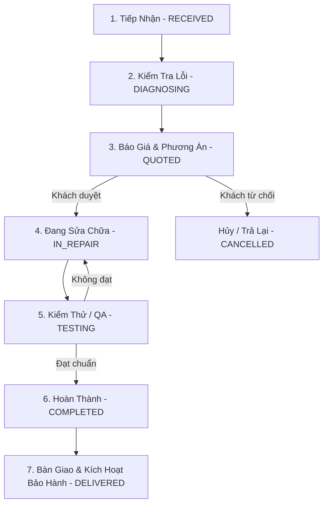

# Repair & Warranty Workflow Rules (Quy Trình Sửa Chữa & Bảo Hành)

Tài liệu này chuẩn hóa quy trình xử lý phiếu bảo hành, sửa chữa phần cứng và dịch vụ kỹ thuật trong CyberRig.

---

## 1. Trạng Thái Vòng Đời Phiếu Sửa Chữa (Ticket Lifecycle)

---~~~

## 2. Quy Định Chi Tiết Từng Bước

### Bước 1: Tiếp Nhận Thiết Bị (RECEIVED)
- Ghi nhận thông tin khách hàng, số điện thoại, số Serial Number (SN / IMEI).
- Biên bản bàn giao tình trạng ngoại quan (trầy xước, móp méo, nứt vỡ) kèm ảnh chụp hiện trạng.
- Ghi nhận mô tả lỗi sơ bộ từ khách hàng.
- Sinh mã phiếu duy nhất định dạng: `TK-YYYYMMDD-XXXX`.
~~~~
### Bước 2: Chẩn Đoán Kỹ Thuật (DIAGNOSING)
- Kỹ thuật viên (KTV) tiếp nhận kiểm tra phần cứng, đo đạc thông mạch, kiểm tra nhiệt độ, stress test.
- Ghi chú nguyên nhân gây lỗi (lỗi linh kiện, chập cháy do nguồn, vào nước, BIOS lỗi, v.v.).
- Thời gian chẩn đoán tiêu chuẩn: Tối đa 24h kể từ khi nhận máy.

### Bước 3: Đề Xuất Giải Pháp & Báo Giá (QUOTED)
- Liệt kê linh kiện cần thay thế hoặc chi phí công sửa chữa/phục hồi.
- Cập nhật chi phí dự kiến và thời gian bảo hành cho hạng mục sửa chữa.
- Gửi thông báo tự động (SMS / Zalo / Portal) cho khách hàng để chờ phê duyệt.

### Bước 4: Thực Hiện Sửa Chữa (IN_REPAIR)
- Chỉ bắt đầu khi khách hàng đã xác nhận đồng ý (Approved).
- Trường hợp phát sinh thêm lỗi trong quá trình sửa, phải quay lại trạng thái `QUOTED` để khách duyệt bổ sung trước khi làm tiếp.

### Bước 5: Kiểm Thử QA / Stress Test (TESTING)
- Chạy phần mềm stress test tối thiểu: FurMark (GPU), Cinebench/Prime95 (CPU), MemTest86 (RAM).
- Nhiệt độ và điện áp phải ổn định trong ngưỡng an toàn của nhà sản xuất.
- KTV ký nghiệm thu checklist trước khi chuyển trạng thái.

### Bước 6 & 7: Hoàn Thành & Bàn Giao (COMPLETED & DELIVERED)
- Đóng gói sạch sẽ, vệ sinh thiết bị, dán tem niêm phong / tem bảo hành mới.
- Khách hàng nhận máy, kiểm tra chữ ký biên bản bàn giao.
- Tự động kích hoạt thời hạn bảo hành dịch vụ (thường từ 1 đến 6 tháng tùy linh kiện/dịch vụ).
