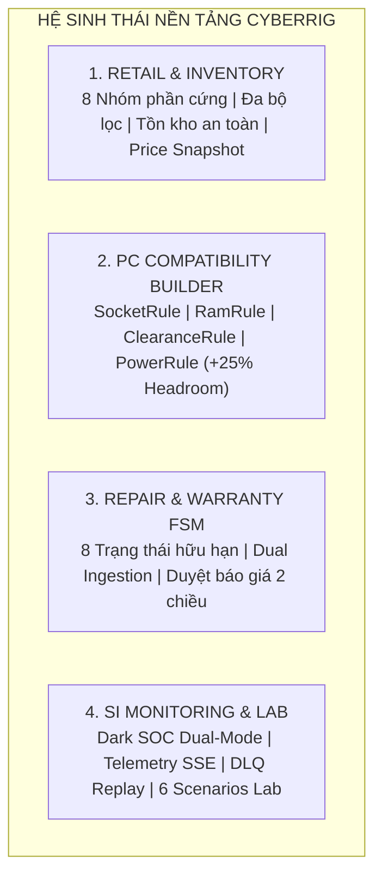
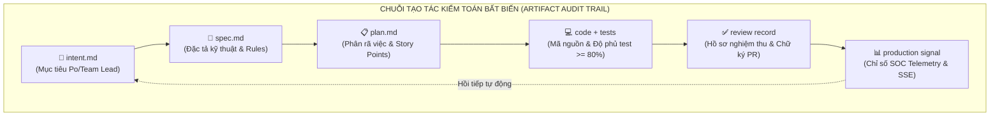
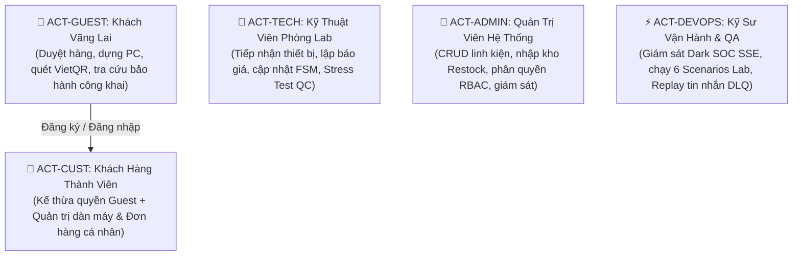
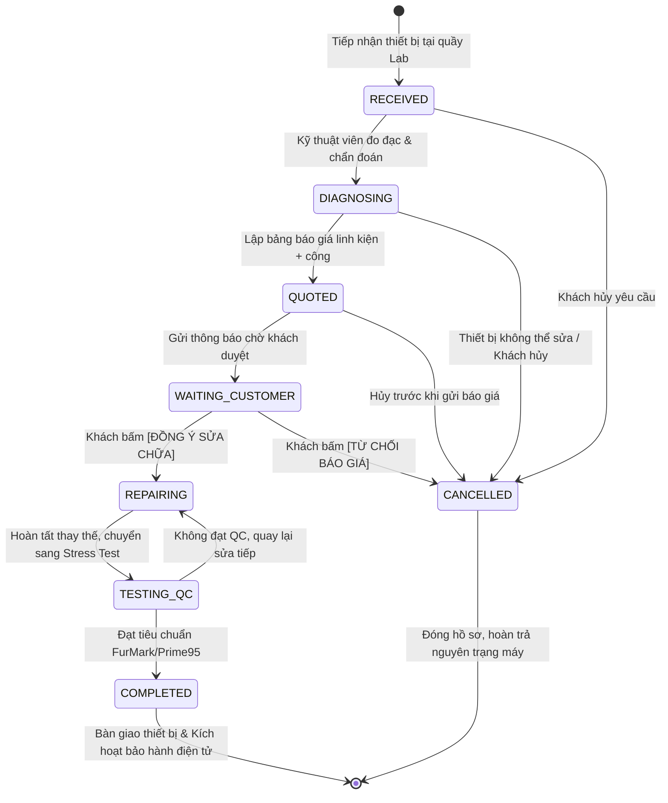
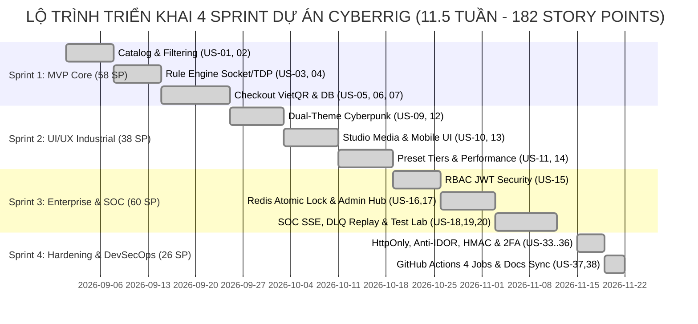
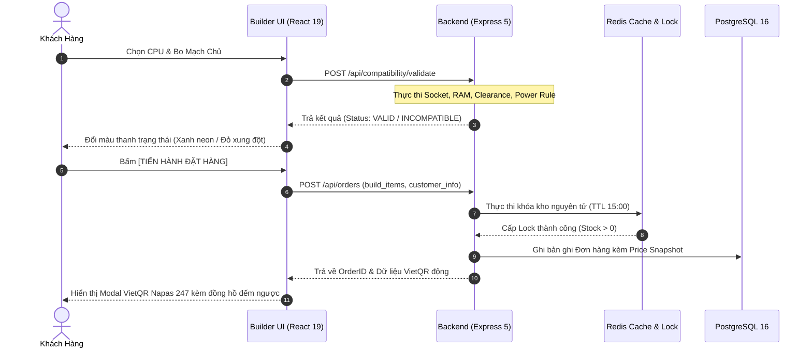
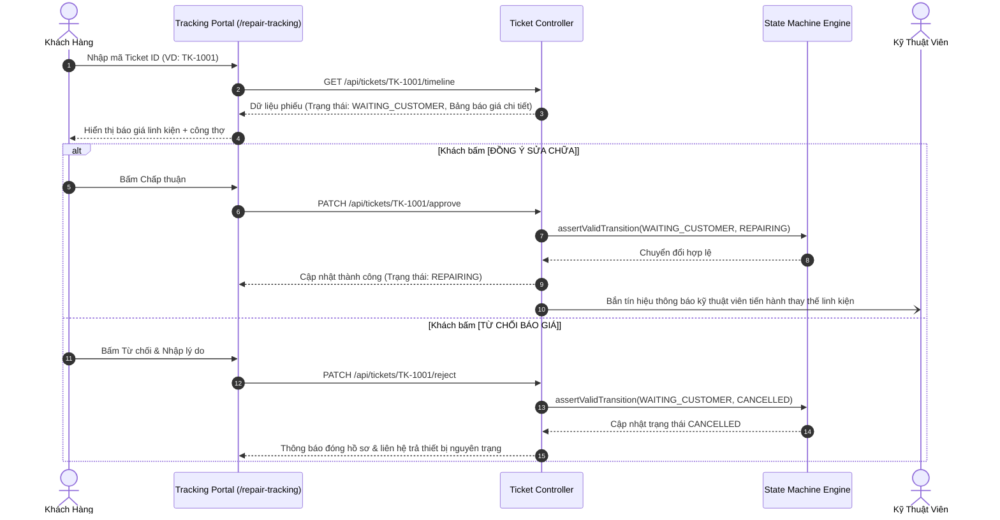

# TÀI LIỆU YÊU CẦU PHẦN MỀM & THIẾT KẾ HỆ THỐNG (SRS & SDD)
## DỰ ÁN: CYBERRIG - HỆ SINH THÁI BÁN LẺ LINH KIỆN PC, THẨM ĐỊNH TƯƠNG THÍCH CẤU HÌNH & QUẢN LÝ VÒNG ĐỜI BẢO HÀNH - SỬA CHỮA

> **Mã Dự Án**: `CR-2026-ENT`  
> **Phiên Bản Tài Liệu**: `v2.4.1-STABLE` (Đã đối chiếu và đồng bộ 100% với Codebase thực tế)  
> **Mô Hình Vận Hành**: Agile / Scrum kết hợp Vòng đời Tác tử **ADLC (Agentic Development Life Cycle)**  
> **Quy Mô Dự Án**: 4 Sprint liên tục (11.5 tuần / 182 Story Points — 10 Epics / 37 User Stories / 44 Sub-tasks trên Jira `SCRUM`)  
> **Kiến Trúc Triển Khai**: Clean Monorepo, Single Responsibility Principle (SRP), Single-Origin Gateway  
> **Chủ Sở Hữu**: Nhóm Kỹ Sư Phát Triển CyberRig & Ban Giám Sát Kỹ Thuật

---

## MỤC LỤC TỔNG QUAN
- [PHẦN 1: TỔNG QUAN HỆ SINH THÁI CYBERRIG & TECH STACK THỰC TẾ](#phần-1-tổng-quan-hệ-sinh-thái-cyberrig--tech-stack-thực-tế)
- [PHẦN 2: MÔ HÌNH VÒNG ĐỜI ADLC & CHUỖI TẠO TÁC KIỂM TOÁN](#phần-2-mô-hình-vòng-đời-adlc--chuỗi-tạo-tác-kiểm-toán)
- [PHẦN 3: KIẾN TRÚC PHÂN MIỀN MONOREPO & BẢO MẬT](#phần-3-kiến-trúc-phân-miền-monorepo--bảo-mật)
- [PHẦN 4: HỆ THỐNG TÁC NHÂN & MA TRẬN 20 USE CASES](#phần-4-hệ-thống-tác-nhân--ma-trận-20-use-cases)
- [PHẦN 5: ĐẶC TẢ CHI TIẾT CÁC QUY TẮC NGHIỆP VỤ & STATE MACHINE](#phần-5-đặc-tả-chi-tiết-các-quy-tắc-nghiệp-vụ--state-machine)
- [PHẦN 6: KẾ HOẠCH TRIỂN KHAI 4 SPRINT & SEQUENCE FLOWS (182 SP)](#phần-6-kế-hoạch-triển-khai-4-sprint--sequence-flows-182-sp)
- [PHẦN 7: MA TRẬN PHÂN CÔNG RACI, TIÊU CHUẨN DoR & DoD](#phần-7-ma-trận-phân-công-raci-tiêu-chuẩn-dor--dod)

---

# PHẦN 1: TỔNG QUAN HỆ SINH THÁI CYBERRIG & TECH STACK THỰC TẾ

## 1.1. Mục Tiêu Sản Phẩm & Tầm Nhìn Chiến Lược
CyberRig là giải pháp công nghệ toàn diện giải quyết triệt để các rủi ro trong chuỗi cung ứng và mua sắm phần cứng máy tính:
1. **Xung đột phần cứng (Hardware Incompatibility)**: Chặn đứng tình trạng mua sai chân cắm Socket, lệch chuẩn RAM hoặc kích thước linh kiện vượt quá kích thước vỏ máy.
2. **Nguy cơ sập nguồn quá tải (Power Inadequacy)**: Tự động tính toán công suất tiêu thụ đỉnh (TDP) kèm mức đệm an toàn 25% chống quá dòng ngắt mạch.
3. **Thiếu minh bạch trong sửa chữa & bảo hành**: Số hóa vòng đời bảo hành bằng Finite State Machine bất biến và cổng phê duyệt báo giá trực tuyến 2 chiều.
4. **Bán quá số lượng (Overselling Risk)**: Bảo vệ kho hàng tức thời bằng cơ chế khóa nguyên tử Redis Atomic Stock Reservation có thời hạn sống TTL 15 phút.



## 1.2. Bảng Tổng Hợp Tech Stack Chuẩn Xác Theo Codebase
Sau khi đối chiếu trực tiếp với `package.json` và cấu trúc mã nguồn, bảng công nghệ chuẩn xác của hệ thống được xác lập như sau:

| Tầng Hệ Thống | Công Nghệ Lựa Chọn | Phiên Bản | Vai Trò & Lý Do Kỹ Thuật |
| :--- | :--- | :--- | :--- |
| **Frontend Framework** | React Native/DOM | `19.2.x` | Sử dụng React 19 tối ưu hóa triệt để re-render cho Builder UI và Form tương tác |
| **Ngôn Ngữ Lập Trình** | TypeScript | `5.3.x` | Định kiểu tĩnh nghiêm ngặt (Strict Type Safety), loại bỏ lỗi runtime trên toàn bộ dữ liệu linh kiện |
| **Styling & Theme** | Cyberpunk CSS System | Custom Native | Hệ thống CSS Module & Design Tokens công nghiệp Cyberpunk, hỗ trợ Dual-Theme Day/Night mượt mà 60 FPS |
| **Quản Lý Trạng Thái UI** | React Context API | Native | Zero-dependency, quản lý tập trung qua `BuilderContext`, `ThemeContext`, `AuthContext` |
| **Backend Core** | Express.js / Node.js | `5.2.x` / `v20+` | Express 5 native async routing, xử lý non-blocking I/O tốc độ cao và kiến trúc phân miền SRP |
| **Cơ Sở Dữ Liệu Quan Hệ** | PostgreSQL | `16.x` | Đảm bảo tính toàn vẹn dữ liệu chuẩn ACID, hỗ trợ JSONB cho trường thông số kỹ thuật linh kiện |
| **Bộ Nhớ Đệm & Khóa Kho** | Redis / ioredis | `7.x` / `6.0.x` | Caching danh mục, thực thi khóa tồn kho nguyên tử chống bán âm với thời gian giữ 15 phút (TTL) |
| **Cơ Chế Real-Time** | Server-Sent Events | Native SSE | Kênh truyền phát metric máy chủ và nhật ký SOC một chiều với chi phí kết nối cực thấp |
| **Hạ Tầng Đóng Gói** | Docker & Compose | `26.x` / `2.27+` | Đóng gói môi trường gồm 4 container: `cyberrig_backend`, `cyberrig_postgres`, `cyberrig_redis`, `cyberrig_nginx` |
| **Cổng Reverse Proxy** | Nginx Alpine | `1.25+` | Cổng Single-Origin Gateway tại cổng 80/443: Điều phối `/api` về backend, `/admin` về admin, `/` về storefront |
| **Khung Kiểm Thử Tự Động** | Node.js Test Runner | Native (`tsx --test`) | Bộ kiểm thử tự động không phụ thuộc thư viện ngoài, bao phủ 100% các domain service và API rules |

---

# PHẦN 2: MÔ HÌNH VÒNG ĐỜI ADLC & CHUỖI TẠO TÁC KIỂM TOÁN

## 2.1. Sự Chuyển Dịch Từ SDLC Truyền Thống Sang ADLC
Khác biệt cốt lõi giữa SDLC truyền thống và ADLC (Agentic Development Life Cycle) trong CyberRig là sự tích hợp của **Tác tử AI (AI Agents)** làm việc đồng hành cùng kỹ sư, vận hành dựa trên ngữ cảnh được chuẩn hóa trong `.skills/` và `.agentrules`.



## 2.2. Chi Tiết 6 Giai Đoạn Phát Triển Chuẩn Hóa
1. **Lập Kế Hoạch (Planning)**: PO xác lập mục tiêu nghiệp vụ trong `intent.md`. AI Agent rà soát xung đột yêu cầu và đề xuất các ca kiểm thử biên (edge-cases).
2. **Thiết Kế (Design & Spec)**: Chuẩn hóa logic dữ liệu và hợp đồng API trong `spec.md`. Agent hỗ trợ sinh sơ đồ ERD và mã khung OpenAPI.
3. **Phát Triển (Agentic Dev)**: Triển khai mã nguồn tuân thủ Clean Code và nguyên tắc SRP (không có tệp tin nào vượt quá 300 dòng; tách riêng fixtures và rules).
4. **Kiểm Thử (Continuous QA)**: Đánh giá tự động qua bộ test suite (`npm run test:monorepo`). Toàn bộ kiểm thử phải vượt qua 100% trước khi mở Pull Request.
5. **Triển Khai (Deployment)**: Tự động đóng gói qua Docker Compose và Nginx Gateway; kiểm tra lỗ hổng cấu hình cổng mạng.
6. **Vận Hành (Ops & Monitoring)**: Thu nhận chỉ số thời gian thực từ SOC Dashboard qua SSE, cô lập thông điệp hỏng vào Dead Letter Queue và phát lại sau khắc phục.

---

# PHẦN 3: KIẾN TRÚC PHÂN MIỀN MONOREPO & BẢO MẬT

Dự án được cấu trúc theo mô hình phân tầng miền doanh nghiệp, đảm bảo tính đóng gói độc lập và giảm thiểu bề mặt tấn công:

```text
CYBERRIG-ECOSYSTEM/
├── docs/                           # Hồ sơ thiết kế hệ thống & kiểm toán Scrum
├── CyberRig-Backend/               # Tầng xử lý logic nghiệp vụ, Database & APIs
│   ├── src/
│   │   ├── core/                   # DB Pool, Redis Client, Error Handling, Seed Data
│   │   └── modules/                # Các domain độc lập (Clean Architecture)
│   │       ├── auth/               # RBAC JWT, Password Hashing, Route Guards
│   │       ├── hardware/           # Quản lý linh kiện, lọc đa chiều, kho hàng
│   │       ├── compatibility/      # Rule Engine: Socket, RAM, Clearance, Power
│   │       ├── repair-tickets/     # Máy trạng thái 8 bước, chẩn đoán Lab
│   │       ├── orders/             # Đặt hàng, Redis Lock 15 phút, VietQR
│   │       ├── customer/           # Portal cá nhân hóa (đơn hàng, bảo hành)
│   │       ├── admin/              # Inventory Control, Restock, Soft-delete
│   │       └── monitoring/         # SOC Telemetry, 6 Scenarios Lab, DLQ Replay
├── CyberRig-Frontend/              # Storefront dành cho Khách Hàng (Customer Portal)
│   └── src/pages/                  # Home, PC Builder, Catalog, Checkout, Tra cứu bảo hành
├── CyberRig-Admin/                 # Trung tâm Chỉ huy Quản trị & Kỹ thuật viên
│   └── src/
│       ├── business-ops/           # Admin Control Center (Kho hàng, báo giá)
│       └── si-monitoring/          # Dark SOC Dashboard (SSE Stream, DLQ, Test Lab)
└── CyberRig-Infra/                 # Hạ tầng Nginx Gateway & Docker Compose
```

> [!IMPORTANT]
> **Quy Tắc Bất Biến Về Phân Tách Bề Mặt Tấn Công (Zero Admin Code in Storefront)**:  
> Bundle JavaScript của ứng dụng khách hàng (`CyberRig-Frontend`) **tuyệt đối không chứa** bất kỳ mã nguồn, components hay routes nào của trung tâm quản trị và giám sát. Mọi tác vụ quản trị được cô lập riêng biệt tại `CyberRig-Admin` và được Nginx định tuyến kiểm soát nghiêm ngặt.

---

# PHẦN 4: HỆ THỐNG TÁC NHÂN & MA TRẬN 20 USE CASES

## 4.1. Hệ Thống 5 Tác Nhân (Actor Catalog)



## 4.2. Ma Trận 20 Use Cases Chi Tiết Theo 5 Gói Phân Hệ

| Mã UC | Tên Use Case | Phân Hệ | Tác Nhân Chính | Mức Độ | Trạng Thái Codebase |
| :---: | :--- | :--- | :--- | :---: | :---: |
| **UC-01** | Tra cứu danh mục & bộ lọc linh kiện đa tiêu chí | Hardware Catalog | ACT-GUEST, ACT-CUST | High | Đã hoàn thành (100%) |
| **UC-02** | Xem chi tiết thông số kỹ thuật phần cứng | Hardware Catalog | ACT-GUEST, ACT-CUST | Medium | Đã hoàn thành (100%) |
| **UC-03** | Chọn linh kiện vào 8 khoang của PC Builder | PC Builder | ACT-GUEST, ACT-CUST | High | Đã hoàn thành (100%) |
| **UC-04** | Thẩm định tương thích Socket, RAM, Kích thước, TDP | PC Builder | ACT-GUEST, ACT-CUST | Critical | Đã hoàn thành (100%) |
| **UC-05** | Tra cứu danh mục PC Setup & Thiết bị không gian làm việc | Equipments | ACT-GUEST, ACT-CUST | Should | Đã tích hợp catalog |
| **UC-06** | Chuyển giỏ hàng cấu hình sang giao diện Checkout | Checkout | ACT-GUEST, ACT-CUST | High | Đã hoàn thành (100%) |
| **UC-07** | Đặt hàng, khóa kho Redis & Thanh toán VietQR Napas | Checkout | ACT-CUST | Critical | Đã hoàn thành (100%) |
| **UC-08** | Tra cứu tiến độ đơn hàng công khai theo mã | Orders | ACT-GUEST, ACT-CUST | Low | Đã hoàn thành (100%) |
| **UC-09** | Tiếp nhận & Lập hồ sơ thiết bị (Dual Ingestion) | Repair Tickets | ACT-TECH | High | Đã hoàn thành (100%) |
| **UC-10** | Khách hàng phê duyệt hoặc từ chối báo giá 2 chiều | Repair Tickets | ACT-CUST, ACT-GUEST | Critical | Đã hoàn thành (100%) |
| **UC-11** | Kiểm soát chuyển trạng thái phiếu qua FSM 8 bước | Repair Tickets | ACT-TECH | High | Đã hoàn thành (100%) |
| **UC-12** | Ghi nhận kết quả chẩn đoán & Stress Test QC | Repair Tickets | ACT-TECH | Medium | Đã hoàn thành (100%) |
| **UC-13** | Tra cứu tiến độ sửa chữa công khai bằng Ticket ID | Repair Tickets | ACT-GUEST, ACT-CUST | High | Đã hoàn thành (100%) |
| **UC-14** | Quản lý dàn máy cá nhân & Lịch sử dịch vụ (Dashboard) | Customer Hub | ACT-CUST | Should | Đã hoàn thành (100%) |
| **UC-15** | Bàn làm việc Kỹ thuật viên phân luồng trạng thái | Technician Hub | ACT-TECH | High | Đã hoàn thành (100%) |
| **UC-16** | Quản trị kho, nhập thêm hàng & Cảnh báo tồn an toàn | Admin Hub | ACT-ADMIN | High | Đã hoàn thành (100%) |
| **UC-17** | Xác thực và phân quyền RBAC JWT 3 vai trò | Security | Toàn bộ Tác nhân | High | Đã hoàn thành (100%) |
| **UC-18** | Giám sát Dark SOC thời gian thực qua Server-Sent Events | SI Monitoring | ACT-DEVOPS, ACT-ADMIN | High | Đã hoàn thành (100%) |
| **UC-19** | Kích hoạt 6 kịch bản kiểm thử tích hợp trong Test Lab | Testing Lab | ACT-DEVOPS, ACT-ADMIN | Medium | Đã hoàn thành (100%) |
| **UC-20** | Thu giữ Poison Message vào DLQ & Phát lại (Replay) | SI Monitoring | ACT-DEVOPS | High | Đã hoàn thành (100%) |

---

# PHẦN 5: ĐẶC TẢ CHI TIẾT CÁC QUY TẮC NGHIỆP VỤ & STATE MACHINE

## 5.1. Bộ Quy Tắc Thẩm Định Tương Thích (4 Rule Engine Engines)
Mã nguồn thực tế tại `CyberRig-Backend/src/modules/compatibility/rules/` triển khai 4 bộ quy tắc độc lập:

### 1. Socket Rule (`SocketRule`)
- Kiểm tra tính tương thích chân cắm vật lý giữa CPU và Bo Mạch Chủ (Motherboard).
- **Ràng buộc**: `normalizedCpuSocket === normalizedMbSocket`.
- **Hành vi**: Nếu khác nhau (ví dụ: CPU AMD Socket AM5 lắp vào Mainboard Intel LGA1700), trả về LỖI (ERROR), thanh trạng thái chuyển đỏ và chặn hành động tạo đơn hàng.

### 2. RAM Rule (`RamRule`)
- **Kiểm tra thế hệ RAM**: Khớp chuẩn thế hệ giữa RAM và Mainboard (DDR4 vs DDR5).
- **Kiểm tra số khe cắm vật lý**: Tính tổng số thanh RAM được chọn (`totalRamModules = sum(modulesCount)`). Nếu vượt quá số khe cắm trên Mainboard (`totalRamModules > mbSpecs.ramSlots`), kích hoạt cảnh báo lỗi chặn lắp ráp.

### 3. Kích Thước Vật Lý & Khoảng Trống (`ClearanceRule`)
- **Chiều dài GPU vs Khoang Case**: Chiều dài GPU cộng thêm khoảng đệm an toàn 10mm phải nhỏ hơn hoặc bằng chiều dài tối đa Case hỗ trợ:
  $$\text{Clearance}_{\text{Safe}} = \text{CaseMaxGpuLengthMm} - 10\text{mm}$$
  Nếu $\text{GpuLengthMm} > \text{Clearance}_{\text{Safe}}$, phát sinh lỗi cấn linh kiện vào quạt trước của Case.
- **Chiều cao Tản nhiệt Khí vs Bề ngang Case**:
  $$\text{CoolerHeightMm} \le \text{CaseMaxCpuCoolerHeightMm}$$

### 4. Công Suất Nguồn Điện Khuyến Nghị (`PowerRule`)
- **Công thức tính tổng điện năng tiêu thụ ước tính (Estimated Wattage)**:
  $$\text{Wattage}_{\text{Estimated}} = \text{TDP}_{\text{CPU}} + \text{TDP}_{\text{GPU}} + 50\text{W (Bo mạch chủ)} + 50\text{W (Quạt LED, Ổ đĩa, Chipset)}$$
- **Biên an toàn bắt buộc (25% Headroom)**:
  $$\text{Wattage}_{\text{Safe}} = \lceil \text{Wattage}_{\text{Estimated}} \times 1.25 \rceil$$
- **Xử lý cảnh báo**:
  - Nếu $P_{\text{PSU}} < \text{Wattage}_{\text{Estimated}}$: Báo LỖI (ERROR) nghiêm trọng - Nguy cơ sập nguồn quá tải OCP.
  - Nếu $\text{Wattage}_{\text{Estimated}} \le P_{\text{PSU}} < \text{Wattage}_{\text{Safe}}$: Báo CẢNH BÁO VÀNG (WARNING) - Thiếu biên an toàn 25% chống sốc điện khi chạy tải nặng.
  - Nếu $P_{\text{PSU}} \ge \text{Wattage}_{\text{Safe}}$: Báo XANH (VALID) - Hệ thống an toàn tuyệt đối.

---

## 5.2. Máy Trạng Thái Hữu Hạn Vòng Đời Bảo Hành (8-State FSM)
Theo `ticket.state.ts`, quy trình sửa chữa được kiểm soát bằng máy trạng thái 8 bước nghiêm ngặt:



> [!NOTE]
> Khi phiếu đã chuyển sang trạng thái `REPAIRING`, hệ thống **khóa hoàn toàn quyền hủy phiếu** nhằm bảo vệ chi phí vật tư đã xuất kho của phòng Lab.

---

## 5.3. Danh Mục 6 Kịch Bản Tự Động Trong Scenario Testing Lab
Theo `CyberRig-Backend/src/modules/monitoring/scenario-runner.service.ts`, 6 kịch bản kiểm thử tích hợp chuẩn hóa gồm:

1. **`scenario-1-order-placement` (Pipeline)**: Kiểm thử chuỗi đặt hàng từ tiếp nhận thông tin, thực thi khóa kho Redis, sinh mã VietQR và gửi thông điệp vào broker.
2. **`scenario-2-stock-check` (Concurrency Lock)**: Giả lập đồng thời 5 luồng tranh mua linh kiện HOT (như NVIDIA RTX 4090) để xác nhận cơ chế Zero Oversell hoạt động hoàn hảo.
3. **`scenario-3-trigger-dlq` (Resilience & DLQ)**: Bơm payload lỗi cấu trúc (Poison Message) vào queue; consumer thử lại 3 lần thất bại sẽ tự động chuyển vào Dead Letter Queue mà không làm sập pipeline.
4. **`scenario-4-ai-mapping` (AI Data Normalization)**: Pipeline chuẩn hóa dữ liệu linh kiện dị thể từ nhà cung cấp về định dạng schema chuẩn của CyberRig với độ chính xác $>98\%$.
5. **`scenario-5-rate-limiting` (Security 429)**: Bắn loạt 25 request dồn dập trong 150ms để kích hoạt cơ chế phòng thủ Rate Limiting, xác nhận mã phản hồi HTTP 429 kèm header `Retry-After`.
6. **`scenario-6-system-health` (Diagnostic Probe)**: Quét kết nối và đo độ trễ toàn diện của 4 dịch vụ: Node.js V8 Heap, PostgreSQL Pool, Redis Connection và Nginx Gateway.

---

# PHẦN 6: KẾ HOẠCH TRIỂN KHAI 4 SPRINT & SEQUENCE FLOWS (182 SP)



## 6.1. Sequence Flow 1: Kiểm Tra Tương Thích & Đặt Mua Dàn Máy


## 6.2. Sequence Flow 2: Phê Duyệt Báo Giá Sửa Chữa Trực Tuyến 2 Chiều


---

# PHẦN 7: MA TRẬN PHÂN CÔNG RACI, TIÊU CHUẨN DoR & DoD

## 7.1. Bảng Ma Trận Phân Công Trách Nhiệm RACI (5 Vị Trí Kỹ Thuật)

| Hạng Mục Trách Nhiệm Kỹ Thuật | TV 1 (PO/FE) | TV 2 (FE/UI) | TV 3 (BE Core) | TV 4 (BE/Sec) | TV 5 (Ops/QA) |
| :--- | :---: | :---: | :---: | :---: | :---: |
| Quản trị Backlog, Jira `SCRUM` & Tạo tác ADLC (`intent`, `spec`, `plan`) | **A / R** | C | C | C | I |
| Thiết kế Kiến trúc Monorepo & Quy chuẩn Clean Code | **A / R** | C | C | C | C |
| Lập trình Giao diện Giỏ Hàng, Checkout VietQR & Customer Hub | **A / R** | C | I | C | I |
| Lập trình Giao diện Catalog, PC Builder, Dual-Theme & Tech UI | C | **A / R** | C | I | I |
| Lập trình Rule Engine Thẩm Định Tương Thích (4 Rules) | C | C | **A / R** | C | I |
| Xây dựng Finite State Machine Bảo Hành, Báo Giá & Redis Atomic Lock | C | I | **A / R** | C | I |
| Thiết kế PostgreSQL Schema, Admin Control Center (`#admin`) | C | I | C | **A / R** | C |
| Gia cố Bảo Mật OWASP (RBAC JWT `HttpOnly`, 2FA TOTP, HMAC Webhook, Anti-IDOR) | C | I | C | **A / R** | C |
| Xây dựng Bảng Điều Khiển Dark SOC, Telemetry SSE & Audit Logs Viewer | I | I | I | C | **A / R** |
| Xây dựng Dead Letter Queue (DLQ) & 6 Kịch Bản Testing Lab | I | I | I | C | **A / R** |
| Đóng gói Docker Compose, Nginx Hardening, 24 Spec Tests & GitHub Actions CI/CD | C | I | I | C | **A / R** |

*(Quy ước: **R** = Responsible; **A** = Accountable; **C** = Consulted; **I** = Informed)*

## 7.2. Tiêu Chuẩn Sẵn Sàng Tiếp Nhận (Definition of Ready - DoR)
1. **Tạo tác hoàn tất**: Tệp `intent.md` và `spec.md` đã được biên soạn và duyệt bởi Product Owner.
2. **Kịch bản kiểm thử biên**: Có tối thiểu 3 ca kiểm thử biên giới (Given - When - Then).
3. **Kích thước chuẩn hóa**: Khối lượng công việc của một User Story không vượt quá 13 Story Points.
4. **Hợp đồng API đã chốt**: Định dạng Request/Response JSON giữa Frontend và Backend đã thống nhất.

## 7.3. Tiêu Chuẩn Nghiệm Thu Hoàn Thành (Definition of Done - DoD)
1. **Quy chuẩn mã nguồn**: Tuân thủ Clean Code & SRP; không có tệp tin nào vượt quá 300 dòng; tách riêng fixtures và rules.
2. **Độ bao phủ kiểm thử**: Đạt độ bao phủ kiểm thử $\ge 80\%$; toàn bộ bài kiểm thử tự động `npm run test:monorepo` vượt qua 100%.
3. **An toàn đồng thời**: Không phát sinh lỗi Race Condition hoặc bán âm khi kiểm thử đồng thời (Concurrency Test).
4. **Cô lập kiến trúc**: Chạy ổn định trong môi trường Docker Container và tuân thủ nguyên tắc **Zero Admin Code in Storefront**.
5. **Giám sát & Tạo tác**: Sinh log có gắn `correlationId` truyền phát tới SSE của SOC Dashboard; cập nhật đầy đủ tệp `review record`.
