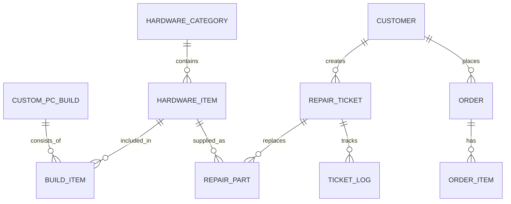

# CyberRig - Database Schema Specification

Tài liệu thiết kế cơ sở dữ liệu quan hệ (Entity-Relationship) cho hệ thống CyberRig.

---

## 1. Mô Hình Thực Thể Tổng Quan (ER Diagram)

~
---

## 2. Chi Tiết Các Bảng Chính (Tables & Fields)

### 2.1. Bảng Linh Kiện Phần Cứng (`hardware_items`)
- `id` (UUID, Primary Key)
- `category_id` (VARCHAR): Enum (`CPU`, `MOTHERBOARD`, `RAM`, `GPU`, `STORAGE`, `PSU`, `CASE`, `COOLER`)
- `name` (VARCHAR): Tên thương mại linh kiện
- `brand` (VARCHAR): Hãng sản xuất (Intel, AMD, ASUS, Corsair, v.v.)
- `model` (VARCHAR): Mã model
- `price` (DECIMAL): Đơn giá bán lẻ
- `stock_quantity` (INT): Số lượng tồn kho
- `specs` (JSONB): Thông số kỹ thuật chi tiết phục vụ kiểm tra tương thích:
  - *CPU*: `{ socket: "LGA1700", tdp: 125, pcie_gen: 5, integrated_gpu: true }`
  - *Motherboard*: `{ socket: "LGA1700", chipset: "Z790", form_factor: "ATX", ram_type: "DDR5", ram_slots: 4, m2_slots: 4 }`
  - *GPU*: `{ length_mm: 336, tdp: 450, recommended_psu: 850, power_connectors: ["16-pin"] }`
  - *Case*: `{ max_gpu_length_mm: 400, max_cpu_cooler_height_mm: 170, supported_radiators: ["360mm", "240mm"] }`
- `created_at`, `updated_at` (TIMESTAMP)

### 2.2. Bảng Cấu Hình Tùy Chỉnh (`custom_pc_builds`)
- `id` (UUID, PK)
- `user_id` (UUID, FK, Nullable nếu khách vãng lai)
- `build_name` (VARCHAR)
- `total_price` (DECIMAL)
- `total_estimated_wattage` (INT)
- `compatibility_status` (VARCHAR): `COMPATIBLE`, `WARNING`, `INCOMPATIBLE`
- `notes` (TEXT)

### 2.3. Bảng Phiếu Sửa Chữa & Bảo Hành (`repair_tickets`)
- `id` (UUID, PK)
- `ticket_code` (VARCHAR, Unique): Mã phiếu hiển thị khách hàng (VD: `TK-20260905-001`)
- `customer_name` (VARCHAR)
- `customer_phone` (VARCHAR)
- `device_type` (VARCHAR): Laptop, PC Gaming, VGA, Mainboard, v.v.
- `serial_number` (VARCHAR)
- `initial_condition` (TEXT): Tình trạng ngoại quan khi tiếp nhận
- `fault_description` (TEXT): Mô tả lỗi từ khách hàng
- `technician_id` (UUID, FK): Kỹ thuật viên phụ trách
- `status` (VARCHAR): `RECEIVED`, `DIAGNOSING`, `QUOTED`, `IN_REPAIR`, `TESTING`, `COMPLETED`, `DELIVERED`, `CANCELLED`
- `quote_amount` (DECIMAL): Số tiền báo giá
- `warranty_months` (INT): Số tháng bảo hành sau sửa chữa
- `created_at`, `updated_at` (TIMESTAMP)

### 2.4. Bảng Nhật Ký Trạng Thái Phiếu (`ticket_logs`)
- `id` (UUID, PK)
- `ticket_id` (UUID, FK)
- `from_status` (VARCHAR)
- `to_status` (VARCHAR)
- `note` (TEXT): Ghi chú chẩn đoán hoặc tiến độ
- `technician_id` (UUID, FK)
- `created_at` (TIMESTAMP)
