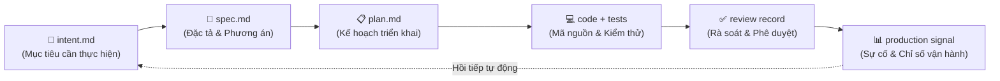

# CyberRig - System Requirements Specification (SRS)
## Đặc Tả Yêu Cầu Hệ Thống & Khung Phát Triển ADLC

> **Dự án**: CyberRig - Hệ sinh thái Bán lẻ Phần cứng PC, Bộ Lắp ráp Cấu hình Tương thích Thông minh, Quản lý Bảo hành/Sửa chữa & Bảng Giám sát Tích hợp SI Monitoring.  
> **Thời gian phát triển**: 2.5 tháng (Gồm 3 Sprint liên tục).  
> **Phương pháp luận**: Chuyển đổi từ SDLC truyền thống sang **ADLC (Agentic Development Life Cycle)** với chuỗi tạo tác kiểm toán xuyên suốt.

---

## 1. Bối Cảnh & Mô Hình Phát Triển (SDLC sang ADLC)

### 1.1. So sánh Vòng đời Phát triển

```mermaid
flowchart TD
    subgraph SDLC["SDLC Truyền Thống (Tuần tự - Phụ thuộc bàn giao thủ công)"]
        A1[Phân tích yêu cầu & Lập kế hoạch] --> A2[Thiết kế kiến trúc]
        A2 --> A3[Phát triển phần mềm]
        A3 --> A4[Kiểm thử & Bảo đảm chất lượng]
        A4 --> A5[Phát hành & Triển khai]
        A5 --> A6[Giám sát & Xử lý sự cố]
        A6 -.-> A1
    end

    subgraph ADLC["ADLC Hiện Đại (Vòng đời với Tác tử AI - Vận hành qua Tạo tác)"]
        B1["Xác lập mục tiêu (Goal Definition)"] --> B2["Agent hỗ trợ Phân tích & Thiết kế"]
        B2 --> B3["Agent phát triển dựa trên Ngữ cảnh & Kỹ năng"]
        B3 --> B4["Đánh giá liên tục (Continuous Evaluation)"]
        B4 --> B5["Agent rà soát tại các điểm kiểm soát tự động"]
        B5 --> B6["Tín hiệu vận hành hình thành yêu cầu mới"]
        B6 -.-> B1
    end
```

### 1.2. Chuỗi Tạo Tác & Dấu Vết Kiểm Toán (Artifact Traceability Chain)

Dự án CyberRig áp dụng chuẩn chuỗi tạo tác liên tục đảm bảo mọi thay đổi mã nguồn đều có dấu vết kiểm toán:

| Giai đoạn | Cơ chế vận hành ADLC trong CyberRig |
| :--- | :--- |
| **1. Lập kế hoạch** | Không qua nhiều vòng họp kéo dài; mô tả mục tiêu trong `intent.md` đủ rõ ràng để con người hiểu và AI Agent có thể thực thi ngay từ commit đầu tiên. |
| **2. Thiết kế** | Yêu cầu nghiệp vụ và thiết kế kiến trúc được xử lý trong cùng một phiên; chính sách nghiệp vụ đóng gói thành các Kỹ năng (`.skills/`) định hướng Agent. |
| **3. Phát triển** | Tri thức tổ chức được chuẩn hóa trong `.agentrules` và `.skills/`; các nguyên tắc Clean Code và SRP được kiểm soát tự động bằng hook và linter. |
| **4. Kiểm thử** | Đánh giá liên tục qua test suites (`npm test`, `monitoring.spec.ts`) tại mỗi phiên làm việc thay vì kiểm thử dồn ở cuối giai đoạn. |
| **5. Triển khai** | Agent rà soát theo quy tắc quản trị đóng gói trong Docker Compose và Nginx; con người phê duyệt các thay đổi có mức độ rủi ro cao. |
| **6. Vận hành & Bảo trì** | Cảnh báo vận hành từ SI Monitoring Telemetry tự động sinh yêu cầu mới đưa vào backlog mà không cần chờ khởi tạo thủ công. |

---

## 2. Yêu Cầu Chức Năng (Functional Requirements - FR)

### Phân Hệ 1: Danh Mục Linh Kiện & Tra Cứu Phần Cứng (Hardware Catalog)
- **FR-01.1**: Hệ thống cung cấp danh mục 8 loại linh kiện phần cứng chính (CPU, Bo Mạch Chủ, RAM, Card Đồ Họa, Nguồn PSU, Vỏ Case, Ổ Cứng, Tản Nhiệt) kèm hình ảnh thực tế chất lượng cao.
- **FR-01.2**: Tìm kiếm theo từ khóa tức thì (Full-text search), hỗ trợ đa bộ lọc theo Category, Brand (Intel, AMD, ASUS, MSI, Corsair...), khoảng giá (Price range), và tình trạng còn hàng (Stock status).
- **FR-01.3**: Tích hợp nút "+ Chọn" nhanh tại từng thẻ linh kiện để tự động nạp linh kiện vào khoang tương ứng của bộ PC Builder.

### Phân Hệ 2: Bộ Cấu Hình PC Tương Thích Thông Minh (PC Compatibility Builder)
- **FR-02.1 (Socket Rule)**: Tự động kiểm tra khớp chuẩn Socket giữa CPU và Mainboard (VD: Socket AM5 cho AMD Ryzen 7000/9000; LGA1700 cho Intel Core Gen 12-14th). Bắn cảnh báo xung đột ngay khi chọn sai.
- **FR-02.2 (Power & TDP Rule)**: Tính toán tổng công suất tiêu thụ điện (TDP) của hệ thống theo thời gian thực và tự động khuyến nghị công suất danh định tối thiểu cho PSU kèm biên an toàn $\ge 20\%$.
- **FR-02.3 (Compatibility Progress Bar)**: Hiển thị thanh tiến trình tương thích phần cứng trực quan (0% - 100%), phản ánh số linh kiện đã chọn và trạng thái an toàn/xung đột của cấu hình.
- **FR-02.4 (Preset Tiers)**: Cung cấp các gói cấu hình định sẵn theo ngân sách (Gaming Ultra, Designer Workstation, Office Budget) cho phép người dùng nạp cấu hình hoàn chỉnh chỉ với 1 click.

### Phân Hệ 3: Giỏ Hàng, Đặt Hàng & Thanh Toán VietQR (Order & Checkout)
- **FR-03.1 (One-click Checkout Transfer)**: Chuyển toàn bộ danh sách 8 linh kiện từ PC Builder sang giao diện Checkout Split-View với đầy đủ thông số kỹ thuật và đơn giá.
- **FR-03.2 (Price Snapshot)**: Lưu lại ảnh chụp giá (Price Snapshot) tại thời điểm khách hàng bấm đặt mua, đảm bảo đơn hàng không bị thay đổi khi giá niêm yết biến động.
- **FR-03.3 (Dynamic VietQR Napas 247)**: Tự động sinh mã VietQR theo chuẩn Napas 247 chứa mã đơn hàng định danh duy nhất (`ORD-XXXXXX`) và số tiền chính xác; có đồng hồ đếm ngược giữ hàng (15 phút).
- **FR-03.4 (Public Order Tracking)**: Khách hàng vãng lai có thể tra cứu tình trạng đơn hàng (PENDING, PAID, SHIPPING, DELIVERED) qua đường dẫn công khai `/orders/:code`.

### Phân Hệ 4: Quản Lý Vòng Đời Bảo Hành & Sửa Chữa (Repair & Warranty Lifecycle)
- **FR-04.1 (6-Stage Finite State Machine)**: Kiểm soát chặt chẽ quy trình sửa chữa qua 6 trạng thái bất biến:  
  `RECEIVED` $\rightarrow$ `DIAGNOSING` $\rightarrow$ `QUOTED` $\rightarrow$ `REPAIRING` $\rightarrow$ `QC` $\rightarrow$ `COMPLETED`. Ngăn chặn mọi hành vi nhảy cóc trạng thái sai quy trình.
- **FR-04.2 (Two-Way Quote Approval)**: Sau khi Kỹ thuật viên lập báo giá (tiền công + linh kiện thay thế), khách hàng có thể truy cập `/repair-tracking` để bấm `[ ĐỒNG Ý SỬA CHỮA ]` (chuyển sang `REPAIRING`) hoặc `[ TỪ CHỐI ]`.
- **FR-04.3 (Public Timeline Tracking)**: Cung cấp giao diện tra cứu tiến độ công khai với Stepper trực quan, hiển thị lịch sử thời gian và nhân viên phụ trách từng chặng mà không bắt buộc đăng nhập.
- **FR-04.4 (Dual Device Ingestion)**: Hỗ trợ tiếp nhận cả thiết bị mua tại CyberRig (`CYBERRIG` - tra cứu tự động qua Serial Number) và thiết bị mua từ bên ngoài mang đến sửa chữa (`EXTERNAL`).

### Phân Hệ 5: Không Gian Làm Việc & Thiết Bị Ngoại Vi (PC Setup & Equipments)
- **FR-05.1**: Cung cấp danh mục 20 thiết bị không gian làm việc chuyên nghiệp (Màn hình OLED 240Hz, Ghế công thái học, Bàn nâng hạ Smart Desk, Bàn phím cơ Custom, Audio Studio).
- **FR-05.2**: Hỗ trợ xem thông số công thái học, thêm trực tiếp vào giỏ hàng mua kèm cùng dàn máy PC.

### Phân Hệ 6: Cổng Kỹ Thuật Viên & Khách Hàng (Unified Workbenches)
- **FR-06.1 (Customer Dashboard)**: Cổng thông tin khách hàng tập trung quản lý lịch sử đơn hàng đã mua, dàn máy cá nhân và các phiếu sửa chữa đang thực hiện.
- **FR-06.2 (Technician Workbench)**: Bàn làm việc Kỹ thuật viên với giao diện Split-View chia hàng đợi theo trạng thái, soạn biên bản kiểm định lỗi phần cứng, bóc tách báo giá linh kiện từ kho và tiếp nhận máy tại quầy Lab.

### Phân Hệ 7: Quản Trị Kho Hàng & Bảo Mật Hệ Thống (Admin & Security)
- **FR-07.1 (Admin Inventory Hub)**: Quản trị viên có toàn quyền CRUD linh kiện, nhập kho bổ sung (Restock), ngừng kinh doanh (Soft Delete), và theo dõi KPI cảnh báo linh kiện sắp hết hàng (Low Stock Alert).
- **FR-07.2 (RBAC Security)**: Phân quyền truy cập 3 cấp độ: `CUSTOMER` (Khách hàng), `TECHNICIAN` (Kỹ thuật viên), `ADMIN` (Quản trị viên) với JWT Token Rotation và Route Guards bảo vệ API.
- **FR-07.3 (Redis Atomic Stock Reservation)**: Khóa giữ kho nguyên tử bằng Redis Lua Script tại thời điểm thanh toán, đảm bảo Zero Oversell khi có hàng trăm lượt mua đồng thời.

### Phân Hệ 8: Hệ Thống Giám Sát SI Monitoring & Scenario Testing Lab
- **FR-08.1 (Dual-Mode SOC Dashboard)**: Giao diện điều khiển Dark SOC Mission Control hỗ trợ chuyển đổi linh hoạt 2 chế độ: Real-Time Monitoring và Scenario Testing Lab.
- **FR-08.2 (In-Memory Telemetry & SSE)**: Thu thập chỉ số tài nguyên, sức khỏe container Docker và thông lượng Message Broker qua Ring Buffer trên RAM (Zero-DB Overhead), phát trực tiếp qua Server-Sent Events (SSE).
- **FR-08.3 (Dead Letter Queue & Replay)**: Bắt giữ thông điệp lỗi (Poison Message), cách ly vào bảng DLQ và cung cấp nút phát lại (Replay) thủ công sau khi khắc phục sự cố.
- **FR-08.4 (Scenario Runner)**: Tích hợp phòng Lab thực thi tự động 6 kịch bản tích hợp hệ thống (Order Pipeline, Stock Check, Trigger DLQ, AI Data Mapping, Rate Limiting, Health Diagnostics).

---

## 3. Yêu Cầu Phi Chức Năng (Non-Functional Requirements - NFR)

### 3.1. Hiệu Năng (Performance)
- **NFR-PERF-01**: Tốc độ phản hồi API nghiệp vụ (Catalog, Builder validation, Order creation) đạt $< 100\text{ms}$ tại mức tải thông thường.
- **NFR-PERF-02**: Động cơ Telemetry chạy độc lập trên RAM In-Memory Ring Buffer (tối đa 200 bản ghi), tuyệt đối không sinh thêm câu lệnh `INSERT`/`UPDATE` gây nghẽn PostgreSQL Database.
- **NFR-PERF-03**: Giao diện người dùng duy trì tốc độ khung hình ổn định $60\text{ FPS}$, thời gian tải trang ban đầu (First Contentful Paint) $< 1.2\text{s}$.

### 3.2. Độ Tin Cậy & Tính Toàn Vẹn (Reliability & Integrity)
- **NFR-REL-01**: Cơ chế khóa tồn kho nguyên tử Redis Atomic Stock Reservation cam kết loại bỏ $100\%$ tình trạng bán khống (Zero Oversell).
- **NFR-REL-02**: State Machine phiếu bảo hành áp dụng ràng buộc toàn vẹn cơ sở dữ liệu (Database Foreign Keys & Constraints), không cho phép dữ liệu mồ côi (Orphan records).
- **NFR-REL-03**: Tỷ lệ vượt qua của toàn bộ các bộ kiểm thử tự động (Unit test, Integration test, Scenario tests) duy trì ở mức $100\%$.

### 3.3. Bảo Mật (Security)
- **NFR-SEC-01**: Mật khẩu người dùng và kỹ thuật viên được mã hóa một chiều an toàn bằng thuật toán `bcrypt` với cost factor $\ge 10$.
- **NFR-SEC-02**: Mọi yêu cầu truy cập các tài nguyên quản trị và kỹ thuật viên phải được xác thực qua JSON Web Token (JWT) có thời hạn sống ngắn kèm cơ chế Refresh Token Rotation.
- **NFR-SEC-03**: Thiết lập bộ lọc CORS Whitelist nghiêm ngặt, bộ đệm Rate Limiting chống tấn công vét cạn (Brute-force) và cơ chế làm sạch tham số ngăn chặn SQL Injection / XSS.

### 3.4. Trải Nghiệm Giao Diện (Usability & Design System)
- **NFR-UI-01**: Tuân thủ tuyệt đối ngôn ngữ thiết kế công nghiệp Cyberpunk / Tech Industrial: Bo góc $0\text{px}$ sắc cạnh, đường viền mô phỏng HUD scanner, neon accents.
- **NFR-UI-02**: Hỗ trợ đồng bộ hệ thống Dual-Theme (Chế độ Sáng Day Theme và Chế độ Tối Night Theme) với độ tương phản văn bản đạt tiêu chuẩn WCAG 2.1 AA.
- **NFR-UI-03**: Tương thích tốt trên mọi thiết bị: Desktop (1920x1080, 1440x900), Laptop (1366x768) và Tablet/Mobile.

### 3.5. Khả Năng Vận Hành & Bảo Trì (Maintainability & DevOps)
- **NFR-OPS-01**: Cụm dịch vụ được đóng gói hoàn chỉnh bằng Docker Compose gồm 4 container: `postgres` (PostgreSQL 16), `redis` (Redis 7 Alpine), `app` (Node.js Express TypeScript), `nginx` (Nginx Gateway).
- **NFR-OPS-02**: Mã nguồn tuân thủ nguyên tắc Clean Code và Single Responsibility Principle (SRP); tách biệt hoàn toàn fixtures, mocks ra khỏi Domain Business Services.
