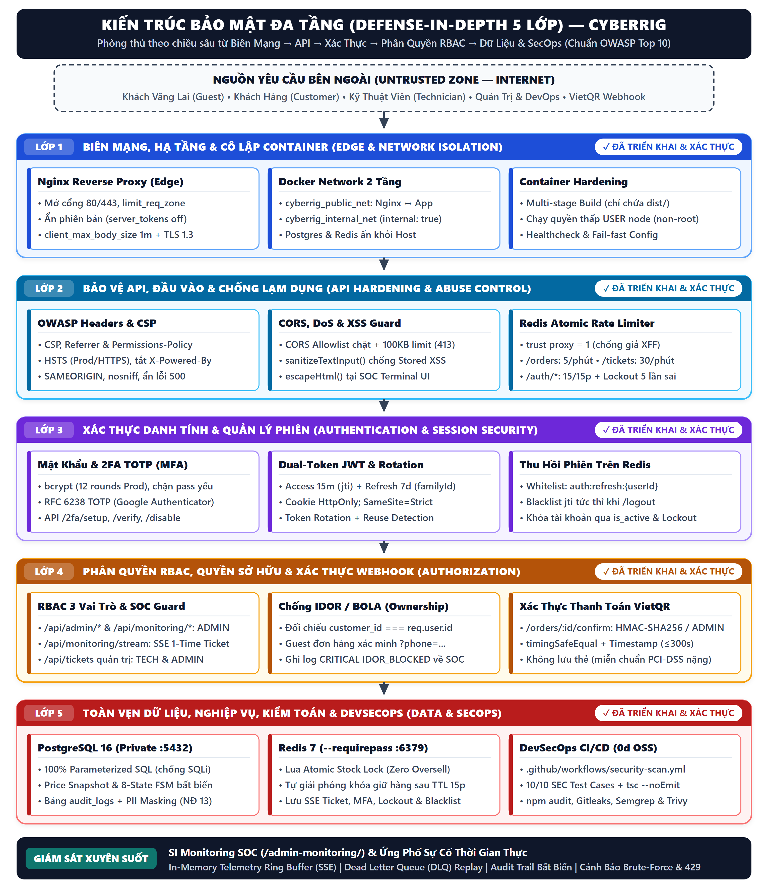

# THIẾT KẾ KIẾN TRÚC BẢO MẬT HỆ THỐNG CYBERRIG
## Security Architecture Design, STRIDE Threat Model & OWASP Hardening Roadmap

> **Hệ thống:** CyberRig Ecosystem (PC Hardware Retail, PC Compatibility Builder, Repair/Warranty Tracking & SI Monitoring SOC)  
> **Trạng thái triển khai:** **ĐÃ TRIỂN KHAI HOÀN CHỈNH CẢ 3 GIAI ĐOẠN (0đ Open Source)** — Đã xác thực `npx tsc --noEmit` (0 lỗi) & **10/10 Security Hardening Tests (`SEC-01` → `SEC-10`) + 74/74 Core/Integration/E2E Tests PASS**.  
> **Tiêu chuẩn tham chiếu:** Defense-in-Depth (5 Lớp), OWASP Top 10, OWASP API Security Top 10, RFC 6238 (TOTP 2FA), Nghị định 13/2023/NĐ-CP  
> **Sơ đồ kiến trúc:** [`docs/diagrams/diagram_security_architecture.png`](./diagrams/diagram_security_architecture.png)

---

## 1. Nguyên Tắc Thiết Kế & Kiến Trúc Phòng Thủ Nhiều Lớp (Defense-in-Depth 5 Lớp)

Kiến trúc bảo mật của CyberRig được thiết kế theo 4 nguyên tắc nền tảng:
1. **Phòng thủ nhiều lớp (*Defense-in-Depth*):** Không dựa vào một hàng rào đơn lẻ; yêu cầu đi từ Internet tới cơ sở dữ liệu phải vượt qua 5 lớp kiểm soát độc lập (Biên mạng → API → Xác thực → Phân quyền → Dữ liệu & Kiểm toán).
2. **Đặc quyền tối thiểu (*Least Privilege*):** Tách bạch nghiêm ngặt quyền hạn của 4 nhóm tác nhân (`GUEST`, `CUSTOMER`, `TECHNICIAN`, `ADMIN`); container ứng dụng chạy bằng user không đặc quyền (`USER node`).
3. **Mặc định an toàn (*Fail-Safe Defaults*):** Mọi endpoint quản trị mặc định chặn truy cập (401/403); tầng dữ liệu cô lập hoàn toàn khỏi mạng công cộng (`internal: true`).
4. **Không tin cậy dữ liệu phía Client (*Zero Client Trust*):** Toàn bộ giá linh kiện (Price Snapshot), tồn kho (Redis Lua Lock), tương thích phần cứng và trạng thái sửa chữa (8-State FSM) đều do Backend xác thực từ dữ liệu gốc.



### Bảng Tổng Hợp Kiến Trúc Bảo Mật 5 Lớp Hiện Hành

| Lớp Bảo Mật | Thành Phần / Vị Trí Mã Nguồn | Cơ Chế Bảo Vệ Đang Vận Hành |
| :--- | :--- | :--- |
| **Lớp 1: Mạng & Hạ tầng** | `docker-compose.prod.yml`, `Dockerfile`, `nginx/nginx.conf` | Cô lập 2 mạng Docker (`cyberrig_internal_net` với `internal: true` ẩn hoàn toàn PostgreSQL & Redis khỏi Host; `cyberrig_public_net` chỉ mở Nginx 80/443). Multi-stage Docker build + non-root `USER node`. Redis `--requirepass`. Nginx tắt `server_tokens off`, sẵn mẫu TLS 1.2/1.3. |
| **Lớp 2: Biên & Bảo vệ API** | `src/app.ts`, `src/core/middlewares/rate-limiter.middleware.ts` | Tắt `X-Powered-By`, bật Security Headers (`X-Frame-Options: SAMEORIGIN`, `X-Content-Type-Options: nosniff`, `X-XSS-Protection`). CORS Whitelist theo origin. Redis Atomic Rate Limiter trả chuẩn `429 Too Many Requests`: `POST /api/orders` (5 req/phút), tra cứu phiếu (30 req/phút), danh mục phần cứng (120 req/phút). |
| **Lớp 3: Xác thực & Phiên** | `src/modules/auth/password.util.ts`, `jwt.util.ts`, `auth.service.ts` | Băm mật khẩu 1 chiều `bcryptjs` (10 salt rounds). Dual-Token JWT: Access Token ngắn hạn (15 phút, `JWT_SECRET`) và Refresh Token dài hạn (7 ngày, `JWT_REFRESH_SECRET` tách biệt). Lưu Refresh Token whitelist trên Redis (`auth:refresh:{userId}`), thu hồi ngay khi `/logout`. Chặn tài khoản khóa (`is_active = false`). |
| **Lớp 4: Phân quyền RBAC** | `src/core/middlewares/auth.middleware.ts`, `admin.routes.ts`, `ticket.routes.ts`, `customer.routes.ts` | Middleware `authenticateToken`, `requireRoles(...)`, `optionalAuthenticate`. Bảo vệ `/api/admin/*` (chỉ `ADMIN`), `/api/tickets` quản trị (`TECHNICIAN`, `ADMIN`), `/api/customer/*` (cô lập theo `req.user.userId`). Route Guard 2 lớp (Server 403 + Client UI Guard). |
| **Lớp 5: Toàn vẹn Dữ liệu & Nghiệp vụ** | `src/core/db.ts`, `src/core/redis.ts`, `order.service.ts`, `ticket.service.ts` | 100% Parameterized SQL (`$1, $2...`) chống SQL Injection. Redis Lua Script khóa tồn kho nguyên tử chống Race Condition / Zero Oversell. Price Snapshot chống giả mạo giá đơn hàng. Finite State Machine 8 trạng thái chặn nhảy cóc quy trình bảo hành. |

---

## 2. Mô Hình Hóa Mối Đe Dọa (STRIDE Threat Modeling)

| Nhóm Mối Đe Dọa (STRIDE) | Kịch Bản Tấn Công Thực Tế Trên CyberRig | Cơ Chế Phòng Vệ (Hiện Có & Thiết Kế Gia Cố) |
| :--- | :--- | :--- |
| **S — Spoofing** *(Giả mạo danh tính)* | Dò mật khẩu tài khoản Admin/KTV; giả mạo Webhook thanh toán VietQR gọi `POST /api/orders/:id/confirm`; giả IP qua header `X-Forwarded-For`. | Băm mật khẩu mạnh (`bcrypt`/`Argon2id`), Rate Limit `/auth/login` + Lockout + 2FA TOTP; xác thực Webhook bằng chữ ký `HMAC-SHA256` + timestamp; bật `trust proxy` đúng tầng Nginx. |
| **T — Tampering** *(Giả mạo dữ liệu)* | Sửa giá linh kiện trong JSON đặt hàng; nhảy cóc trạng thái phiếu bảo hành; chèn mã SQL Injection vào bộ lọc tìm kiếm. | Tính giá hoàn toàn từ DB (Price Snapshot); cưỡng chế luồng bằng 8-State FSM; 100% Parameterized Queries; validate schema chặt bằng Zod và mã hóa kênh truyền TLS 1.3. |
| **R — Repudiation** *(Chối bỏ hành vi)* | Quản trị viên thay đổi tồn kho/giá hoặc kỹ thuật viên chỉnh báo giá nhưng không có bằng chứng truy vết. | Ghi nhận nhật ký `ticket_logs` theo từng chuyển trạng thái và mở rộng bảng `audit_logs` bất biến (*append-only*) lưu `actorId`, `role`, `ip`, `before/after` mọi thao tác nhạy cảm. |
| **I — Information Disclosure** *(Lộ lọt thông tin)* | Lộ thông tin cá nhân (SĐT, địa chỉ) qua trang tra cứu công khai; lộ stack trace khi lỗi 500; lộ dữ liệu nội bộ qua `/api/monitoring/*` chưa khóa. | Gắn RBAC cho `/api/monitoring/*`; kiểm tra sở hữu (chống IDOR) trên `/api/orders/:id`; PII Masking (`090****567`) ở trang công khai; ẩn `err.message` nội bộ tại Production. |
| **D — Denial of Service** *(Từ chối dịch vụ)* | Spam `POST /api/orders` làm cạn kiệt tồn kho ảo trên Redis; gửi payload JSON cực lớn; flood request làm sập API. | Redis Rate Limiter theo IP (5 req/phút cho tạo đơn) + Nginx `limit_req_zone`; TTL tự giải phóng khóa giữ hàng sau 15 phút; giới hạn payload `express.json({ limit: '100kb' })`. |
| **E — Elevation of Privilege** *(Leo thang đặc quyền)* | Khách hàng dùng JWT `CUSTOMER` gọi API `/api/admin/*` hoặc đánh cắp JWT trong `localStorage` qua XSS để chiếm quyền Admin. | Kiểm soát `requireRoles` bắt buộc phía Server (HTTP 403); chuyển Refresh Token sang Cookie `HttpOnly; Secure; SameSite=Strict` + Rotation + Reuse Detection; bật CSP & chống XSS. |

---

## 3. Ma Trận Phân Quyền API (RBAC Matrix) & Luồng Bảo Mật Nâng Cao

### 3.1. Ma Trận Kiểm Soát Truy Cập API (Target Security Design)

| Nhóm Endpoint | Guest | Customer | Technician | Admin | Cơ Chế Bảo Vệ Bắt Buộc |
| :--- | :---: | :---: | :---: | :---: | :--- |
| `/api/auth/login`, `/register`, `/refresh` | ✅ | ✅ | ✅ | ✅ | Rate Limit 5–10 req/15p + Account Lockout + Cookie `HttpOnly` |
| `/api/hardware/*`, `/api/compatibility/*` | ✅ | ✅ | ✅ | ✅ | Public Read + Rate Limit 120 req/phút + Zod Query Validation |
| `POST /api/orders` | ✅ | ✅ | ❌ | ❌ | `optionalAuthenticate` + Rate Limit 5 req/phút + Redis Lua Lock |
| `GET /api/orders/:id`, `POST /:id/cancel` | 🔒 Mã+SĐT | 🔒 Chủ đơn | ❌ | ✅ | Chống IDOR: kiểm tra `order.customerId === req.user.userId` |
| `POST /api/orders/:id/confirm` | ❌ | ❌ | ❌ | ✅ / Webhook | Bắt buộc chữ ký `HMAC-SHA256` từ cổng VietQR hoặc quyền `ADMIN` |
| `GET /api/tickets/:id/timeline`, `quotation` | ✅ (Masked) | ✅ | ✅ | ✅ | Rate Limit 30 req/phút + PII Masking với khách vãng lai |
| `GET /api/tickets`, `PATCH /:id/status`, `POST /:id/quotation` | ❌ (403) | ❌ (403) | ✅ | ✅ | `authenticateToken` + `requireRoles('TECHNICIAN', 'ADMIN')` + 8-State FSM |
| `/api/customer/*` | ❌ (401) | ✅ | ❌ | ❌ | `authenticateToken` + Cô lập truy vấn theo `req.user.userId` |
| `/api/admin/*` | ❌ (401) | ❌ (403) | ❌ (403) | ✅ | `authenticateToken` + `requireRoles('ADMIN')` + MFA + Audit Log |
| `/api/monitoring/*` (SOC, SSE, DLQ, Lab) | ❌ (401) | ❌ (403) | ❌ (403) | ✅ | `authenticateToken` + `requireRoles('ADMIN')` + SSE Short-Lived Ticket |

### 3.2. Thiết Kế Luồng Refresh Token Rotation & Xác Thực Webhook VietQR

```text
[1] LUỒNG REFRESH TOKEN ROTATION + REUSE DETECTION (Cookie HttpOnly):
  1. Client gửi POST /api/auth/refresh (trình duyệt tự đính kèm Cookie HttpOnly refreshToken).
  2. Server giải mã JWT bằng JWT_REFRESH_SECRET, trích xuất (userId, tokenFamilyId, jti).
  3. Đối chiếu Redis key "auth:refresh:{userId}:{tokenFamilyId}":
     - Nếu token không khớp giá trị mới nhất -> PHÁT HIỆN REUSE (Token bị đánh cắp)!
       -> Xóa toàn bộ session family của userId trên Redis -> Buộc đăng nhập lại (401).
     - Nếu khớp -> Sinh cặp (newAccessToken 15m, newRefreshToken 7d), ghi đè Redis, trả Cookie mới.
  4. Khi POST /api/auth/logout: Xóa Refresh Token trên Redis VÀ thêm jti của Access Token vào
     Redis Blacklist với TTL = (exp - now) để vô hiệu hóa tức thì.

[2] LUỒNG XÁC THỰC WEBHOOK THANH TOÁN VIETQR (HMAC-SHA256):
  1. Cổng thanh toán gửi POST /api/orders/:id/confirm kèm header:
     X-CyberRig-Signature, X-CyberRig-Timestamp.
  2. Server kiểm tra |now - timestamp| <= 300s (chống Replay Attack).
  3. Tính expectedSig = HMAC_SHA256(WEBHOOK_SECRET, timestamp + "." + rawBody).
  4. So sánh an toàn thời gian hằng (crypto.timingSafeEqual):
     - Sai chữ ký -> Từ chối HTTP 401 + ghi log cảnh báo lên SI Monitoring SOC.
     - Đúng chữ ký -> Xác nhận đơn hàng PAID, trừ tồn kho vật lý nguyên tử, giải phóng Redis Lock.
```

---

## 4. Kết Quả Triển Khai Bảo Mật 3 Giai Đoạn & Phân Tích Chi Phí

### 4.1. Trạng Thái Triển Khai 3 Giai Đoạn (100% Đã Hiện Thực Trong Mã Nguồn)

1. **Giai đoạn 1 — Kiểm soát truy cập & Xác thực `[HOÀN THÀNH]`:**
   - **RBAC Monitoring & SSE Ticket:** [`monitoring.routes.ts`](../src/modules/monitoring/monitoring.routes.ts), [`monitoring.controller.ts`](../src/modules/monitoring/monitoring.controller.ts), [`monitoring.js`](../nginx/html/admin-monitoring/monitoring.js) — khóa toàn bộ `/api/monitoring/*` theo quyền `ADMIN` và cấp vé dùng 1 lần 30 giây (`POST /api/monitoring/stream-ticket`).
   - **Anti-IDOR & HMAC-SHA256 Webhook:** [`order.routes.ts`](../src/modules/orders/order.routes.ts), [`order.controller.ts`](../src/modules/orders/order.controller.ts), [`hmac-webhook.util.ts`](../src/core/security/hmac-webhook.util.ts) — kiểm tra quyền sở hữu đơn hàng và xác thực chữ ký `HMAC-SHA256` + timestamp (≤ 300s) cho `POST /api/orders/:id/confirm`.
   - **Chống Brute-Force & Lockout:** [`rate-limiter.middleware.ts`](../src/core/middlewares/rate-limiter.middleware.ts) (`authRateLimiter` 15 req/15p + dùng `req.ip` qua `trust proxy`), [`auth.service.ts`](../src/modules/auth/auth.service.ts) (khóa tạm 15 phút sau 5 lần sai mật khẩu, chặn mật khẩu phổ biến).
   - **Cookie `HttpOnly`, Refresh Token Rotation + Reuse Detection & Blacklist `jti`:** [`cookie.util.ts`](../src/core/security/cookie.util.ts), [`token-blacklist.service.ts`](../src/core/security/token-blacklist.service.ts), [`jwt.util.ts`](../src/modules/auth/jwt.util.ts), [`auth.controller.ts`](../src/modules/auth/auth.controller.ts).
2. **Giai đoạn 2 — Gia cố Ứng dụng & Truyền tải `[HOÀN THÀNH]`:**
   - **OWASP Headers & DoS Limit:** [`app.ts`](../src/app.ts) (`CSP`, `Referrer-Policy`, `Permissions-Policy`, `HSTS`, giới hạn body `100kb` trả HTTP 413), [`nginx.conf`](../nginx/nginx.conf) (`limit_req_zone`, `client_max_body_size 1m`, Edge headers).
   - **Fail-fast Production & Ẩn lỗi nội bộ:** [`config.ts`](../src/core/config.ts) (`validateProductionSecurityConfig`), [`error-handler.middleware.ts`](../src/core/middlewares/error-handler.middleware.ts) (ẩn `err.message` ở Production + gắn `traceId`), [`pii-mask.util.ts`](../src/core/security/pii-mask.util.ts) (`sanitizeTextInput`).
3. **Giai đoạn 3 — Vận hành SecOps & Tuân thủ `[HOÀN THÀNH]`:**
   - **MFA / 2FA TOTP (RFC 6238):** [`totp.util.ts`](../src/core/security/totp.util.ts), [`mfa.service.ts`](../src/modules/auth/mfa.service.ts), API `/api/auth/2fa/setup`, `/verify`, `/disable` (tương thích Google Authenticator, 0đ).
   - **Audit Log bất biến & SOC Alert:** [`audit-log.service.ts`](../src/core/security/audit-log.service.ts), bảng `audit_logs` trong [`seed.ts`](../src/core/seed.ts), tra cứu qua `GET /api/monitoring/audit-logs`.
   - **PII Masking (Nghị định 13/2023/NĐ-CP):** [`pii-mask.util.ts`](../src/core/security/pii-mask.util.ts), áp dụng tại [`ticket.controller.ts`](../src/modules/repair-tickets/ticket.controller.ts) và [`order.controller.ts`](../src/modules/orders/order.controller.ts).
   - **DevSecOps CI/CD miễn phí:** [`.github/workflows/security-scan.yml`](../.github/workflows/security-scan.yml) (`tsc --noEmit`, `npm test`, `npm audit`, Gitleaks, Semgrep OSS, Trivy).
   - **Bộ kiểm thử bảo mật tự động:** [`security-hardening.spec.ts`](../src/core/security/security-hardening.spec.ts) (`SEC-01` → `SEC-10`: **10/10 PASS**).

### 4.2. Phân Tích Chi Phí Triển Khai (0đ Open Source vs Tùy Chọn Thương Mại)

| Giai Đoạn | Giải Pháp Miễn Phí (0đ — Đồ án / MVP / SME) | Tùy Chọn Trả Phí (Khi Mở Rộng Enterprise) |
| :--- | :--- | :--- |
| **Giai đoạn 1** | **0 đồng:** Chỉnh code Express/Redis + thư viện mã nguồn mở (`cookie-parser`, `argon2`, `crypto` HMAC, Email OTP). | Chỉ tốn phí nếu dùng **SMS OTP Brandname** (~500–800đ/SMS). |
| **Giai đoạn 2** | **0 đồng:** Let's Encrypt SSL + Cloudflare Free + `zod` + `helmet` + `DOMPurify` + Docker Secrets / Vault Community. | Tên miền (~250–350k/năm), VPS (~150–500k/tháng), Cloudflare Pro WAF (~20 USD/tháng), AWS Secrets Manager (~0.4 USD/secret/tháng). |
| **Giai đoạn 3** | **0 đồng:** `otplib` TOTP 2FA (Google Authenticator), PostgreSQL `audit_logs`, Trivy, Gitleaks, Semgrep OSS, `npm audit`, Dependabot. | SIEM Cloud tập trung (Datadog/Elastic Cloud), Pentest độc lập định kỳ, gói Snyk Pro / GitHub Advanced Security. *(Thanh toán VietQR không lưu thẻ nên miễn chi phí chuẩn PCI-DSS nặng).* |
