# CyberRig - Master Use Case Specification
## Tài Liệu Phân Tích Use Case Tổng Quát & Đặc Tả Nghiệp Vụ

> **Hệ thống**: CyberRig Ecosystem  
> **Phiên bản**: 2.0 (Hợp nhất 3 Sprint / 2.5 tháng)  
> **Đối tượng sử dụng**: Nhóm phát triển, Product Owner, AI Agents, Kỹ sư kiểm thử QA & Quản trị viên.

---

## 1. Biểu Đồ Use Case Tổng Quát Hệ Thống (Master Use Case Diagram)

```mermaid
flowchart TD
    %% Tác nhân (Actors)
    Guest["👤 Khách Vãng Lai (Guest)"]
    Customer["👤 Khách Hàng Thành Viên (Customer)"]
    Tech["🔧 Kỹ Thuật Viên (Technician)"]
    Admin["👑 Quản Trị Viên (Admin)"]
    DevOps["⚡ DevOps / QA Engineer (Quyền ADMIN)"]
    VietQR["🏦 «system» Cổng Thanh Toán VietQR (Webhook HMAC)"]

    %% Phân hệ 1: Retail & Builder
    subgraph Sub1["[1] Phân Hệ Phần Cứng & PC Builder"]
        UC01(["UC-01: Tra cứu & Lọc linh kiện"])
        UC02(["UC-02: Xem chi tiết thông số kỹ thuật"])
        UC03(["UC-03: Chọn cấu hình mẫu (Preset Tiers)"])
        UC04(["UC-04: Tự phối linh kiện & Kiểm tra tương thích"])
        UC05(["UC-05: Xem danh mục PC Setup ngoại vi"])
    end

    %% Phân hệ 2: Checkout & Orders
    subgraph Sub2["[2] Phân Hệ Đơn Hàng & Thanh Toán"]
        UC06(["UC-06: Chuyển cấu hình sang Checkout"])
        UC07(["UC-07: Đặt hàng & Thanh toán VietQR (Webhook HMAC)"])
        UC08(["UC-08: Tra cứu trạng thái đơn hàng (Anti-IDOR & PII Mask)"])
    end

    %% Phân hệ 3: Repair & Warranty
    subgraph Sub3["[3] Phân Hệ Bảo Hành & Sửa Chữa"]
        UC09(["UC-09: Tra cứu tiến độ phiếu bảo hành (Rate Limit & PII Mask)"])
        UC10(["UC-10: Phê duyệt báo giá sửa chữa 2 chiều"])
        UC11(["UC-11: Tiếp nhận máy tại quầy Lab"])
        UC12(["UC-12: Giám định lỗi & Lập báo giá vật tư"])
        UC13(["UC-13: Cập nhật State Machine sửa chữa"])
    end

    %% Phân hệ 4: Portals & Workbenches
    subgraph Sub4["[4] Cổng Thông Tin & Bàn Làm Việc"]
        UC14(["UC-14: Quản lý dàn máy & Đơn hàng cá nhân"])
        UC15(["UC-15: Quản lý hàng đợi Lab Kỹ thuật viên"])
    end

    %% Phân hệ 5: Admin, Security & Monitoring
    subgraph Sub5["[5] Quản Trị Kho, Bảo Mật & SI Monitoring"]
        UC16(["UC-16: Quản trị kho linh kiện & Tồn kho an toàn"])
        UC17(["UC-17: Xác thực JWT, 2FA TOTP & Phân quyền RBAC"])
        UC18(["UC-18: Giám sát SOC Real-time SSE & Audit Logs"])
        UC19(["UC-19: Kích hoạt 6 kịch bản kiểm thử Lab"])
        UC20(["UC-20: Kiểm tra & Phát lại thông điệp DLQ"])
    end

    %% Mối liên kết Khách vãng lai
    Guest --> UC01
    Guest --> UC02
    Guest --> UC03
    Guest --> UC04
    Guest --> UC05
    Guest --> UC06
    Guest --> UC07
    Guest --> UC08
    Guest --> UC09
    Guest --> UC10

    %% Mối liên kết Khách hàng thành viên
    Customer -- Kế thừa quyền Guest --> Guest
    Customer --> UC14

    %% Mối liên kết Hệ thống thanh toán ngoài
    VietQR -. Webhook HMAC-SHA256 .-> UC07

    %% Mối liên kết Kỹ thuật viên
    Tech --> UC11
    Tech --> UC12
    Tech --> UC13
    Tech --> UC15

    %% Mối liên kết Quản trị viên (khớp middleware requireRoles('ADMIN'))
    Admin --> UC16
    Admin --> UC17
    Admin --> UC18
    Admin --> UC19
    Admin --> UC20

    %% Mối liên kết DevOps / QA (vận hành bằng tài khoản quyền ADMIN)
    DevOps --> UC18
    DevOps --> UC19
    DevOps --> UC20
```

> **Lưu ý bảo mật xuyên suốt:** Tất cả Use Case nội bộ (`UC-11`..`UC-20`) yêu cầu xác thực JWT (`HttpOnly` Cookie Refresh Token Rotation + Redis `jti` Blacklist) và kiểm tra phân quyền RBAC (`UC-17`), hỗ trợ bảo vệ 2 lớp **2FA TOTP** (`/api/auth/2fa/*`). Toàn bộ nhóm API giám sát SOC (`UC-18`..`UC-20`) yêu cầu quyền `ADMIN` và kết nối SSE dùng vé một lần (`/api/monitoring/stream-ticket`).

---

## 2. Bảng Ma Trận Tác Nhân Hệ Thống (Actor Matrix)

| Tác nhân (Actor) | Bản chất vai trò | Trách nhiệm & Quyền hạn chính |
| :--- | :--- | :--- |
| **Khách Vãng Lai (Guest)** | Người dùng ngoài internet chưa đăng nhập | • Tìm kiếm linh kiện, xem catalog phần cứng. • Sử dụng công cụ PC Builder thẩm định tương thích socket/công suất. • Đặt mua hàng, quét mã VietQR và tra cứu đơn hàng (qua `?phone=` chống IDOR, dữ liệu PII được che mờ). • Tra cứu tiến độ phiếu bảo hành (giới hạn 30 req/phút, che mờ PII) và duyệt/từ chối báo giá trực tuyến. |
| **Khách Hàng (Customer)** | Khách hàng đã có tài khoản định danh (`CUSTOMER`) | • Toàn bộ quyền hạn của Guest. • Đăng nhập JWT (`HttpOnly` Cookie), bật/tắt bảo mật 2 lớp 2FA TOTP. • Quản trị dàn máy cá nhân, xem toàn bộ lịch sử đơn hàng và bảo hành tập trung trên Customer Dashboard. |
| **Kỹ Thuật Viên (Technician)** | Nhân sự kỹ thuật phòng Lab bảo hành (`TECHNICIAN`) | • Tiếp nhận thiết bị tại quầy (thiết bị mua tại cửa hàng hoặc ngoài). • Kiểm định phần cứng, ghi nhận lỗi, lập báo giá linh kiện + công thợ. • Cập nhật các chặng chuyển trạng thái của phiếu theo State Machine. |
| **Quản Trị Viên (Admin)** | Quản lý cửa hàng và vận hành hệ thống (`ADMIN`) | • Thêm mới linh kiện, cập nhật giá, điều chỉnh tồn kho an toàn, soft-delete. • Quản trị phân quyền RBAC, chính sách xác thực JWT/2FA TOTP. • Truy cập toàn bộ Dark SOC (`/admin-monitoring/`), xem Nhật ký Kiểm toán Bảo mật (`Audit Logs`), kích hoạt Testing Lab và phát lại DLQ. |
| **Kỹ Sư DevOps / QA (System Operator)** | Kỹ sư vận hành, kiểm thử chất lượng (dùng tài khoản quyền `ADMIN`) | • Giám sát SOC thời gian thực (SSE qua Single-use Ticket, trạng thái Docker container, broker queues) và tra cứu `Audit Logs`. • Phân tích thông điệp lỗi trong Dead Letter Queue (DLQ) và bấm phát lại (Replay). • Kích hoạt 6 kịch bản kiểm thử tích hợp tại Testing Lab để đánh giá hồi quy. |
| **Cổng Thanh Toán VietQR (`«system»`)** | Hệ thống ngân hàng bên thứ ba (Webhook HMAC-SHA256) | • Gửi yêu cầu callback có chữ ký mật mã `HMAC-SHA256` (`X-CyberRig-Signature`, `X-CyberRig-Timestamp`) tới `POST /api/orders/:id/confirm` để xác nhận thanh toán thực tế và chuyển trạng thái đơn sang `PAID`. |

---

## 3. Danh Mục Chi Tiết Toàn Bộ Use Cases

| Mã UC | Tên Use Case | Phân hệ | Tác nhân chính | Mức ưu tiên |
| :---: | :--- | :--- | :--- | :---: |
| **UC-01** | Tra cứu danh mục & bộ lọc linh kiện đa tiêu chí | Hardware Catalog | Guest, Customer | Must |
| **UC-02** | Xem chi tiết thông số kỹ thuật phần cứng | Hardware Catalog | Guest, Customer | Must |
| **UC-03** | Chọn cấu hình mẫu định sẵn (Gaming, Workstation) | PC Builder | Guest, Customer | Should |
| **UC-04** | Tự phối linh kiện & Thẩm định tương thích Socket/TDP | PC Builder | Guest, Customer | Must |
| **UC-05** | Tra cứu danh mục PC Setup & Thiết bị không gian làm việc | Equipments | Guest, Customer | Should |
| **UC-06** | Chuyển giỏ hàng cấu hình sang trang Checkout Split-View | Checkout | Guest, Customer | Must |
| **UC-07** | Đặt hàng & Thanh toán VietQR Napas 247 (Xác thực Webhook HMAC-SHA256) | Checkout | Guest, Customer, VietQR Webhook | Must |
| **UC-08** | Tra cứu tình trạng đơn hàng theo mã (Chống IDOR & Che mờ PII) | Orders | Guest, Customer | Should |
| **UC-09** | Tra cứu tiến độ phiếu bảo hành 6 chặng (Rate Limit 30 req/phút & PII Masking) | Repair Tickets | Guest, Customer | Must |
| **UC-10** | Khách hàng phê duyệt hoặc từ chối báo giá sửa chữa | Repair Tickets | Guest, Customer | Must |
| **UC-11** | Tiếp nhận thiết bị sửa chữa tại quầy Lab (Internal/External) | Technician Hub | Technician | Must |
| **UC-12** | Soạn biên bản chẩn đoán & Lập báo giá vật tư chi tiết | Technician Hub | Technician | Must |
| **UC-13** | Kiểm soát chuyển trạng thái phiếu qua Finite State Machine | Repair Tickets | Technician | Must |
| **UC-14** | Quản lý dàn máy & Lịch sử dịch vụ cá nhân (Dashboard) | Customer Hub | Customer | Should |
| **UC-15** | Quản lý hàng đợi sửa chữa theo trạng thái (Workbench) | Technician Hub | Technician | Must |
| **UC-16** | Quản trị kho hàng, nhập bổ sung & Cảnh báo tồn kho | Admin Hub | Admin | Must |
| **UC-17** | Xác thực JWT (`HttpOnly` Rotation), 2FA TOTP & Phân quyền RBAC | Security | Admin, System | Must |
| **UC-18** | Giám sát SOC thời gian thực (SSE Ticket) & Nhật ký Kiểm toán (Audit Logs) | SI Monitoring | Admin, DevOps/QA | Must |
| **UC-19** | Kích hoạt 6 kịch bản kiểm thử tích hợp tự động | Testing Lab | Admin, DevOps/QA | Must |
| **UC-20** | Kiểm tra, phân tích và phát lại (Replay) thông điệp lỗi DLQ | SI Monitoring | Admin, DevOps/QA | Must |

---

## 4. Đặc Tả Chi Tiết Các Use Cases Nòng Cốt (Use Case Specifications)

### 4.1. UC-04: Tự Phối Linh Kiện & Thẩm Định Tương Thích Phần Cứng
- **Mục tiêu**: Hỗ trợ người dùng tự chọn từng linh kiện PC và nhận phản hồi tức thì về độ tương thích chân cắm Socket, công suất nguồn PSU.
- **Tiền điều kiện (Preconditions)**: Danh mục linh kiện đã được nạp và phân loại thông số chuẩn xác.
- **Luồng sự kiện chính (Main Success Scenario)**:
  1. Người dùng truy cập trang `/builder`.
  2. Người dùng bấm vào khoang "CPU" và chọn một chip xử lý (VD: `AMD Ryzen 7 7800X3D - Socket AM5`).
  3. Hệ thống nạp CPU vào cấu hình, tính toán mức TDP cơ sở, cập nhật thanh tiến trình tương thích (12%).
  4. Người dùng tiếp tục chọn khoang "Bo Mạch Chủ (Motherboard)".
  5. Hệ thống kích hoạt Rule Engine kiểm tra Socket:
     - Khớp socket: Cho phép nạp vào cấu hình, hiển thị thông báo an toàn màu xanh.
     - Cập nhật công suất nguồn tối thiểu khuyến nghị.
  6. Người dùng chọn tiếp RAM, VGA, Ổ cứng, Tản nhiệt, Nguồn và Vỏ Case.
  7. Khi cấu hình đủ 8 linh kiện và không có xung đột, thanh tương thích đạt 100% kèm nhãn "[ HỆ THỐNG TƯƠNG THÍCH HOÀN TOÀN ]".
  8. Hệ thống kích hoạt nút `[ TIẾN HÀNH MUA CẤU HÌNH ]`.
- **Luồng phụ / Ngoại lệ (Extensions)**:
  - *4a. Xung đột Socket*: Người dùng chọn Mainboard Socket LGA1700 trong khi CPU là Socket AM5 $\rightarrow$ Hệ thống hiển thị cảnh báo đỏ "[ XUNG ĐỘT PHẦN CỨNG: Socket AM5 không tương thích Bo mạch chủ LGA1700 ]", hạ thanh tương thích và khóa nút đặt mua cho đến khi sửa lại.
  - *4b. Nguồn không đủ công suất*: Tổng TDP các linh kiện vượt quá công suất danh định của nguồn PSU đã chọn $\rightarrow$ Hệ thống hiển thị cảnh báo vàng "[ NGUỒN YẾU: Cần PSU tối thiểu 750W để đảm bảo biên an toàn 20% ]".

---

### 4.2. UC-07: Đặt Hàng & Thanh Toán Bằng Cổng VietQR Napas 247 Động
- **Mục tiêu**: Khách hàng chốt đơn hàng cấu hình PC và quét mã QR chuyển khoản trực tiếp với thông tin chính xác.
- **Tiền điều kiện**: Người dùng có ít nhất 1 linh kiện trong cấu hình hoặc giỏ hàng.
- **Luồng sự kiện chính (Main Success Scenario)**:
  1. Người dùng tại trang `/builder` bấm nút `[ TIẾN HÀNH MUA CẤU HÌNH ]`.
  2. Hệ thống chuyển hướng sang `/checkout`, hiển thị danh sách linh kiện và tổng chi phí.
  3. Người dùng điền thông tin người nhận (Họ tên, SĐT, Địa chỉ) và chọn phương thức "Chuyển khoản Ngân Hàng (VietQR)".
  4. Người dùng bấm nút `[ XÁC NHẬN ĐẶT HÀNG ]`.
  5. Hệ thống gọi backend `POST /api/orders`:
     - Khóa kho nguyên tử (Redis Stock Lock) cho các mã hàng.
     - Tạo bản ghi đơn hàng với Price Snapshot cố định.
     - Sinh mã định danh duy nhất (VD: `ORD-2026-8891`).
  6. Hệ thống hiển thị khung thanh toán chứa mã VietQR động:
     - Số tài khoản & Tên ngân hàng nhận thụ hưởng.
     - Số tiền giao dịch chuẩn xác đến từng đồng.
     - Cú pháp chuyển khoản bắt buộc: `CYBERRIG ORD-2026-8891`.
     - Đồng hồ đếm ngược 15:00 phút.
  7. Khách hàng mở ứng dụng ngân hàng quét mã và thanh toán.
  8. Cổng thanh toán VietQR (`«system»`) gửi Webhook kèm chữ ký `HMAC-SHA256` (`X-CyberRig-Signature`, `X-CyberRig-Timestamp`) tới `POST /api/orders/:id/confirm` (hoặc quản trị viên `ADMIN` xác nhận; môi trường dev/demo hỗ trợ `/simulate-payment`). Backend xác thực chữ ký chống giả mạo & Replay Attack, trừ tồn kho vật lý, cập nhật trạng thái `PAID` và hiển thị màn hình xác nhận hoàn tất.
- **Luồng phụ / Ngoại lệ (Extensions)**:
  - *5a. Hết hàng trong kho (Zero Stock)*: Một linh kiện vừa bị đặt hết bởi khách hàng khác $\rightarrow$ Hệ thống trả về thông báo lỗi 409 Conflict, giải phóng phiên giữ hàng và thông báo người dùng đổi linh kiện khác.
  - *6a. Hết thời gian chờ thanh toán (15 phút)*: Khách hàng không chuyển khoản $\rightarrow$ Hệ thống tự động kích hoạt hủy đơn, Redis tự động hoàn trả số lượng linh kiện về kho sẵn sàng bán.
  - *8a. Chữ ký Webhook không hợp lệ / quá hạn*: Request thiếu hoặc sai chữ ký `HMAC-SHA256` hoặc lệch timestamp vượt cửa sổ cho phép $\rightarrow$ Backend từ chối `401/403` và ghi nhận nhật ký kiểm toán bảo mật (`Audit Logs`).

---

### 4.3. UC-10: Tra Cứu Tiến Độ Phiếu Sửa Chữa & Phê Duyệt Báo Giá 2 Chiều
- **Mục tiêu**: Khách hàng theo dõi minh bạch thiết bị đang sửa ở giai đoạn nào và trực tuyến chấp thuận hoặc từ chối báo giá.
- **Tiền điều kiện**: Thiết bị đã được kỹ thuật viên tiếp nhận và sinh mã phiếu (VD: `TK-1001`).
- **Luồng sự kiện chính (Main Success Scenario)**:
  1. Khách hàng truy cập trang `/repair-tracking`, nhập mã `TK-1001` và bấm "Tra cứu".
  2. Hệ thống truy vấn API `GET /api/tickets/TK-1001/timeline` và hiển thị:
     - Thanh trạng thái 6 giai đoạn với chặng hiện tại là `QUOTED`.
     - Thông tin thiết bị, serial number và biên bản mô tả lỗi từ kỹ thuật viên.
     - Bảng báo giá chi tiết (Tiền linh kiện thay thế + Tiền công thợ + Tổng chi phí dự kiến).
     - Hai nút bấm hành động: `[ ĐỒNG Ý SỬA CHỮA ]` và `[ TỪ CHỐI BÁO GIÁ ]`.
  3. Khách hàng xem xét và bấm nút `[ ĐỒNG Ý SỬA CHỮA ]`.
  4. Hệ thống hiển thị modal xác nhận và gửi lệnh `PATCH /api/tickets/TK-1001/approve`.
  5. Backend thực thi State Machine: chuyển trạng thái phiếu từ `QUOTED` sang `REPAIRING`, ghi nhận audit log thời gian duyệt.
  6. Giao diện trang tra cứu cập nhật tức thì: bước `REPAIRING` sáng đèn, nút phê duyệt biến mất, hiển thị thông báo "Thiết bị đang được kỹ thuật viên bắt đầu sửa chữa".
- **Luồng phụ / Ngoại lệ (Extensions)**:
  - *3a. Khách hàng từ chối báo giá*: Khách hàng bấm nút `[ TỪ CHỐI BÁO GIÁ ]` và nhập lý do $\rightarrow$ Hệ thống chuyển trạng thái sang `CANCELLED`, thông báo kỹ thuật viên lắp ráp lại nguyên trạng thiết bị để bàn giao hoàn trả.

---

### 4.4. UC-20: Giám Sát SOC & Phân Tích, Phát Lại (Replay) Lỗi Trong Dead Letter Queue (DLQ)
- **Mục tiêu**: Quản trị viên / Kỹ sư vận hành DevOps phát hiện thông điệp lỗi độc hại (Poison Message), cách ly an toàn, kích hoạt thử lại sau khi xử lý gốc rễ và theo dõi nhật ký kiểm toán bảo mật (`Audit Logs`).
- **Tiền điều kiện**: Người dùng đăng nhập bằng tài khoản có quyền `ADMIN` (JWT hợp lệ, hỗ trợ 2FA TOTP); mọi endpoint `/api/monitoring/*` được bảo vệ bởi `authenticateToken` + `requireRoles('ADMIN')`.
- **Luồng sự kiện chính (Main Success Scenario)**:
  1. Người dùng truy cập trang `/admin-monitoring/`, mặc định tại tab `[01] REAL-TIME MONITORING`.
  2. Giao diện xin vé kết nối một lần (`POST /api/monitoring/stream-ticket`), sau đó kết nối dòng sự kiện Server-Sent Events (`GET /api/monitoring/stream`) hiển thị trạng thái 4 container Docker, chỉ số hàng đợi và có thể tra cứu nhật ký kiểm toán (`GET /api/monitoring/audit-logs`).
  3. Khi có thông điệp hỏng (VD: JSON sai cấu trúc hoặc dịch vụ bên thứ ba mất kết nối sau 3 lần retry NACK), hệ thống tự động đẩy vào Dead Letter Queue.
  4. Bảng điều khiển DLQ phát chuông cảnh báo và hiển thị bản ghi mới:
     - `Message ID`: Mã thông điệp.
     - `Queue Name`: Hàng đợi phát sinh lỗi (VD: `order.provisioning.dlq`).
     - `Error Reason`: Nguyên nhân lỗi (VD: `Third-party Gateway Timeout`).
     - `Payload`: Dữ liệu gốc của thông điệp.
     - Nút hành động: `[ REPLAY ]` và `[ PURGE ]`.
  5. DevOps sau khi khôi phục dịch vụ bên thứ ba, bấm nút `[ REPLAY ]`.
  6. Backend gửi yêu cầu tái nạp thông điệp về hàng đợi chính, xóa bản ghi khỏi DLQ.
  7. Dòng chữ nhật ký màu xanh xuất hiện trên Terminal Console ở chân trang: `[SUCCESS] Message Replayed successfully into primary queue`.
