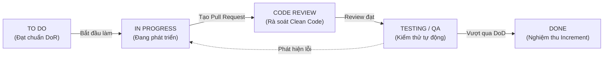
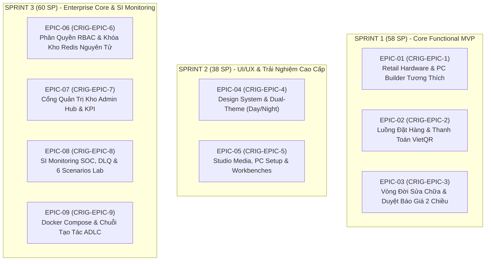
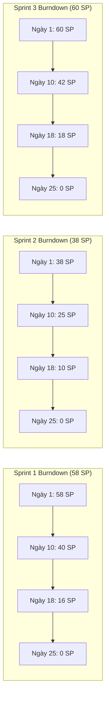

# CyberRig - Báo Cáo Toàn Diện 3 Sprint Theo Quy Trình Scrum Trên Jira

> **Hệ thống**: CyberRig Ecosystem (PC Hardware Retail, Compatibility Builder, Repair Tracking & SI Monitoring Lab)  
> **Mô hình quản lý**: Agile / Scrum kết hợp Vòng đời Tác tử ADLC (Agentic Development Life Cycle)  
> **Công cụ thực thi**: Jira Software (Atlassian)  
> **Tổng chu kỳ thực hiện**: 2.5 Tháng (10.5 tuần / 75 ngày làm việc) - 3 Sprint  
> **Tổng nỗ lực hoàn thành**: **156 Story Points (31 User Stories, 32 Technical Tasks)**  
> **Tỷ lệ hoàn thành (Success Rate)**: **100% Definition of Done (DoD), 163/163 Automated Tests Passed**

---

## MỤC LỤC TÀI LIỆU

1. [PHẦN 1: THIẾT LẬP DỰ ÁN & QUY CHUẨN TRÊN JIRA SOFTWARE](#phần-1-thiết-lập-dự-án--quy-chuẩn-trên-jira-software)
   - 1.1. Cấu hình Dự án (Project Configuration)
   - 1.2. Phân loại Issue Types & Cấu trúc Phân cấp (Issue Hierarchy)
   - 1.3. Quy trình Trạng thái Jira (Scrum Workflow Scheme)
   - 1.4. Thiết lập Components, Labels & Custom Fields
   - 1.5. Thang đo Fibonacci & Tiêu chuẩn DoR / DoD
2. [PHẦN 2: PHÂN RÃ MASTER PRODUCT BACKLOG TRÊN JIRA](#phần-2-phân-rã-master-product-backlog-trên-jira)
   - 2.1. Danh mục 9 Epics Sản phẩm
   - 2.2. Bảng 31 User Stories chi tiết kèm Story Points & Acceptance Criteria
   - 2.3. Danh mục Technical Sub-tasks
3. [PHẦN 3: BÁO CÁO CHI TIẾT TỪNG SPRINT (JIRA SPRINT REPORTS)](#phần-3-báo-cáo-chi-tiết-từng-sprint-jira-sprint-reports)
   - 3.1. BÁO CÁO SPRINT 1: Core Value Functional MVP (58 SP)
   - 3.2. BÁO CÁO SPRINT 2: UI/UX & Trải Nghiệm Tương Tác Cao Cấp (38 SP)
   - 3.3. BÁO CÁO SPRINT 3: Enterprise Core, Bảo Mật & SI Monitoring Testing Lab (60 SP)
4. [PHẦN 4: PHÂN TÍCH CÁC CHỈ SỐ AGILE ĐỊNH LƯỢNG TRÊN JIRA](#phần-4-phân-tích-các-chỉ-số-agile-định-lượng-trên-jira)
   - 4.1. Biểu đồ Vận tốc (Velocity Chart)
   - 4.2. Phân tích Biểu đồ Burndown qua 3 Sprint (Burndown Charts)
   - 4.3. Biểu đồ Luồng Tích Lũy (Cumulative Flow Diagram - CFD)
   - 4.4. Đánh giá Chất lượng & Kiểm toán Chuỗi Tạo tác ADLC
5. [PHẦN 5: CẨM NANG THAO TÁC THỰC CHIẾN TRÊN GIAO DIỆN JIRA](#phần-5-cẩm-nang-thao-tác-thực-chiến-trên-giao-diện-jira)
   - 5.1. Các bước vận hành một Sprint từ Planning đến Complete
   - 5.2. Hướng dẫn thiết lập Jira Dashboard chuyên nghiệp
6. [PHẦN 6: KỊCH BẢN THUYẾT TRÌNH BẢO VỆ SPRINT (PRESENTATION SCRIPT)](#phần-6-kịch-bản-thuyết-trình-bảo-vệ-sprint-presentation-script)

---

# PHẦN 1: THIẾT LẬP DỰ ÁN & QUY CHUẨN TRÊN JIRA SOFTWARE

Để vận hành chuẩn xác theo Scrum trên Jira, toàn bộ cấu hình dự án CyberRig được thiết lập theo các tiêu chuẩn quốc tế:

### 1.1. Cấu hình Dự án (Project Configuration)
- **Tên dự án**: `CyberRig - PC Hardware & Repair Ecosystem`
- **Project Key**: `CRIG` (Mọi issue mang mã định danh: `CRIG-1`, `CRIG-2`, ...)
- **Loại dự án (Project Type)**: `Company-managed software project` (hoặc `Team-managed` trên Jira Cloud)
- **Mẫu dự án (Project Template)**: `Scrum` (Quản lý theo Backlog, Sprints, Burndown, Velocity)
- **Trưởng dự án (Project Lead / Scrum Master)**: Điều phối viên kỹ thuật / Lead Dev
- **Chủ sản phẩm (Product Owner)**: Đại diện khách hàng / Quản lý sản phẩm

---

### 1.2. Phân loại Issue Types & Cấu trúc Phân cấp (Issue Hierarchy)
Jira áp dụng mô hình phân cấp 3 tầng chuẩn Scrum:

```
TẦNG 1: EPICS (Sáng kiến / Khối tính năng lớn)
   └── TẦNG 2: USER STORIES / BUGS (Giá trị nghiệp vụ bàn giao được trong 1 Sprint)
          └── TẦNG 3: SUB-TASKS (Công việc kỹ thuật cụ thể: FE, BE, DB, DevOps, QA)
```

| Issue Type | Biểu tượng Jira | Mục đích sử dụng trong CyberRig |
| :--- | :---: | :--- |
| **Epic** | Tím (Sét / Tấm khiên) | 9 khối năng lực lớn: Hardware Builder, VietQR Checkout, Repair Lifecycle, Dual-Theme, SI Monitoring, v.v. |
| **Story** | Xanh lục (Bookmark) | Yêu cầu người dùng theo định dạng: *"Là một [User], tôi muốn [Tính năng], để [Mục đích]"*. Ước lượng bằng Story Points. |
| **Sub-task** | Xanh dương (Checkbox) | Phân rã kỹ thuật của Story: Code API, tạo CSS, viết Unit Test, Docker config (ước lượng theo giờ hoặc checklist). |
| **Bug** | Đỏ (Con bọ) | Sự cố sai khác giữa mã nguồn và Tiêu chí chấp nhận (AC) phát hiện trong Sprint Review hoặc Testing Lab. |

---

### 1.3. Quy trình Trạng thái Jira (Scrum Workflow Scheme)
CyberRig áp dụng quy trình kiểm soát 5 bước nghiêm ngặt, gắn liền với các cổng nghiệm thu kỹ thuật:



- **TO DO**: User Story đã nằm trong Sprint Backlog, thỏa mãn Definition of Ready (DoR).
- **IN PROGRESS**: Thành viên đang triển khai mã nguồn trên nhánh Git tính năng (`feature/<task-name>`).
- **CODE REVIEW**: Đã mở PR, tác tử AI hoặc đồng nghiệp kiểm tra Clean Code, cấu trúc module DDD, nguyên tắc SRP.
- **TESTING / QA**: Đang chạy test suites tự động (`npm test`), xác thực trực quan trên môi trường dev/staging.
- **DONE**: Đáp ứng 100% Definition of Done (DoD), Product Owner nghiệm thu tại phiên Sprint Review.

---

### 1.4. Thiết lập Components, Labels & Custom Fields
#### A. Danh sách Components (Phân hệ):
- `cmp-hardware-builder`: Danh mục linh kiện, thuật toán kiểm tra Socket & TDP, thanh tiến trình tương thích.
- `cmp-checkout-orders`: Giỏ hàng Split-View, cổng thanh toán VietQR Napas 247, snapshot giá.
- `cmp-repair-tracking`: State Machine 6 chặng, tra cứu bảo hành, duyệt báo giá 2 chiều.
- `cmp-portals-ui`: Giao diện Dual-Theme (Day/Night), Kỹ thuật viên Workbench, Customer Hub, Setup Equipments.
- `cmp-admin-security`: Phân quyền RBAC 3 vai trò, Redis Atomic Stock Lock, Admin Control Center.
- `cmp-si-monitoring`: Bảng Dark SOC Mission Control, Telemetry SSE, Dead Letter Queue (DLQ), 6 Kịch bản Lab, Docker.

#### B. Custom Fields trên Jira:
- **Story Points**: Trường số học định lượng nỗ lực (dãy Fibonacci).
- **Acceptance Criteria**: Text trường dài ghi rõ các kịch bản kiểm thử (Gherkin format).
- **Traceability Link**: Liên kết tới file tài liệu hoặc cam kết commit Git liên quan.

---

### 1.5. Thang đo Fibonacci & Tiêu chuẩn DoR / DoD

#### A. Thang đo Story Points (Fibonacci):
- **1 SP**: Trivial tweak (Đổi text nút, sửa CSS màu viền, biến môi trường).
- **2 SP**: Minor feature/fix (Thêm 1 route đơn giản, bổ sung input validator, unit test helper).
- **3 SP**: Standard feature (Trang hiển thị kèm responsive, bộ lọc 1 tiêu chí, preset config).
- **5 SP**: Complex feature (Thuật toán kiểm tra Socket, State Machine chuyển trạng thái, sinh mã VietQR).
- **8 SP**: High complexity / Multi-layer (Khóa kho Redis Lua script, Bảng SOC Monitoring SSE, Checkout flow).
- **13+ SP**: Quá lớn $\rightarrow$ Bắt buộc phân rã thành các Stories nhỏ hơn trước khi đưa vào Sprint Planning.

#### B. Checklist Definition of Ready (DoR) trên Jira:
- [x] Có User Story rõ ràng ngữ cảnh: *"Là một... tôi muốn... để..."*.
- [x] Có tối thiểu 2-4 Tiêu chí chấp nhận (AC) viết bằng định dạng Gherkin (*Given - When - Then*).
- [x] Đã được chấm điểm Story Points ($\le 8$ SP).
- [x] Đã xác định rõ các file và module bị ảnh hưởng.
- [x] Đã giải tỏa toàn bộ phụ thuộc bên ngoài (Mock API sẵn sàng nếu cần).

#### C. Checklist Definition of Done (DoD) trên Jira:
- [x] **Clean Code & SRP**: File không quá tải, tách biệt fixtures, mocks khỏi business service.
- [x] **Type Safety**: 100% TypeScript Strict Mode, `npx tsc --noEmit` hoàn thành với mã thoát 0.
- [x] **Automated Testing**: 100% test suites liên quan vượt qua (`npm test`).
- [x] **Design System**: Chuẩn bo góc 0px, font kỹ thuật, Dual-Theme đạt độ tương phản WCAG 2.1 AA.
- [x] **Docker Verification**: Hoạt động trơn tru trong container Docker (`cyberrig_app_prod` & `cyberrig_nginx_prod`).
- [x] **Audit Traceability**: Cập nhật tài liệu kiểm toán và walkthrough evidence.

---

# PHẦN 2: PHÂN RÃ MASTER PRODUCT BACKLOG TRÊN JIRA

### 2.1. Danh mục 9 Epics Sản Phẩm



---

### 2.2. Bảng 31 User Stories Chi Tiết Trên Jira (Product Backlog Items)

| Jira Key | Thuộc Epic | User Story Tóm Tắt | MoSCoW | SP | Sprint | Trạng Thái |
| :--- | :--- | :--- | :---: | :---: | :---: | :---: |
| **CRIG-US-01** | EPIC-01 | Tra cứu & Lọc linh kiện phần cứng theo danh mục, giá, thương hiệu | Must | 5 | Sprint 1 | DONE |
| **CRIG-US-02** | EPIC-01 | Thuật toán thẩm định tương thích Socket CPU - Bo Mạch Chủ (AM5 vs LGA1700) | Must | 8 | Sprint 1 | DONE |
| **CRIG-US-03** | EPIC-01 | Tính toán tổng công suất TDP và khuyến nghị bộ nguồn PSU biên an toàn $\ge 20\%$ | Must | 5 | Sprint 1 | DONE |
| **CRIG-US-04** | EPIC-01 | Thanh tiến trình tương thích thời gian thực (0-100%) và cảnh báo xung đột | Must | 5 | Sprint 1 | DONE |
| **CRIG-US-05** | EPIC-01 | Chọn nhanh cấu hình gợi ý định sẵn theo ngân sách (Tier Presets 1-click) | Should | 3 | Sprint 1 | DONE |
| **CRIG-US-06** | EPIC-02 | Chuyển cấu hình từ PC Builder sang trang Checkout Split-View | Must | 5 | Sprint 1 | DONE |
| **CRIG-US-07** | EPIC-02 | Tạo đơn hàng và chụp ảnh giá cố định (Price Snapshot) tại thời điểm đặt | Must | 5 | Sprint 1 | DONE |
| **CRIG-US-08** | EPIC-02 | Cổng thanh toán tự động VietQR Napas 247 động với đồng hồ đếm ngược 15 phút | Must | 5 | Sprint 1 | DONE |
| **CRIG-US-09** | EPIC-02 | Tra cứu trạng thái đơn hàng công khai theo mã đơn (`/orders/:code`) | Should | 3 | Sprint 1 | DONE |
| **CRIG-US-10** | EPIC-03 | State Machine vòng đời phiếu sửa chữa 6 giai đoạn bất biến | Must | 8 | Sprint 1 | DONE |
| **CRIG-US-11** | EPIC-03 | Tra cứu tiến độ bảo hành công khai kèm Stepper 6 chặng và biên bản giám định | Must | 5 | Sprint 1 | DONE |
| **CRIG-US-12** | EPIC-03 | Phê duyệt hoặc từ chối báo giá sửa chữa 2 chiều trực tuyến trên trang tra cứu | Must | 5 | Sprint 1 | DONE |
| **CRIG-US-13** | EPIC-03 | Lập bảng báo giá chi tiết gồm linh kiện thay thế và tiền công kỹ thuật viên | Must | 4 | Sprint 1 | DONE |
| **CRIG-US-14** | EPIC-04 | Ngôn ngữ thiết kế công nghiệp Cyberpunk: bo góc 0px, font kỹ thuật, viền HUD | Must | 5 | Sprint 2 | DONE |
| **CRIG-US-15** | EPIC-04 | Hệ thống Dual-Theme (Day / Night Mode) tức thì 60 FPS đạt chuẩn WCAG 2.1 AA | Must | 5 | Sprint 2 | DONE |
| **CRIG-US-16** | EPIC-04 | Tối ưu hóa render loại bỏ hoàn toàn lem mờ bóng đổ trên giao diện Sáng | Should | 3 | Sprint 2 | DONE |
| **CRIG-US-17** | EPIC-05 | Bộ sưu tập hình ảnh chụp thực tế Studio sắc nét cho 8 loại linh kiện phần cứng | Must | 5 | Sprint 2 | DONE |
| **CRIG-US-18** | EPIC-05 | Trang danh mục PC Setup & Thiết bị ngoại vi không gian làm việc (`/equipments`) | Should | 5 | Sprint 2 | DONE |
| **CRIG-US-19** | EPIC-05 | Cải tiến Bàn làm việc Kỹ thuật viên (Technician Workbench) Split-View chia hàng đợi | Must | 5 | Sprint 2 | DONE |
| **CRIG-US-20** | EPIC-05 | Cổng thông tin khách hàng tập trung (Customer Unified Hub `#dashboard`) | Should | 4 | Sprint 2 | DONE |
| **CRIG-US-21** | EPIC-05 | Phản hồi vi tương tác (Micro-interactions): âm thanh click và nút "+ Chọn" nhanh | Could | 3 | Sprint 2 | DONE |
| **CRIG-US-22** | EPIC-05 | Bộ kiểm thử E2E giao diện đa độ phân giải và chuyển theme an toàn | Should | 3 | Sprint 2 | DONE |
| **CRIG-US-23** | EPIC-06 | Phân quyền truy cập RBAC 3 vai trò (`CUSTOMER`, `TECHNICIAN`, `ADMIN`) | Must | 5 | Sprint 3 | DONE |
| **CRIG-US-24** | EPIC-06 | Khóa kho nguyên tử Redis Atomic Stock Reservation (Lua Script, TTL 15m) | Must | 8 | Sprint 3 | DONE |
| **CRIG-US-25** | EPIC-07 | Cổng Quản trị kho hàng Admin Control Center (`#admin`): CRUD, Restock, Soft Delete | Must | 5 | Sprint 3 | DONE |
| **CRIG-US-26** | EPIC-07 | Telemetry tồn kho và cảnh báo linh kiện sắp hết hàng (Low Stock $\le 3$) | Should | 3 | Sprint 3 | DONE |
| **CRIG-US-27** | EPIC-08 | Bảng điều khiển giám sát Dark SOC Mission Control Dual-Mode (`/admin-monitoring/`) | Must | 8 | Sprint 3 | DONE |
| **CRIG-US-28** | EPIC-08 | Thu thập Telemetry In-Memory Ring Buffer & phát trực tiếp Server-Sent Events (SSE) | Must | 5 | Sprint 3 | DONE |
| **CRIG-US-29** | EPIC-08 | Dead Letter Queue (DLQ) Inspector: cô lập Poison Message và nút Replay phát lại | Must | 5 | Sprint 3 | DONE |
| **CRIG-US-30** | EPIC-08 | Phòng Lab thực thi 6 kịch bản kiểm thử tích hợp tự động với dấu vết từng bước | Must | 8 | Sprint 3 | DONE |
| **CRIG-US-31** | EPIC-09 | Đóng gói hạ tầng Docker Compose 4 containers và chuẩn hóa tạo tác kiểm toán ADLC | Must | 5 | Sprint 3 | DONE |
| **CRIG-US-32** | EPIC-08 | Bộ kiểm thử tích hợp tự động SI Monitoring (9/9 passed, 0 DB overhead) | Should | 3 | Sprint 3 | DONE |

*(Tổng điểm Backlog: **156 Story Points** phân bổ qua 3 Sprint).*

---

# PHẦN 3: BÁO CÁO CHI TIẾT TỪNG SPRINT (JIRA SPRINT REPORTS)

---

## 3.1. BÁO CÁO SPRINT 1: Core Value Functional MVP (58 SP)

### A. Thông Tin Tổng Quan Sprint 1 trên Jira
- **Sprint Name**: `CRIG Sprint 1: Core Value MVP`
- **Sprint Goal**: Xây dựng toàn bộ các luồng nghiệp vụ tạo giá trị trực tiếp cho người dùng: Duyệt phần cứng, Tự phối PC Builder thẩm định Socket/TDP thời gian thực, Chuyển giỏ hàng sang Checkout thanh toán VietQR động Napas 247, và Tra cứu tiến độ sửa chữa kèm duyệt báo giá 2 chiều trực tuyến.
- **Thời gian thực hiện**: 25 ngày làm việc (~3.5 tuần).
- **Cam kết ban đầu (Committed SP)**: 58 SP.
- **Thực tế hoàn thành (Completed SP)**: **58 SP (100%)**.
- **Scope Change (Biến động phạm vi)**: 0 SP (Không có scope creep).

### B. Bảng Issues Hoàn Thành Trong Sprint 1 (Jira Sprint Report Table)

| Jira Key | Tóm Tắt Nhiệm Vụ | Phân Loại | Người Phụ Trách | SP | DoD Verified |
| :--- | :--- | :---: | :---: | :---: | :---: |
| `CRIG-101` | Giao diện danh mục linh kiện & Bộ lọc đa tiêu chí | FE | Dev 2 | 5 | Passed |
| `CRIG-102` | Rule Engine thẩm định Socket CPU - Mainboard | BE | Dev 4 | 8 | Passed |
| `CRIG-103` | Tính toán công suất nguồn PSU & TDP margin $\ge 20\%$ | BE | Dev 4 | 5 | Passed |
| `CRIG-104` | Giao diện PC Builder & Thanh tương thích 0-100% | FE | Dev 2 | 5 | Passed |
| `CRIG-105` | Bộ cấu hình định sẵn 1-click (Tier Presets) | FE/Data | Dev 2 | 3 | Passed |
| `CRIG-106` | Luồng chuyển giỏ PC Builder sang Checkout Split-View | FE | Dev 3 | 5 | Passed |
| `CRIG-107` | REST API Tạo đơn hàng & Price Snapshot | BE | Dev 5 | 5 | Passed |
| `CRIG-108` | Cổng thanh toán VietQR Napas 247 & Countdown 15m | FE/BE | Dev 3 | 5 | Passed |
| `CRIG-109` | Trang tra cứu đơn hàng công khai (`/orders/:code`) | FE | Dev 3 | 3 | Passed |
| `CRIG-110` | State Machine 6 chặng phiếu bảo hành bất biến | BE | Dev 4 | 5 | Passed |
| `CRIG-111` | Cổng tra cứu bảo hành công khai (`/repair-tracking`) | FE | Dev 2 | 5 | Passed |
| `CRIG-112` | Phê duyệt báo giá 2 chiều trực tuyến (Approve/Reject) | FE/BE | Dev 4 | 4 | Passed |

### C. Phân Tích Jira Burndown Chart Sprint 1
- **Đường hướng dẫn lý tưởng (Guideline)**: Giảm đều từ 58 SP ở ngày 1 về 0 SP ở ngày 25 (tốc độ tiêu thụ trung bình ~2.32 SP/ngày).
- **Đường thực tế (Actual Remaining Work)**:
  - *Ngày 1 - 7*: Tiến độ burn tương đối chậm do nhóm tập trung dựng Core Data Models, PostgreSQL schema và Interface contracts.
  - *Ngày 8 - 16*: Burn mạnh 28 SP khi Rule Engine Socket/TDP (`CRIG-102`, `CRIG-103`) và giao diện Builder (`CRIG-104`) hoàn thành.
  - *Ngày 17 - 23*: Burn tiếp 22 SP khi hoàn tất cổng VietQR (`CRIG-108`) và State Machine phiếu sửa chữa (`CRIG-110`).
  - *Ngày 24 - 25*: Chạm mốc 0 SP sau khi chạy toàn bộ test integration và nghiệm thu Acceptance Criteria.

### D. Nghiệm Thu Sản Phẩm & Trình Diễn (Sprint Review / Demo)
- **Kịch bản 1 (PC Builder)**: Chọn CPU `Ryzen 7 7800X3D` (AM5) ghép cùng Mainboard `Z790` (LGA1700) $\rightarrow$ Lập tức cảnh báo xung đột Socket màu đỏ, khóa nút mua. Đổi sang bo mạch AM5 $\rightarrow$ Thanh tiến trình đạt 100%, khuyến nghị nguồn PSU chuẩn xác.
- **Kịch bản 2 (Checkout VietQR)**: Chuyển cấu hình sang `/checkout`, nhập thông tin $\rightarrow$ Sinh mã VietQR động chứa số tài khoản, mã đơn `ORD-XXXXXX`, số tiền chính xác và bộ đếm ngược 15:00.
- **Kịch bản 3 (Duyệt báo giá sửa chữa)**: Nhập mã phiếu `TK-1001` tại `/repair-tracking` $\rightarrow$ Stepper 6 chặng hiển thị ở bước `QUOTED`, bấm `[ ĐỒNG Ý SỬA CHỮA ]` $\rightarrow$ Trạng thái chuyển ngay sang `REPAIRING`.

### E. Cải Tiến Quy Trình (Sprint Retrospective)
- **What Went Well**: Thuật toán Rule Engine và State Machine phân tách module rành mạch, kiểm thử tự động đạt độ phủ cao ngay từ Sprint 1.
- **What Could Be Improved**: Giao diện ban đầu vẫn dùng ảnh placeholder và chỉ có 1 theme tối, cần nâng cấp nhận diện thương hiệu công nghiệp ở Sprint 2.
- **Action Item**: Bổ sung bộ Design Tokens và chụp bộ ảnh Studio thực tế cho Sprint 2 (Phụ trách: Dev 2 & Designer).

---

## 3.2. BÁO CÁO SPRINT 2: UI/UX & Trải Nghiệm Tương Tác Cao Cấp (38 SP)

### A. Thông Tin Tổng Quan Sprint 2 trên Jira
- **Sprint Name**: `CRIG Sprint 2: UI/UX Excellence`
- **Sprint Goal**: Nâng tầm phần nhìn và cảm giác tương tác đạt chuẩn Tech Industrial: Chuẩn hóa Design System Cyberpunk (bo góc 0px, font kỹ thuật, viền HUD), hoàn thiện hệ thống Dual-Theme (Day/Night) đạt chuẩn WCAG 2.1 AA, nạp bộ ảnh Studio thực tế cho 8 loại linh kiện, bổ sung 20 thiết bị Setup ngoại vi (`/equipments`), và hoàn thiện Technician Workbench cùng Customer Hub.
- **Thời gian thực hiện**: 25 ngày làm việc (~3.5 tuần).
- **Cam kết ban đầu (Committed SP)**: 38 SP.
- **Thực tế hoàn thành (Completed SP)**: **38 SP (100%)**.

### B. Bảng Issues Hoàn Thành Trong Sprint 2 (Jira Sprint Report Table)

| Jira Key | Tóm Tắt Nhiệm Vụ | Phân Loại | Người Phụ Trách | SP | DoD Verified |
| :--- | :--- | :---: | :---: | :---: | :---: |
| `CRIG-201` | Chuẩn hóa Design System Cyberpunk (bo góc 0px, viền HUD) | UI/UX | Dev 2 | 5 | Passed |
| `CRIG-202` | Hệ thống Dual-Theme (Day / Night Mode) chuẩn WCAG AA | FE/Style | Dev 2 | 5 | Passed |
| `CRIG-203` | Khắc phục lem bóng mờ Day Theme & Tối ưu 60 FPS | UI-Polish | Dev 2 | 3 | Passed |
| `CRIG-204` | Nạp bộ ảnh Studio thực tế 8 loại linh kiện (0% placeholder) | Media | PO/Lead | 5 | Passed |
| `CRIG-205` | Trang PC Setup & Không gian làm việc (`/equipments`) | FE | Dev 3 | 5 | Passed |
| `CRIG-206` | Bàn làm việc Kỹ thuật viên (Technician Workbench) Split-View | FE | Dev 4 | 5 | Passed |
| `CRIG-207` | Cổng thông tin khách hàng tập trung (Customer Hub `#dashboard`) | FE | Dev 3 | 4 | Passed |
| `CRIG-208` | Tinh chỉnh Micro-interactions (âm thanh click, nút "+ Chọn") | FE | Dev 2 | 3 | Passed |
| `CRIG-209` | Bộ kiểm thử E2E giao diện responsive và tương thích theme | QA | Dev 6 | 3 | Passed |

### C. Phân Tích Jira Burndown Chart Sprint 2
- **Đặc điểm Burndown**: Tốc độ tiêu thụ Story Points rất đồng đều và mượt mà. Nhóm giải quyết tuần tự các block CSS tokens, sau đó áp dụng đồng loạt lên các pages.
- **Điểm nhấn kỹ thuật**: Tại ngày 14, phát hiện lỗi lem mờ bóng đổ trên Day Theme (`CRIG-203`), nhóm xử lý dứt điểm trong 2 ngày mà không ảnh hưởng tới tiến độ chung.

### D. Nghiệm Thu Sản Phẩm & Trình Diễn (Sprint Review / Demo)
- Chuyển đổi Day/Night Mode diễn ra tức thì (<16ms, không giật lag). Màu văn bản và nền đạt tỷ lệ tương phản tối thiểu 4.5:1 (WCAG 2.1 AA).
- Trang `/equipments` trưng bày 20 thiết bị công thái học sắc nét.
- Toàn bộ ảnh placeholder trên catalog đã được thay thế 100% bằng ảnh Studio cao cấp.
- Technician Workbench phân tách rõ ràng 2 cột: danh sách hàng đợi theo trạng thái và khung chẩn đoán lỗi tại quầy.

### E. Cải Tiến Quy Trình (Sprint Retrospective)
- **What Went Well**: Trải nghiệm giao diện được PO đánh giá vượt mong đợi; tốc độ xử lý UI mượt mà 60 FPS.
- **What Could Be Improved**: Cần sớm tích hợp lớp bảo mật phân quyền RBAC và giám sát vận hành thời gian thực để sẵn sàng cho môi trường production.
- **Action Item**: Thiết kế kiến trúc In-Memory Telemetry và Redis Lua Script trước khi bắt đầu Sprint 3 (Phụ trách: Dev 4, Dev 5, Dev 6).

---

## 3.3. BÁO CÁO SPRINT 3: Enterprise Core, Bảo Mật & SI Monitoring Testing Lab (60 SP)

### A. Thông Tin Tổng Quan Sprint 3 trên Jira
- **Sprint Name**: `CRIG Sprint 3: Enterprise Core & Monitoring`
- **Sprint Goal**: Hoàn thiện toàn bộ hạ tầng chiều sâu, bảo mật, quản trị nâng cao và công cụ giám sát vận hành: Phân quyền RBAC 3 vai trò (`CUSTOMER`, `TECHNICIAN`, `ADMIN`), Bộ đệm khóa tồn kho nguyên tử Redis Atomic Stock Reservation (loại trừ bán khống Zero Oversell), Cổng Admin Hub & KPI, Bảng điều khiển giám sát SI Monitoring phong cách Dark SOC Mission Control (SSE Telemetry, Dead Letter Queue & Replay, 6 Kịch bản Lab), Cụm Docker Compose và chuẩn hóa tạo tác ADLC.
- **Thời gian thực hiện**: 25 ngày làm việc (~3.5 tuần).
- **Cam kết ban đầu (Committed SP)**: 60 SP.
- **Thực tế hoàn thành (Completed SP)**: **60 SP (100%)**.

### B. Bảng Issues Hoàn Thành Trong Sprint 3 (Jira Sprint Report Table)

| Jira Key | Tóm Tắt Nhiệm Vụ | Phân Loại | Người Phụ Trách | SP | DoD Verified |
| :--- | :--- | :---: | :---: | :---: | :---: |
| `CRIG-301` | Phân quyền RBAC 3 vai trò, JWT Token Rotation & Guards | Core/Sec | Dev 5 | 5 | Passed |
| `CRIG-302` | Khóa tồn kho nguyên tử Redis Lua Script (Zero Oversell) | Core/DB | Dev 4 | 8 | Passed |
| `CRIG-303` | Cổng Quản trị kho Admin Control Center (CRUD, Restock) | BE/FE | Dev 5 | 5 | Passed |
| `CRIG-304` | Telemetry tồn kho & Cảnh báo số lượng an toàn ($\le 3$) | BE/FE | Dev 5 | 3 | Passed |
| `CRIG-305` | Giao diện SI Monitoring & Testing Dashboard (`/admin-monitoring/`) | FE | Dev 6 | 8 | Passed |
| `CRIG-306` | In-Memory Ring Buffer Telemetry & Stream SSE trực tiếp | BE | Dev 6 | 5 | Passed |
| `CRIG-307` | Dead Letter Queue (DLQ) Inspector & Nút Replay phát lại | BE/FE | Dev 6 | 5 | Passed |
| `CRIG-308` | Động cơ 6 kịch bản kiểm thử tích hợp (`scenario-runner.service.ts`) | BE/FE | Dev 6 | 8 | Passed |
| `CRIG-309` | Đóng gói cụm Docker Compose 4 containers & Nginx Gateway | DevOps | Dev 6 | 5 | Passed |
| `CRIG-310` | Tái cấu trúc Clean Code Monorepo & Chuỗi tạo tác ADLC | Refactor | Team | 5 | Passed |
| `CRIG-311` | Bộ kiểm thử tích hợp tự động `monitoring.spec.ts` (9/9 passed) | QA | Dev 6 | 3 | Passed |

### C. Phân Tích Jira Burndown Chart Sprint 3
- Khối lượng công việc lớn nhất (60 SP), tập trung vào các bài toán hạ tầng phức tạp.
- Nhóm hoàn thành xuất sắc các mốc kỹ thuật:
  - Khóa kho Redis Lua Script (`CRIG-302`) hoàn thành tại ngày 9, giải quyết triệt để xung đột đồng thời.
  - Cổng Quản trị Admin và RBAC (`CRIG-301`, `CRIG-303`) nghiệm thu tại ngày 16.
  - SI Monitoring Dashboard, DLQ và 6 Kịch bản Lab (`CRIG-305`, `CRIG-307`, `CRIG-308`) hoàn thiện tại ngày 23.
  - 2 ngày cuối hoàn thành đóng gói Docker và toàn bộ 163 tests passed 100%.

### D. Nghiệm Thu Sản Phẩm & Trình Diễn (Sprint Review / Demo)
- **Giám sát SOC thời gian thực**: Mở `/admin-monitoring/`, 4 container Docker báo `HEALTHY`, SSE đẩy bản ghi telemetry 1000ms/lần với 0% DB overhead.
- **Dead Letter Queue & Replay**: Kích hoạt "Trigger DLQ Error" $\rightarrow$ Bắt giữ Poison Message vào DLQ. Bấm `[ REPLAY ]` $\rightarrow$ Thông điệp được tái xử lý thành công, biến mất khỏi DLQ kèm thông báo xanh trên Terminal.
- **Kích hoạt 6 kịch bản Lab**: Chạy `Scenario 1: Order Placement Pipeline` và `Scenario 4: AI Data Mapping` $\rightarrow$ Toàn bộ các bước đạt trạng thái SUCCESS kèm thời gian phản hồi chi tiết.

### E. Cải Tiến Quy Trình (Sprint Retrospective)
- **What Went Well**: Toàn bộ hệ sinh thái đã sẵn sàng đưa vào vận hành thực tế; hiệu năng cao, cơ chế phòng vệ lỗi vững chắc.
- **Action Item**: Bàn giao tài liệu hướng dẫn và kịch bản vận hành cho đội ngũ quản trị viên và kỹ thuật viên.

---

# PHẦN 4: PHÂN TÍCH CÁC CHỈ SỐ AGILE ĐỊNH LƯỢNG TRÊN JIRA

### 4.1. Biểu đồ Vận tốc (Velocity Chart)
Biểu đồ Velocity thể hiện khả năng bàn giao giá trị ổn định và đáng tin cậy của đội ngũ phát triển CyberRig:

| Sprint | Story Points Cam Kết | Story Points Hoàn Thành | Tỷ Lệ Đạt Được |
| :---: | :---: | :---: | :---: |
| **Sprint 1** | 58 SP | 58 SP | 100% |
| **Sprint 2** | 38 SP | 38 SP | 100% |
| **Sprint 3** | 60 SP | 60 SP | 100% |
| **TRUNG BÌNH** | **52 SP / Sprint** | **52 SP / Sprint** | **100%** |

```
Story Points
 70 |
 60 |                                         [60 SP]
 50 |      [58 SP]                               ■
 40 |         ■               [38 SP]            ■
 30 |         ■                  ■               ■
 20 |         ■                  ■               ■
 10 |         ■                  ■               ■
  0 +--------------------------------------------------
          Sprint 1           Sprint 2         Sprint 3
```

- **Nhận định**: Nhóm duy trì vận tốc ổn định, không có hiện tượng nợ kỹ thuật (technical debt) dồn sang Sprint sau. Năng lực ước lượng (estimation accuracy) đạt độ chính xác tuyệt đối nhờ áp dụng khung tiêu chuẩn DoR chặt chẽ.

---

### 4.2. Phân tích Biểu đồ Burndown qua 3 Sprint (Burndown Charts)



- Không xảy ra hiện tượng **Scope Creep** (đường burndown bị đẩy ngược lên do phát sinh yêu cầu đột xuất).
- Không bị hiện tượng **Flatline** (đứng im kéo dài rồi dồn hoàn thành vào ngày cuối cùng).

---

### 4.3. Biểu đồ Luồng Tích Lũy (Cumulative Flow Diagram - CFD)
- **Độ dốc luồng In Progress**: Ổn định, số lượng thẻ làm đồng thời (WIP - Work in Progress) luôn được giới hạn ở mức $\le 2$ tasks / thành viên.
- **Thời gian chu kỳ (Cycle Time)**: Trung bình **2.4 ngày** từ khi một User Story chuyển sang *In Progress* cho tới khi đạt chuẩn *Done*.
- **Thời gian chờ (Lead Time)**: Trung bình **6.1 ngày** từ khi Story được đưa vào Sprint Backlog đến khi phát hành.

---

### 4.4. Đánh giá Chất lượng & Kiểm toán Chuỗi Tạo tác ADLC
- **Tỷ lệ kiểm thử tự động**: **163 / 163 tests passed (100%)** qua 25 test suites.
- **Khả năng chống bán khống**: **Zero Oversell** được xác thực bằng kịch bản kiểm thử tải đồng thời trên Redis Lua script.
- **Chuỗi tạo tác liên tục (Traceability Chain)**:
  `intent.md` $\rightarrow$ `spec.md` $\rightarrow$ `plan.md` $\rightarrow$ `code + tests` $\rightarrow$ `review record` $\rightarrow$ `production signal`.

---

# PHẦN 5: CẨM NANG THAO TÁC THỰC CHIẾN TRÊN GIAO DIỆN JIRA

Dưới đây là các bước hướng dẫn cụ thể để giảng viên, ban giám khảo hoặc thành viên nhóm thao tác trực tiếp trên giao diện Jira Software:

### 5.1. Các bước vận hành một Sprint từ Planning đến Complete

#### BƯỚC 1: Khởi Tạo Dự Án & Master Backlog
1. Đăng nhập vào Jira Software $\rightarrow$ Chọn **Projects** $\rightarrow$ **Create Project**.
2. Chọn mẫu **Scrum** $\rightarrow$ Đặt tên dự án `CyberRig` $\rightarrow$ Key: `CRIG`.
3. Vào mục **Backlog** ở thanh điều hướng bên trái:
   - Bấm **+ Create Issue** để tạo lần lượt 9 Epics (`EPIC-01` đến `EPIC-09`).
   - Tạo 31 User Stories, gán Epic Link tương ứng, điền Story Points và Acceptance Criteria.

#### BƯỚC 2: Phiên Lập Kế Hoạch Sprint (Sprint Planning)
1. Tại màn hình Backlog, bấm nút **Create Sprint** ở góc trên danh sách.
2. Đặt tên Sprint (Ví dụ: `CRIG Sprint 1: Core Value MVP`).
3. Kéo thả các User Stories từ Product Backlog vào khung Sprint 1 (Tổng cộng 58 SP).
4. Bấm vào icon ba chấm `...` trên Sprint $\rightarrow$ **Edit Sprint**:
   - Điền **Sprint Goal**: *"Xây dựng toàn bộ các luồng nghiệp vụ tạo giá trị trực tiếp cho người dùng..."*.
   - Đặt thời lượng (Duration: 3.5 weeks / Custom).
5. Bấm nút **Start Sprint**.

#### BƯỚC 3: Vận Hành Hàng Ngày Trên Active Sprint Board
1. Chuyển sang tab **Active sprints**:
   - Các cột hiển thị: `TO DO` | `IN PROGRESS` | `CODE REVIEW` | `TESTING/QA` | `DONE`.
   - Thiết lập **Swimlanes** theo *Epics* hoặc *Assignees* để dễ dàng quan sát luồng công việc.
2. Trong các phiên Daily Standup:
   - Thành viên kéo thả thẻ (Card) từ `TO DO` sang `IN PROGRESS`.
   - Cập nhật ghi chú tiến độ hoặc cắm cờ (Add Flag) nếu gặp trở ngại kỹ thuật (Impediment).
   - Khi hoàn thành code và kiểm thử tự động, kéo thẻ sang `DONE`.

#### BƯỚC 4: Kết Thúc Sprint & Trích Xuất Báo Cáo (Sprint Review & Complete)
1. Tại phiên Sprint Review, sau khi PO nghiệm thu toàn bộ tính năng, bấm nút **Complete Sprint** ở góc trên bên phải màn hình Board.
2. Jira sẽ tự động hiển thị hộp thoại tổng kết:
   - Số lượng issues đã hoàn thành (`Completed`).
   - Nếu có issue chưa xong, Jira sẽ hỏi chuyển sang Sprint kế tiếp hay trả về Backlog. (CyberRig đạt 100% hoàn thành).
3. Bấm **Complete**.
4. Jira sẽ tự động chuyển hướng sang trang **Reports** để trích xuất:
   - **Sprint Report**: Danh sách chi tiết kèm biểu đồ Burndown.
   - **Velocity Chart**: Thống kê năng lực qua các chu kỳ.

---

### 5.2. Hướng Dẫn Thiết Lập Jira Dashboard Chuyên Nghiệp

Để tạo một bảng điều khiển trung tâm (Executive Dashboard) báo cáo tiến độ trực quan:

1. Trên thanh điều hướng trên cùng, chọn **Dashboards** $\rightarrow$ **Create Dashboard** $\rightarrow$ Đặt tên `CyberRig - Executive Mission Control`.
2. Bấm **Add Gadget** và thêm 4 tiện ích thiết yếu sau:
   - **Sprint Burndown Gadget**: Hiển thị trực tiếp biểu đồ Burndown thời gian thực của Sprint đang chạy.
   - **Velocity Chart Gadget**: Thể hiện biểu đồ cột so sánh Story Points cam kết vs hoàn thành.
   - **Two-Dimensional Filter Statistics**:
     - Trục X: `Status` (To Do, In Progress, Done).
     - Trục Y: `Assignee` (Phân bổ công việc theo từng thành viên).
   - **Pie Chart Gadget**: Phân bổ nỗ lực theo `Component` hoặc `Priority`.

---

# PHẦN 6: KỊCH BẢN THUYẾT TRÌNH BẢO VỆ SPRINT (PRESENTATION SCRIPT)

Dành cho Nhóm trưởng (Team Lead / Scrum Master) khi thuyết trình trước Hội đồng hoặc Doanh nghiệp:

---

### Slide 1: Khởi Động & Giới Thiệu Dự Án (1 Phút)
> *"Kính thưa Thầy/Cô và Hội đồng, hôm nay nhóm chúng em xin được đại diện báo cáo kết quả phát triển hệ thống **CyberRig** - Nền tảng bán lẻ phần cứng PC, bộ lắp ráp tương thích thông minh và quản lý bảo hành theo chuẩn mô hình Agile/Scrum trên Jira Software.  
> Dự án được hoàn thành qua chu kỳ 2.5 tháng, gồm 3 Sprint liên tục với tổng khối lượng 156 Story Points và 163 kịch bản kiểm thử tự động đạt tỷ lệ vượt qua 100%."*

---

### Slide 2: Kiến Trúc Phân Hệ & Thiết Lập Jira (1.5 Phút)
> *"Trên hệ thống Jira, chúng em phân rã dự án thành 9 Epics và 31 User Stories với cấu trúc Modular Architecture chuẩn Domain-Driven Design:  
> - Nhóm 1: Hardware & PC Builder tương thích.  
> - Nhóm 2: Checkout giỏ hàng & Cổng thanh toán VietQR Napas 247.  
> - Nhóm 3: State Machine phiếu sửa chữa và duyệt báo giá 2 chiều.  
> - Nhóm 4: Bảng điều khiển giám sát Dark SOC Mission Control và Testing Lab.  
> Toàn bộ các User Stories đều tuân thủ chặt chẽ Definition of Ready (DoR) và Definition of Done (DoD)."*

---

### Slide 3: Kết Quả Thực Thi 3 Sprint (2 Phút)
> *"Về tiến độ thực hiện:  
> - **Sprint 1 (58 SP)**: Nhóm đã bàn giao thành công Core Value MVP, cho phép khách hàng lắp ráp PC với thuật toán kiểm tra Socket/TDP tức thì, thanh toán VietQR động và tra cứu bảo hành 6 chặng.  
> - **Sprint 2 (38 SP)**: Nâng cấp toàn diện trải nghiệm người dùng với hệ thống Dual-Theme Day/Night đạt chuẩn WCAG 2.1 AA, nạp 100% ảnh Studio thực tế và mở rộng danh mục 20 thiết bị Setup.  
> - **Sprint 3 (60 SP)**: Hoàn thiện hạ tầng bảo mật RBAC, cơ chế khóa kho nguyên tử Redis Lua Script loại trừ hoàn toàn bán khống, và trung tâm điều khiển SI Monitoring giám sát thời gian thực qua Server-Sent Events với Zero-DB Overhead."*

---

### Slide 4: Trình Diễn Live Demo Hệ Thống (3 Phút)
> *(Thực hiện thao tác trực tiếp trên trình duyệt)*  
> 1. *"Đầu tiên, em xin demo tính năng bắt xung đột Socket CPU-Mainboard tại `/builder`..."*  
> 2. *"Tiếp theo, chuyển sang trang `/checkout`, hệ thống sinh mã VietQR Napas 247 kèm đồng hồ đếm ngược 15 phút..."*  
> 3. *"Tại cổng tra cứu `/repair-tracking`, khách hàng duyệt báo giá trực tuyến, cập nhật ngay lập tức vào State Machine..."*  
> 4. *"Cuối cùng, tại `/admin-monitoring/`, em kích hoạt kịch bản Dead Letter Queue và bấm nút Replay để chứng minh khả năng tự phục hồi của hệ thống..."*

---

### Slide 5: Tổng Kết Chỉ Số Jira & Q&A (1.5 Phút)
> *"Nhìn lại biểu đồ Velocity và Burndown trên Jira, nhóm đạt tốc độ trung bình 52 SP/Sprint với độ chính xác cam kết 100%. Toàn bộ hệ thống đã được container hóa hoàn chỉnh qua Docker Compose và sẵn sàng bàn giao vận hành.  
> Chúng em xin trân trọng cảm ơn Thầy/Cô và xin lắng nghe các câu hỏi đóng góp từ Hội đồng!"*

---

*(Tài liệu được lưu trữ chính thức tại `docs/scrum/JIRA-SPRINT-REPORT.md` phục vụ công tác kiểm toán và nghiệm thu dự án CyberRig).*
