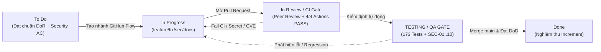
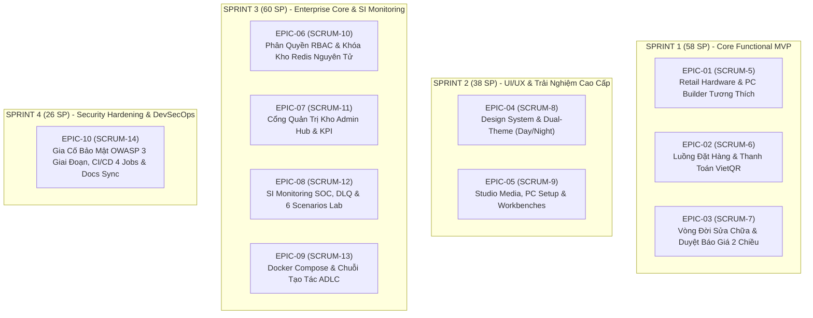
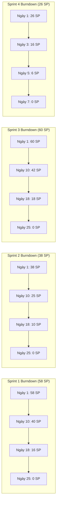

# CyberRig - Báo Cáo Toàn Diện 4 Sprint Theo Quy Trình Scrum Trên Jira

> **Hệ thống**: CyberRig Ecosystem (PC Hardware Retail, Compatibility Builder, Repair Tracking, Security Hardening & SI Monitoring Lab)  
> **Mô hình quản lý**: Agile / Scrum trên Jira Cloud Team-managed (**Project Key: `SCRUM`** — `https://minhlocle112.atlassian.net/jira/software/projects/SCRUM/boards/1`) kết hợp GitHub Flow, DevSecOps CI/CD & Vòng đời Tác tử ADLC  
> **Đội ngũ thực hiện**: 5 thành viên (`TV 1`–`TV 5`, phân bổ đều 20% / thành viên — gắn nhãn `tv-1`..`tv-5` trên Jira để Leader chọn Assignee tương ứng)  
> **Công cụ thực thi**: Jira Software Cloud (`SCRUM-4`..`SCRUM-110` — 107 issues) + GitHub (`https://github.com/itsminloc/Cyberig`) + GitHub Actions  
> **Tổng chu kỳ thực hiện**: 5 Sprint (3 Sprint nghiệp vụ chính + Sprint 4 Security Hardening + Sprint 5 SE445 Omnichannel, AI POS & Executive BI)  
> **Tổng nỗ lực hoàn thành**: **208 Story Points (11 Epics, 42 User Stories, 54 Technical Sub-tasks)**  
> **Tỷ lệ hoàn thành (Success Rate)**: **100% Definition of Done (DoD), 182/182 Automated Tests Passed (26 Spec Files / 28 Suites), 4/4 GitHub Actions DevSecOps Jobs Passed**

---

## MỤC LỤC TÀI LIỆU

1. [PHẦN 1: THIẾT LẬP DỰ ÁN & QUY CHUẨN TRÊN JIRA SOFTWARE](#phần-1-thiết-lập-dự-án--quy-chuẩn-trên-jira-software)
   - 1.1. Cấu hình Dự án (Project Configuration)
   - 1.2. Phân loại Issue Types & Cấu trúc Phân cấp (Issue Hierarchy)
   - 1.3. Quy trình Trạng thái Jira (Scrum Workflow Scheme)
   - 1.4. Thiết lập Components, Labels & Custom Fields
   - 1.5. Thang đo Fibonacci & Tiêu chuẩn DoR / DoD
2. [PHẦN 2: PHÂN RÃ MASTER PRODUCT BACKLOG TRÊN JIRA](#phần-2-phân-rã-master-product-backlog-trên-jira)
   - 2.1. Danh mục 10 Epics Sản phẩm (`SCRUM-5`–`SCRUM-14`)
   - 2.2. Bảng 37 User Stories chi tiết (`SCRUM-15`–`SCRUM-51`) kèm Story Points & Trạng thái
   - 2.3. Chuẩn Phân Rã Technical Sub-tasks (`SCRUM-4`, `SCRUM-52`–`SCRUM-94`)
3. [PHẦN 3: BÁO CÁO CHI TIẾT TỪNG SPRINT (JIRA SPRINT REPORTS)](#phần-3-báo-cáo-chi-tiết-từng-sprint-jira-sprint-reports)
   - 3.1. BÁO CÁO SPRINT 1: Core Value Functional MVP (58 SP)
   - 3.2. BÁO CÁO SPRINT 2: UI/UX & Trải Nghiệm Tương Tác Cao Cấp (38 SP)
   - 3.3. BÁO CÁO SPRINT 3: Enterprise Core, Bảo Mật & SI Monitoring Testing Lab (60 SP)
   - 3.4. BÁO CÁO SPRINT 4: Security Hardening (OWASP Top 10) & DevSecOps Release (26 SP)
4. [PHẦN 4: PHÂN TÍCH CÁC CHỈ SỐ AGILE ĐỊNH LƯỢNG TRÊN JIRA](#phần-4-phân-tích-các-chỉ-số-agile-định-lượng-trên-jira)
   - 4.1. Biểu đồ Vận tốc (Velocity Chart)
   - 4.2. Phân tích Biểu đồ Burndown qua 3 Sprint (Burndown Charts)
   - 4.3. Biểu đồ Luồng Tích Lũy (Cumulative Flow Diagram - CFD)
   - 4.4. Đánh giá Chất lượng & Kiểm toán Chuỗi Tạo tác ADLC
5. [PHẦN 5: CẨM NANG THAO TÁC THỰC CHIẾN TRÊN GIAO DIỆN JIRA](#phần-5-cẩm-nang-thao-tác-thực-chiến-trên-giao-diện-jira)
   - 5.1. Các bước vận hành một Sprint từ Planning đến Complete
   - 5.2. Hướng dẫn thiết lập Jira Dashboard chuyên nghiệp
6. [PHẦN 6: KỊCH BẢN THUYẾT TRÌNH BẢO VỆ SPRINT (PRESENTATION SCRIPT)](#phần-6-kịch-bản-thuyết-trình-bảo-vệ-sprint-presentation-script)

---

# PHẦN 1: THIẾT LẬP DỰ ÁN & QUY CHUẨN TRÊN JIRA SOFTWARE

Để vận hành chuẩn xác theo Scrum trên Jira, toàn bộ cấu hình dự án CyberRig được thiết lập theo các tiêu chuẩn quốc tế:

### 1.1. Cấu hình Dự án (Project Configuration)
- **URL Không gian Jira Cloud**: `https://minhlocle112.atlassian.net/jira/software/projects/SCRUM/boards/1`
- **Tên dự án**: `My Software Team` *(CyberRig — PC Hardware & Repair Ecosystem)*
- **Project Key**: `SCRUM` (91 issues thực tế mang mã `SCRUM-4`..`SCRUM-94`, đồng thời giữ song song mã tham chiếu Backlog `CRIG-US-01`..`CRIG-US-38` ở Summary từng issue)
- **Loại dự án (Project Type)**: `Team-managed software project` (Jira Cloud Free — Board `id: 1`)
- **Mẫu dự án (Project Template)**: `Scrum` (Quản lý theo Backlog, 4 Completed Sprints `id: 4..7`, Burndown, Velocity)
- **Site Admin / Reporter**: `Minh Loc` (`Assignee` mặc định `Unassigned` kèm Labels `tv-1`..`tv-5` để nhóm trưởng gán thành viên `TV 1`–`TV 5` trực tiếp trên UI)

---

### 1.2. Phân loại Issue Types & Cấu trúc Phân cấp (Issue Hierarchy)
Jira áp dụng mô hình phân cấp 3 tầng chuẩn Scrum:

```
TẦNG 1: EPICS (Sáng kiến / Khối tính năng lớn)
   └── TẦNG 2: USER STORIES / BUGS (Giá trị nghiệp vụ bàn giao được trong 1 Sprint)
          └── TẦNG 3: SUB-TASKS (Công việc kỹ thuật cụ thể: FE, BE, DB, DevOps, QA)
```

| Issue Type | Biểu tượng Jira | Mục đích sử dụng trong CyberRig |
| :--- | :---: | :--- |
| **Epic** | Tím (Sét / Tấm khiên) | 10 khối năng lực lớn (`SCRUM-5`–`SCRUM-14`): Hardware Builder, VietQR Checkout, Repair Lifecycle, Dual-Theme, RBAC, Admin Hub, SI Monitoring, Docker/ADLC, Security Hardening & DevSecOps. |
| **Story** | Xanh lục (Bookmark) | Yêu cầu người dùng theo định dạng: *"Là một [User], tôi muốn [Tính năng], để [Mục đích]"*. Ước lượng bằng Story Points. |
| **Sub-task** | Xanh dương (Checkbox) | Phân rã kỹ thuật của Story: Code API, tạo CSS, viết Unit Test, Docker config (ước lượng theo giờ hoặc checklist). |
| **Bug** | Đỏ (Con bọ) | Sự cố sai khác giữa mã nguồn và Tiêu chí chấp nhận (AC) phát hiện trong Sprint Review hoặc Testing Lab. |

---

### 1.3. Quy trình Trạng thái Jira (Scrum Workflow Scheme gắn DevSecOps CI Gate)
CyberRig áp dụng quy trình kiểm soát 5 bước chất lượng khép kín, ánh xạ trực tiếp lên **Board `1` (4 cột thực tế trên Jira Cloud Team-managed `SCRUM`: `To Do` $\rightarrow$ `In Progress` $\rightarrow$ `In Review` $\rightarrow$ `Done`)**:



- **To Do**: User Story đã nằm trong Sprint Backlog, thỏa mãn Definition of Ready (DoR) kèm Security Impact Check và gắn nhãn phân công (`tv-1`–`tv-5`).
- **In Progress**: Thành viên tách nhánh theo quy ước GitHub Flow gắn mã Jira (`feature/SCRUM-XX-...`, `sec/SCRUM-XX-...`, `fix/SCRUM-XX-...`, `docs/SCRUM-XX-...`, tương thích mã Backlog `CRIG-US-XX`) và commit theo chuẩn Conventional Commits.
- **In Review (Code Review & CI Gate)**: Đã mở Pull Request vào `main`; Peer Code Review (Clean Code/SRP `<= 300` dòng) kết hợp **GitHub Actions** (`.github/workflows/security-scan.yml`) chạy 4 job (`TypeScript & 173 Tests`, `Gitleaks OSS`, `Semgrep OSS`, `Trivy CVE`).
- **Testing / QA Gate (trước khi chuyển Done)**: Bắt buộc vượt qua 24 file spec (26 suites / 173 test cases qua `scripts/run-tests.mjs`), 10 ca bảo mật `SEC-01..SEC-10`, 6 kịch bản Testing Lab và nghiệm thu trên môi trường Docker (trên Jira Team-managed có thể giữ kiểm định tại cổng `In Review` hoặc bật thêm cột `Testing / QA` trong Board Settings).
- **Done**: Pull Request đã Merge sạch vào nhánh `main`, đạt 100% Definition of Done (DoD) và được Product Owner nghiệm thu tại phiên Sprint Review.

---

### 1.4. Thiết lập Labels Phân Hệ, Phân Công & Custom Fields
#### A. Danh sách 7 Nhãn Phân Hệ (`cmp-*` Labels trên Team-managed Jira `SCRUM`):
*(Do Jira Cloud Team-managed không dùng trường Components rời của Company-managed, 7 phân hệ dưới đây được đồng bộ thành **Jira Labels** để lọc theo module ngay trên Board/Backlog)*:
- `cmp-hardware-builder`: Danh mục linh kiện, thuật toán kiểm tra Socket & TDP, thanh tiến trình tương thích.
- `cmp-checkout-orders`: Giỏ hàng Split-View, cổng thanh toán VietQR Napas 247, Price Snapshot & Webhook HMAC-SHA256.
- `cmp-repair-tracking`: State Machine 8 trạng thái, tra cứu bảo hành (Rate Limit & PII Masking), duyệt báo giá 2 chiều.
- `cmp-portals-ui`: Giao diện Dual-Theme (Day/Night), Kỹ thuật viên Workbench, Customer Hub, Setup Equipments.
- `cmp-admin-security`: Phân quyền RBAC 3 vai trò, `HttpOnly` Refresh Rotation, Redis `jti` Blacklist, 2FA TOTP, Anti-IDOR, Redis Atomic Stock Lock, Admin Control Center.
- `cmp-si-monitoring`: Bảng Dark SOC Mission Control (`ADMIN` RBAC), Telemetry SSE (Single-use Ticket), Audit Logs, Dead Letter Queue (DLQ), 6 Kịch bản Lab, Docker.
- `cmp-devsecops-ci`: Pipeline GitHub Actions 4-Job (`security-scan.yml`), `.gitleaks.toml`, Test Runner đa nền tảng (`scripts/run-tests.mjs`), Sơ đồ UML & Tài liệu dự án.

#### B. Labels Bổ Sung & Custom Fields trên Jira `SCRUM`:
- **Labels phân công thành viên & Sprint:** `tv-1`..`tv-5`, `sprint-1`..`sprint-4`, kèm nhãn chuyên đề `security-hardening`, `owasp-top-10`, `devsecops`, `ci-cd`, `mfa-2fa`, `audit-log`.
- **Story Points**: Trường số học `Story point estimate` (`customfield_10016`, dãy Fibonacci $\le 8$ SP).
- **Acceptance Criteria**: Ghi chi tiết định dạng Gherkin (bao gồm Security AC) và dòng định danh `Thành viên phụ trách (trên báo cáo): TV X` trong phần Description từng Story.
- **Development Panel (GitHub for Jira)**: Liên kết Branch, Smart Commits (`SCRUM-XX` / `CRIG-US-XX`), Pull Request và trạng thái Build CI từ `https://github.com/itsminloc/Cyberig`.

---

### 1.5. Thang đo Fibonacci & Tiêu chuẩn DoR / DoD

#### A. Thang đo Story Points (Fibonacci):
- **1 SP**: Trivial tweak (Đổi text nút, sửa CSS màu viền, biến môi trường).
- **2 SP**: Minor feature/fix (Thêm 1 route đơn giản, bổ sung input validator, unit test helper, đồng bộ tài liệu).
- **3 SP**: Standard feature (Trang hiển thị kèm responsive, bộ lọc 1 tiêu chí, preset config).
- **5 SP**: Complex feature (Thuật toán kiểm tra Socket, State Machine chuyển trạng thái, Webhook HMAC-SHA256, 2FA TOTP, `HttpOnly` Rotation).
- **8 SP**: High complexity / Multi-layer (Khóa kho Redis Lua script, Bảng SOC Monitoring SSE, Checkout flow).
- **13+ SP**: Quá lớn $\rightarrow$ Bắt buộc phân rã thành các Stories nhỏ hơn trước khi đưa vào Sprint Planning.

#### B. Checklist Definition of Ready (DoR) trên Jira:
- [x] Có User Story rõ ràng ngữ cảnh: *"Là một... tôi muốn... để..."*.
- [x] Có tối thiểu 2-4 Tiêu chí chấp nhận (AC) viết bằng định dạng Gherkin (*Given - When - Then*).
- [x] Đã được chấm điểm Story Points ($\le 8$ SP) và phân công thành viên (`TV 1`–`TV 5`).
- [x] **Security Impact Checked**: Xác định rõ role RBAC (`Guest`, `CUSTOMER`, `TECHNICIAN`, `ADMIN`, `VietQR Webhook`), Anti-IDOR và PII Masking.
- [x] Đã giải tỏa toàn bộ phụ thuộc bên ngoài (Mock API sẵn sàng nếu cần).

#### C. Checklist Definition of Done (DoD) trên Jira:
- [x] **Clean Code & SRP**: File $\le 300$ dòng, tách biệt fixtures, mocks khỏi business service.
- [x] **Type Safety**: 100% TypeScript Strict Mode, `npx tsc --noEmit` hoàn thành với mã thoát `0`.
- [x] **Automated Testing**: 100% test suites vượt qua qua `npm test` (`scripts/run-tests.mjs` — 24 spec files / 26 suites / 173 tests).
- [x] **DevSecOps CI Gate (4/4 PASS)**: Pull Request vượt qua cả 4 job GitHub Actions (TS+Tests, Gitleaks, Semgrep OSS, Trivy CVE) và `npm audit --omit=dev --audit-level=high` đạt `0 vulnerabilities`.
- [x] **Design System**: Chuẩn bo góc 0px, font kỹ thuật, Dual-Theme đạt độ tương phản WCAG 2.1 AA.
- [x] **Docker & Audit Traceability**: Chạy ổn định trên Docker Compose và liên kết commit/PR vào Issue Jira `SCRUM` (`SCRUM-4`..`SCRUM-94`).

---

# PHẦN 2: PHÂN RÃ MASTER PRODUCT BACKLOG TRÊN JIRA

### 2.1. Danh mục 10 Epics Sản Phẩm (`SCRUM-5`–`SCRUM-14`)



---

### 2.2. Bảng 37 User Stories Chi Tiết Trên Jira (Product Backlog Items — `SCRUM-15`..`SCRUM-51`)

| Jira Key | Mã Backlog | Thuộc Epic | User Story Tóm Tắt | MoSCoW | SP | Sprint | Trạng Thái |
| :--- | :--- | :--- | :--- | :---: | :---: | :---: | :---: |
| `SCRUM-42` | **CRIG-US-01** | EPIC-01 | Tra cứu & Lọc linh kiện phần cứng đa tiêu chí (`/hardware`) | Must | 5 | Sprint 1 | Done |
| `SCRUM-15` | **CRIG-US-02** | EPIC-01 | Thuật toán thẩm định tương thích 4 Rules (Socket, RAM, Clearance, Power) | Must | 8 | Sprint 1 | Done |
| `SCRUM-16` | **CRIG-US-03** | EPIC-01 | Tính toán tổng công suất TDP và khuyến nghị bộ nguồn PSU biên an toàn $\ge 25\%$ | Must | 3 | Sprint 1 | Done |
| `SCRUM-17` | **CRIG-US-04** | EPIC-01 | Giao diện PC Builder 8 khoang & Thanh tiến trình tương thích (0–100%) | Must | 5 | Sprint 1 | Done |
| `SCRUM-18` | **CRIG-US-05** | EPIC-01 | Chọn nhanh cấu hình gợi ý định sẵn theo ngân sách (Preset Tiers 1-click) | Should | 3 | Sprint 1 | Done |
| `SCRUM-19` | **CRIG-US-06** | EPIC-02 | Chuyển cấu hình từ PC Builder sang trang Checkout Split-View | Must | 5 | Sprint 1 | Done |
| `SCRUM-20` | **CRIG-US-07** | EPIC-02 | Tạo đơn hàng và chụp ảnh giá cố định (Price Snapshot) tại thời điểm đặt | Must | 5 | Sprint 1 | Done |
| `SCRUM-21` | **CRIG-US-08** | EPIC-02 | Cổng thanh toán tự động VietQR Napas 247 động kèm đếm ngược 15 phút | Must | 5 | Sprint 1 | Done |
| `SCRUM-22` | **CRIG-US-09** | EPIC-02 | Tra cứu trạng thái đơn hàng công khai theo mã đơn (`/orders/:code`) | Should | 3 | Sprint 1 | Done |
| `SCRUM-23` | **CRIG-US-10** | EPIC-03 | Finite State Machine kiểm soát vòng đời phiếu sửa chữa 8 trạng thái | Must | 5 | Sprint 1 | Done |
| `SCRUM-24` | **CRIG-US-11** | EPIC-03 | Cổng tra cứu tiến độ bảo hành công khai kèm Stepper 6 chặng (`/repair-tracking`) | Must | 5 | Sprint 1 | Done |
| `SCRUM-25` | **CRIG-US-12** | EPIC-03 | Khách hàng phê duyệt hoặc từ chối báo giá sửa chữa 2 chiều trực tuyến | Must | 3 | Sprint 1 | Done |
| `SCRUM-26` | **CRIG-US-13** | EPIC-03 | Kỹ thuật viên lập biên bản chẩn đoán & báo giá vật tư + công thợ | Must | 3 | Sprint 1 | Done |
| `SCRUM-27` | **CRIG-US-14** | EPIC-04 | Chuẩn hóa Design System v2.1 Cyberpunk (bo góc 0px, font kỹ thuật, viền HUD) | Must | 5 | Sprint 2 | Done |
| `SCRUM-28` | **CRIG-US-15** | EPIC-04 | Hệ thống Dual-Theme (Day / Night Mode) tức thì 60 FPS đạt chuẩn WCAG 2.1 AA | Must | 5 | Sprint 2 | Done |
| `SCRUM-29` | **CRIG-US-16** | EPIC-04 | Khắc phục lem mờ bóng đổ Day Theme & Tối ưu hiệu năng render 60 FPS | Should | 3 | Sprint 2 | Done |
| `SCRUM-30` | **CRIG-US-17** | EPIC-05 | Bộ hình ảnh Studio thực tế cho 8 nhóm linh kiện (0% placeholder) | Must | 5 | Sprint 2 | Done |
| `SCRUM-31` | **CRIG-US-18** | EPIC-05 | Trang danh mục PC Setup & Thiết bị không gian làm việc (`/equipments`) | Should | 5 | Sprint 2 | Done |
| `SCRUM-32` | **CRIG-US-19** | EPIC-05 | Bàn làm việc Kỹ thuật viên (Technician Workbench) Split-View chia hàng đợi | Must | 5 | Sprint 2 | Done |
| `SCRUM-33` | **CRIG-US-20** | EPIC-05 | Cổng thông tin khách hàng tập trung (Customer Unified Hub `#dashboard`) | Should | 5 | Sprint 2 | Done |
| `SCRUM-34` | **CRIG-US-21** | EPIC-05 | Phản hồi vi tương tác (Micro-interactions) & Nút "+ Chọn" đồng bộ nhanh | Could | 3 | Sprint 2 | Done |
| `SCRUM-35` | **CRIG-US-22** | EPIC-05 | Bộ kiểm thử giao diện UI specs & tương thích đa độ phân giải | Should | 2 | Sprint 2 | Done |
| `SCRUM-43` | **CRIG-US-23** | EPIC-06 | Phân quyền truy cập RBAC 3 vai trò (`CUSTOMER`, `TECHNICIAN`, `ADMIN`) & Route Guards | Must | 5 | Sprint 3 | Done |
| `SCRUM-44` | **CRIG-US-24** | EPIC-06 | Khóa kho nguyên tử Redis Atomic Stock Reservation (Lua Script, TTL 15m) | Must | 8 | Sprint 3 | Done |
| `SCRUM-45` | **CRIG-US-25** | EPIC-07 | Cổng Quản trị kho hàng Admin Control Center (`#admin`: CRUD, Restock, Soft Delete) | Must | 8 | Sprint 3 | Done |
| `SCRUM-46` | **CRIG-US-26** | EPIC-07 | Telemetry tồn kho & Cảnh báo linh kiện sắp hết hàng (Low Stock Alert $\le 3$) | Should | 5 | Sprint 3 | Done |
| `SCRUM-47` | **CRIG-US-27** | EPIC-08 | Bảng điều khiển giám sát Dark SOC Mission Control Dual-Mode (`/admin-monitoring/`) | Must | 8 | Sprint 3 | Done |
| `SCRUM-48` | **CRIG-US-28** | EPIC-08 | Động cơ Telemetry In-Memory Ring Buffer & Stream Server-Sent Events (SSE) | Must | 5 | Sprint 3 | Done |
| `SCRUM-49` | **CRIG-US-29** | EPIC-08 | Dead Letter Queue (DLQ) Inspector & Cơ chế Phát lại (Replay) Poison Message | Must | 5 | Sprint 3 | Done |
| `SCRUM-50` | **CRIG-US-30** | EPIC-08 | Phòng Lab 6 kịch bản kiểm thử tích hợp tự động & `monitoring.spec.ts` (9/9 passed) | Must | 8 | Sprint 3 | Done |
| `SCRUM-51` | **CRIG-US-31** | EPIC-09 | Đóng gói cụm Docker Compose 4 containers, Nginx Gateway & Chuẩn hóa Clean Code ADLC | Must | 8 | Sprint 3 | Done |
| `SCRUM-36` | **CRIG-US-33** | EPIC-10 | Gia cố phiên & Token (`HttpOnly` Cookie Rotation, Reuse Detection, Redis `jti` Blacklist & Lockout) | Must | 5 | Sprint 4 | Done |
| `SCRUM-37` | **CRIG-US-34** | EPIC-10 | Anti-IDOR (`?phone=`), PII Masking & Khóa RBAC `ADMIN` cho SOC + Single-use SSE Ticket | Must | 5 | Sprint 4 | Done |
| `SCRUM-38` | **CRIG-US-35** | EPIC-10 | Xác thực Webhook Thanh toán VietQR bằng `HMAC-SHA256` (`X-CyberRig-Signature`) & Anti-Replay | Must | 5 | Sprint 4 | Done |
| `SCRUM-39` | **CRIG-US-36** | EPIC-10 | Bảo mật 2 lớp MFA/2FA TOTP (RFC 6238) & Nhật ký Kiểm toán bất biến (`audit_logs`) | High | 5 | Sprint 4 | Done |
| `SCRUM-40` | **CRIG-US-37** | EPIC-10 | Pipeline DevSecOps 4-Job trên GitHub Actions (TS+173 Tests, Gitleaks, Semgrep, Trivy) & Test Runner | Must | 4 | Sprint 4 | Done |
| `SCRUM-41` | **CRIG-US-38** | EPIC-10 | Đồng bộ Sơ đồ Use Case v2.1 (Tác nhân hệ thống VietQR Webhook) & Tài liệu Bảo mật / Scrum | Should | 2 | Sprint 4 | Done |

*(Tổng điểm Backlog: **182 Story Points** phân bổ qua **4 Sprint** cho đội ngũ 5 thành viên `TV 1`–`TV 5`).*

---

# PHẦN 3: BÁO CÁO CHI TIẾT TỪNG SPRINT (JIRA SPRINT REPORTS)

---

## 3.1. BÁO CÁO SPRINT 1: Core Value Functional MVP (58 SP)

### A. Thông Tin Tổng Quan Sprint 1 trên Jira
- **Sprint Name**: `CRIG Sprint 1: Core Value MVP`
- **Sprint Goal**: Xây dựng toàn bộ các luồng nghiệp vụ tạo giá trị trực tiếp cho người dùng: Duyệt phần cứng, Tự phối PC Builder thẩm định Socket/TDP thời gian thực, Chuyển giỏ hàng sang Checkout thanh toán VietQR động Napas 247, và Tra cứu tiến độ sửa chữa kèm duyệt báo giá 2 chiều trực tuyến.
- **Thời gian thực hiện**: 25 ngày làm việc (~3.5 tuần).
- **Cam kết ban đầu (Committed SP)**: 58 SP.
- **Thực tế hoàn thành (Completed SP)**: **58 SP (100%)**.
- **Scope Change (Biến động phạm vi)**: 0 SP (Không có scope creep).

### B. Bảng Issues Hoàn Thành Trong Sprint 1 (Jira Sprint Report Table)

| Jira Key | Mã Story | Tóm Tắt Nhiệm Vụ | Phân Loại | Phụ Trách (Label) | SP | DoD Verified |
| :--- | :---: | :--- | :---: | :---: | :---: | :---: |
| `SCRUM-42` | `CRIG-US-01` | Giao diện danh mục linh kiện & Bộ lọc đa tiêu chí (`/hardware`) | FE | TV 2 (`tv-2`) | 5 | Done / Passed |
| `SCRUM-15` | `CRIG-US-02` | Rule Engine thẩm định tương thích 4 Rules (Socket, RAM, Clearance, Power) | BE | TV 3 (`tv-3`) | 8 | Done / Passed |
| `SCRUM-16` | `CRIG-US-03` | Tính toán công suất nguồn PSU & TDP margin $\ge 25\%$ | BE | TV 3 (`tv-3`) | 3 | Done / Passed |
| `SCRUM-17` | `CRIG-US-04` | Giao diện PC Builder 8 khoang & Thanh tương thích 0–100% | FE | TV 2 (`tv-2`) | 5 | Done / Passed |
| `SCRUM-18` | `CRIG-US-05` | Bộ cấu hình gợi ý định sẵn 1-click (Preset Tiers) | FE/Data | TV 2 (`tv-2`) | 3 | Done / Passed |
| `SCRUM-19` | `CRIG-US-06` | Luồng chuyển giỏ PC Builder sang Checkout Split-View | FE | TV 1 (`tv-1`) | 5 | Done / Passed |
| `SCRUM-20` | `CRIG-US-07` | REST API Tạo đơn hàng & Lưu cố định Price Snapshot | BE | TV 4 (`tv-4`) | 5 | Done / Passed |
| `SCRUM-21` | `CRIG-US-08` | Cổng thanh toán VietQR Napas 247 & Countdown 15m | FE/BE | TV 1 (`tv-1`) | 5 | Done / Passed |
| `SCRUM-22` | `CRIG-US-09` | Trang tra cứu đơn hàng công khai (`/orders/:code`) | FE | TV 1 (`tv-1`) | 3 | Done / Passed |
| `SCRUM-23` | `CRIG-US-10` | Finite State Machine vòng đời phiếu sửa chữa 8 trạng thái | BE | TV 3 (`tv-3`) | 5 | Done / Passed |
| `SCRUM-24` | `CRIG-US-11` | Cổng tra cứu bảo hành công khai Stepper 6 chặng (`/repair-tracking`) | FE | TV 2 (`tv-2`) | 5 | Done / Passed |
| `SCRUM-25` | `CRIG-US-12` | Khách hàng phê duyệt hoặc từ chối báo giá 2 chiều trực tuyến | FE/BE | TV 3 (`tv-3`) | 3 | Done / Passed |
| `SCRUM-26` | `CRIG-US-13` | Kỹ thuật viên lập biên bản chẩn đoán & báo giá vật tư + công thợ | FE/BE | TV 3 (`tv-3`) | 3 | Done / Passed |

### C. Phân Tích Jira Burndown Chart Sprint 1
- **Đường hướng dẫn lý tưởng (Guideline)**: Giảm đều từ 58 SP ở ngày 1 về 0 SP ở ngày 25 (tốc độ tiêu thụ trung bình ~2.32 SP/ngày).
- **Đường thực tế (Actual Remaining Work)**:
  - *Ngày 1 - 7*: Tiến độ burn tương đối chậm do nhóm tập trung dựng Core Data Models, PostgreSQL schema và Interface contracts.
  - *Ngày 8 - 16*: Burn mạnh 24 SP khi Rule Engine Socket/TDP (`SCRUM-15`, `SCRUM-16`), danh mục (`SCRUM-42`) và giao diện Builder (`SCRUM-17`, `SCRUM-18`) hoàn thành.
  - *Ngày 17 - 23*: Burn tiếp 28 SP khi hoàn tất Checkout/VietQR (`SCRUM-19`–`SCRUM-22`) và vòng đời phiếu sửa chữa + duyệt báo giá (`SCRUM-23`–`SCRUM-26`).
  - *Ngày 24 - 25*: Chạm mốc 0 SP sau khi chạy toàn bộ test integration và nghiệm thu Acceptance Criteria.

### D. Nghiệm Thu Sản Phẩm & Trình Diễn (Sprint Review / Demo)
- **Kịch bản 1 (PC Builder)**: Chọn CPU `Ryzen 7 7800X3D` (AM5) ghép cùng Mainboard `Z790` (LGA1700) $\rightarrow$ Lập tức cảnh báo xung đột Socket màu đỏ, khóa nút mua. Đổi sang bo mạch AM5 $\rightarrow$ Thanh tiến trình đạt 100%, khuyến nghị nguồn PSU chuẩn xác.
- **Kịch bản 2 (Checkout VietQR)**: Chuyển cấu hình sang `/checkout`, nhập thông tin $\rightarrow$ Sinh mã VietQR động chứa số tài khoản, mã đơn `ORD-XXXXXX`, số tiền chính xác và bộ đếm ngược 15:00.
- **Kịch bản 3 (Duyệt báo giá sửa chữa)**: Nhập mã phiếu `TK-1001` tại `/repair-tracking` $\rightarrow$ Stepper 6 chặng hiển thị ở bước `QUOTED`, bấm `[ ĐỒNG Ý SỬA CHỮA ]` $\rightarrow$ Trạng thái chuyển ngay sang `REPAIRING`.

### E. Cải Tiến Quy Trình (Sprint Retrospective)
- **What Went Well**: Thuật toán Rule Engine và State Machine phân tách module rành mạch, kiểm thử tự động đạt độ phủ cao ngay từ Sprint 1.
- **What Could Be Improved**: Giao diện ban đầu vẫn dùng ảnh placeholder và chỉ có 1 theme tối, cần nâng cấp nhận diện thương hiệu công nghiệp ở Sprint 2.
- **Action Item**: Bổ sung bộ Design Tokens và chụp bộ ảnh Studio thực tế cho Sprint 2 (Phụ trách: TV 1 & TV 2).

---

## 3.2. BÁO CÁO SPRINT 2: UI/UX & Trải Nghiệm Tương Tác Cao Cấp (38 SP)

### A. Thông Tin Tổng Quan Sprint 2 trên Jira
- **Sprint Name**: `CRIG Sprint 2: UI/UX Excellence`
- **Sprint Goal**: Nâng tầm phần nhìn và cảm giác tương tác đạt chuẩn Tech Industrial: Chuẩn hóa Design System Cyberpunk (bo góc 0px, font kỹ thuật, viền HUD), hoàn thiện hệ thống Dual-Theme (Day/Night) đạt chuẩn WCAG 2.1 AA, nạp bộ ảnh Studio thực tế cho 8 loại linh kiện, bổ sung 20 thiết bị Setup ngoại vi (`/equipments`), và hoàn thiện Technician Workbench cùng Customer Hub.
- **Thời gian thực hiện**: 25 ngày làm việc (~3.5 tuần).
- **Cam kết ban đầu (Committed SP)**: 38 SP.
- **Thực tế hoàn thành (Completed SP)**: **38 SP (100%)**.

### B. Bảng Issues Hoàn Thành Trong Sprint 2 (Jira Sprint Report Table)

| Jira Key | Mã Story | Tóm Tắt Nhiệm Vụ | Phân Loại | Phụ Trách (Label) | SP | DoD Verified |
| :--- | :---: | :--- | :---: | :---: | :---: | :---: |
| `SCRUM-27` | `CRIG-US-14` | Chuẩn hóa Design System v2.1 Cyberpunk (bo góc 0px, viền HUD) | UI/UX | TV 2 (`tv-2`) | 5 | Done / Passed |
| `SCRUM-28` | `CRIG-US-15` | Hệ thống Dual-Theme (Day / Night Mode) chuẩn WCAG 2.1 AA | FE/Style | TV 2 (`tv-2`) | 5 | Done / Passed |
| `SCRUM-29` | `CRIG-US-16` | Khắc phục lem bóng mờ Day Theme & Tối ưu 60 FPS | UI-Polish | TV 2 (`tv-2`) | 3 | Done / Passed |
| `SCRUM-30` | `CRIG-US-17` | Nạp bộ ảnh Studio thực tế 8 nhóm linh kiện (0% placeholder) | Media | TV 1 (`tv-1`) | 5 | Done / Passed |
| `SCRUM-31` | `CRIG-US-18` | Trang PC Setup & Thiết bị không gian làm việc (`/equipments`) | FE | TV 2 (`tv-2`) | 5 | Done / Passed |
| `SCRUM-32` | `CRIG-US-19` | Bàn làm việc Kỹ thuật viên (Technician Workbench) Split-View | FE | TV 2 (`tv-2`) | 5 | Done / Passed |
| `SCRUM-33` | `CRIG-US-20` | Cổng thông tin khách hàng tập trung (Customer Hub `#dashboard`) | FE | TV 1 (`tv-1`) | 5 | Done / Passed |
| `SCRUM-34` | `CRIG-US-21` | Tinh chỉnh Micro-interactions (âm thanh/hiệu ứng, nút "+ Chọn") | FE | TV 2 (`tv-2`) | 3 | Done / Passed |
| `SCRUM-35` | `CRIG-US-22` | Bộ kiểm thử giao diện UI specs & tương thích đa độ phân giải | QA | TV 5 (`tv-5`) | 2 | Done / Passed |

### C. Phân Tích Jira Burndown Chart Sprint 2
- **Đặc điểm Burndown**: Tốc độ tiêu thụ Story Points rất đồng đều và mượt mà. Nhóm giải quyết tuần tự các block CSS tokens, sau đó áp dụng đồng loạt lên các pages.
- **Điểm nhấn kỹ thuật**: Tại ngày 14, phát hiện lỗi lem mờ bóng đổ trên Day Theme (`SCRUM-29` / `CRIG-US-16`), nhóm xử lý dứt điểm trong 2 ngày mà không ảnh hưởng tới tiến độ chung.

### D. Nghiệm Thu Sản Phẩm & Trình Diễn (Sprint Review / Demo)
- Chuyển đổi Day/Night Mode diễn ra tức thì (<16ms, không giật lag). Màu văn bản và nền đạt tỷ lệ tương phản tối thiểu 4.5:1 (WCAG 2.1 AA).
- Trang `/equipments` trưng bày 20 thiết bị công thái học sắc nét.
- Toàn bộ ảnh placeholder trên catalog đã được thay thế 100% bằng ảnh Studio cao cấp.
- Technician Workbench phân tách rõ ràng 2 cột: danh sách hàng đợi theo trạng thái và khung chẩn đoán lỗi tại quầy.

### E. Cải Tiến Quy Trình (Sprint Retrospective)
- **What Went Well**: Trải nghiệm giao diện được PO đánh giá vượt mong đợi; tốc độ xử lý UI mượt mà 60 FPS.
- **What Could Be Improved**: Cần sớm tích hợp lớp bảo mật phân quyền RBAC và giám sát vận hành thời gian thực để sẵn sàng cho môi trường production.
- **Action Item**: Thiết kế kiến trúc In-Memory Telemetry và Redis Lua Script trước khi bắt đầu Sprint 3 (Phụ trách: TV 3, TV 4, TV 5).

---

## 3.3. BÁO CÁO SPRINT 3: Enterprise Core, Bảo Mật & SI Monitoring Testing Lab (60 SP)

### A. Thông Tin Tổng Quan Sprint 3 trên Jira
- **Sprint Name**: `CRIG Sprint 3: Enterprise Core & Monitoring`
- **Sprint Goal**: Hoàn thiện toàn bộ hạ tầng chiều sâu, bảo mật, quản trị nâng cao và công cụ giám sát vận hành: Phân quyền RBAC 3 vai trò (`CUSTOMER`, `TECHNICIAN`, `ADMIN`), Bộ đệm khóa tồn kho nguyên tử Redis Atomic Stock Reservation (loại trừ bán khống Zero Oversell), Cổng Admin Hub & KPI, Bảng điều khiển giám sát SI Monitoring phong cách Dark SOC Mission Control (SSE Telemetry, Dead Letter Queue & Replay, 6 Kịch bản Lab), Cụm Docker Compose và chuẩn hóa tạo tác ADLC.
- **Thời gian thực hiện**: 25 ngày làm việc (~3.5 tuần).
- **Cam kết ban đầu (Committed SP)**: 60 SP.
- **Thực tế hoàn thành (Completed SP)**: **60 SP (100%)**.

### B. Bảng Issues Hoàn Thành Trong Sprint 3 (Jira Sprint Report Table)

| Jira Key | Mã Story | Tóm Tắt Nhiệm Vụ | Phân Loại | Phụ Trách (Label) | SP | DoD Verified |
| :--- | :---: | :--- | :---: | :---: | :---: | :---: |
| `SCRUM-43` | `CRIG-US-23` | Phân quyền RBAC 3 vai trò (`CUSTOMER`, `TECHNICIAN`, `ADMIN`) & Route Guards | Core/Sec | TV 4 (`tv-4`) | 5 | Done / Passed |
| `SCRUM-44` | `CRIG-US-24` | Khóa tồn kho nguyên tử Redis Lua Script (Zero Oversell, TTL 15m) | Core/DB | TV 3 (`tv-3`) | 8 | Done / Passed |
| `SCRUM-45` | `CRIG-US-25` | Cổng Quản trị kho Admin Control Center (`#admin`: CRUD, Restock, Soft Delete) | BE/FE | TV 4 (`tv-4`) | 8 | Done / Passed |
| `SCRUM-46` | `CRIG-US-26` | Telemetry tồn kho & Cảnh báo linh kiện sắp hết (Low Stock $\le 3$) | BE/FE | TV 4 (`tv-4`) | 5 | Done / Passed |
| `SCRUM-47` | `CRIG-US-27` | Giao diện SI Monitoring Dark SOC Dual-Mode (`/admin-monitoring/`) | FE | TV 5 (`tv-5`) | 8 | Done / Passed |
| `SCRUM-48` | `CRIG-US-28` | In-Memory Ring Buffer Telemetry & Stream SSE trực tiếp | BE | TV 5 (`tv-5`) | 5 | Done / Passed |
| `SCRUM-49` | `CRIG-US-29` | Dead Letter Queue (DLQ) Inspector & Nút Replay phát lại | BE/FE | TV 5 (`tv-5`) | 5 | Done / Passed |
| `SCRUM-50` | `CRIG-US-30` | Phòng Lab 6 kịch bản kiểm thử tích hợp (`scenario-runner`) & `monitoring.spec.ts` (9/9) | BE/QA | TV 5 (`tv-5`) | 8 | Done / Passed |
| `SCRUM-51` | `CRIG-US-31` | Đóng gói cụm Docker Compose 4 containers, Nginx Gateway & Clean Code ADLC | DevOps/ADLC | TV 5 (`tv-5`) | 8 | Done / Passed |

### C. Phân Tích Jira Burndown Chart Sprint 3
- Khối lượng công việc lớn nhất (60 SP), tập trung vào các bài toán hạ tầng phức tạp.
- Nhóm hoàn thành xuất sắc các mốc kỹ thuật:
  - Khóa kho Redis Lua Script (`SCRUM-44` / `CRIG-US-24`) hoàn thành tại ngày 9, giải quyết triệt để xung đột đồng thời.
  - Cổng Quản trị Admin, Low Stock Alert và RBAC (`SCRUM-43`, `SCRUM-45`, `SCRUM-46`) nghiệm thu tại ngày 16.
  - SI Monitoring Dashboard, DLQ và 6 Kịch bản Lab + `monitoring.spec.ts` (`SCRUM-47`–`SCRUM-50`) hoàn thiện tại ngày 23.
  - 2 ngày cuối hoàn thành đóng gói Docker Compose 4 containers, tái cấu trúc Clean Code ADLC (`SCRUM-51`) và bộ kiểm thử tự động đạt chuẩn nghiệm thu (làm nền tảng để Sprint 4 bổ sung thêm 10 ca bảo mật nâng tổng hệ thống lên **24 spec files / 173 tests passed 100%**).

### D. Nghiệm Thu Sản Phẩm & Trình Diễn (Sprint Review / Demo)
- **Giám sát SOC thời gian thực**: Mở `/admin-monitoring/`, 4 container Docker báo `HEALTHY`, SSE đẩy bản ghi telemetry 1000ms/lần với 0% DB overhead.
- **Dead Letter Queue & Replay**: Kích hoạt "Trigger DLQ Error" $\rightarrow$ Bắt giữ Poison Message vào DLQ. Bấm `[ REPLAY ]` $\rightarrow$ Thông điệp được tái xử lý thành công, biến mất khỏi DLQ kèm thông báo xanh trên Terminal.
- **Kích hoạt 6 kịch bản Lab**: Chạy `Scenario 1: Order Placement Pipeline` và `Scenario 4: AI Data Mapping` $\rightarrow$ Toàn bộ các bước đạt trạng thái SUCCESS kèm thời gian phản hồi chi tiết.

### E. Cải Tiến Quy Trình (Sprint Retrospective)
- **What Went Well**: Toàn bộ hệ sinh thái đã sẵn sàng đưa vào vận hành thực tế; hiệu năng cao, cơ chế phòng vệ lỗi vững chắc.
- **Action Item**: Bàn giao tài liệu hướng dẫn và kịch bản vận hành, đồng thời mở Sprint 4 (Hardening & DevSecOps) để nâng cấp bảo mật theo chuẩn OWASP Top 10 và tự động hóa kiểm định trên GitHub Actions.

---

## 3.4. BÁO CÁO SPRINT 4: Security Hardening (OWASP Top 10) & DevSecOps Release (26 SP)

### A. Thông Tin Tổng Quan Sprint 4 trên Jira
- **Sprint Name**: `CRIG Sprint 4: Security Hardening & DevSecOps`
- **Sprint Goal**: Triển khai hoàn chỉnh 3 giai đoạn gia cố bảo mật theo chuẩn OWASP Top 10 / OWASP API Top 10 (`HttpOnly` Cookie Rotation + Reuse Detection, Redis `jti` Blacklist, Anti-IDOR + PII Masking, RBAC `ADMIN` cho SOC + Single-use SSE Ticket, Webhook VietQR HMAC-SHA256, 2FA TOTP RFC 6238, `audit_logs` bất biến), thiết lập Pipeline DevSecOps 4-Job trên GitHub Actions và đồng bộ Sơ đồ Use Case v2.1 + tài liệu báo cáo.
- **Thời gian thực hiện**: 7 ngày làm việc (Hardening Sprint — Tuần 11).
- **Cam kết ban đầu (Committed SP)**: 26 SP.
- **Thực tế hoàn thành (Completed SP)**: **26 SP (100%)**.

### B. Bảng Issues Hoàn Thành Trong Sprint 4 (Jira Sprint Report Table)

| Jira Key | Mã Story | Tóm Tắt Nhiệm Vụ | Phân Loại | Phụ Trách (Label) | SP | DoD Verified |
| :--- | :---: | :--- | :---: | :---: | :---: | :---: |
| `SCRUM-36` | `CRIG-US-33` | Gia cố phiên: `HttpOnly` Cookie Rotation, Reuse Detection, Redis `jti` Blacklist & Lockout | Core/Sec | TV 4 (`tv-4`) | 5 | Done / Passed |
| `SCRUM-37` | `CRIG-US-34` | Anti-IDOR (`?phone=`), PII Masking & Khóa RBAC `ADMIN` cho SOC + SSE Ticket | BE/SOC | TV 4 / TV 5 (`tv-4`) | 5 | Done / Passed |
| `SCRUM-38` | `CRIG-US-35` | Xác thực Webhook Thanh toán VietQR `HMAC-SHA256` & Chống Replay Attack | BE/FE | TV 4 / TV 1 (`tv-4`) | 5 | Done / Passed |
| `SCRUM-39` | `CRIG-US-36` | MFA/2FA TOTP (RFC 6238) & Nhật ký Kiểm toán bất biến (`audit_logs`) | Core/DB | TV 4 / TV 3 (`tv-4`) | 5 | Done / Passed |
| `SCRUM-40` | `CRIG-US-37` | Pipeline DevSecOps 4-Job trên GitHub Actions, `.gitleaks.toml` & `scripts/run-tests.mjs` | DevOps/QA | TV 5 (`tv-5`) | 4 | Done / Passed |
| `SCRUM-41` | `CRIG-US-38` | Đồng bộ Sơ đồ Use Case v2.1 (Tác nhân hệ thống VietQR) & Tài liệu Bảo mật / Scrum | Docs/UML | TV 1 / TV 2 (`tv-1`) | 2 | Done / Passed |

### C. Nghiệm Thu & Kết Quả Kiểm Định Sprint 4
- Bộ kiểm thử bảo mật `src/core/security/security-hardening.spec.ts` vượt qua **10/10 ca (`SEC-01` → `SEC-10`)**.
- Toàn bộ **24 file spec (`26 test suites / 173 test cases`)** chạy đa nền tảng qua `scripts/run-tests.mjs` đạt **100% PASS**; `npx tsc --noEmit` mã thoát `0`; `npm audit --omit=dev --audit-level=high` báo `0 vulnerabilities`.
- Cả **4/4 job** trên GitHub Actions (`.github/workflows/security-scan.yml`) đạt trạng thái xanh (PASS).

---

## 3.5. BÁO CÁO SPRINT 5: SE445 Omnichannel Integration, AI POS & CEO Executive BI (26 SP)

### A. Thông Tin Tổng Quan Sprint 5 trên Jira
- **Sprint Name**: `CRIG Sprint 5: SE445 Integration & Executive BI` (`id: 8`, đang mở `Active` với 100% thẻ đạt `Done` trên Board để thuận tiện gán thành viên & nghiệm thu)
- **Epic**: `EPIC-11` (`SCRUM-95`) — *Tích Hợp SE445 Omnichannel EDA, AI POS Engine & CEO Executive BI*
- **Cam kết & Hoàn thành**: **26 SP / 26 SP (100% Done)** — phân bổ đều 5 thành viên (`TV 1`–`TV 5`).

### B. Bảng Issues Hoàn Thành Trong Sprint 5 (`SCRUM-96`–`SCRUM-110`)

| Jira Key | Mã Story | Tóm Tắt Nhiệm Vụ & Subtasks | Phụ Trách | SP | Trạng Thái |
| :--- | :---: | :--- | :---: | :---: | :---: |
| `SCRUM-96` | `CRIG-US-39` | Canonical Order Adapter & Truy vết `X-Correlation-ID` (`SCRUM-101`, `SCRUM-102`) | TV 3 / TV 1 (`tv-3`) | 5 | Done |
| `SCRUM-97` | `CRIG-US-40` | Dual-Mode Event Bus, Outbox HTTP 503 & 3 Subscribers (`SCRUM-103`, `SCRUM-104`) | TV 5 / TV 3 (`tv-5`) | 8 | Done |
| `SCRUM-98` | `CRIG-US-41` | AI POS Data Mapper, Che PII Nghị định 13 & Template Cache (`SCRUM-105`, `SCRUM-106`) | TV 4 (`tv-4`) | 5 | Done |
| `SCRUM-99` | `CRIG-US-42` | SI Studio Bento Dual-Theme, Tab 4 Simulator & CEO Dashboard (`SCRUM-107`, `SCRUM-108`) | TV 2 / TV 1 (`tv-2`) | 5 | Done |
| `SCRUM-100` | `CRIG-US-43` | Kong/RabbitMQ Reference, Postman SE445, 182 Tests & Docs (`SCRUM-109`, `SCRUM-110`) | TV 1 / TV 5 (`tv-1`) | 3 | Done |

---

# PHẦN 4: PHÂN TÍCH CÁC CHỈ SỐ AGILE ĐỊNH LƯỢNG TRÊN JIRA

### 4.1. Biểu đồ Vận tốc (Velocity Chart — 4 Sprint)
Biểu đồ Velocity thể hiện khả năng bàn giao giá trị ổn định của đội ngũ 5 thành viên CyberRig:

| Sprint | Story Points Cam Kết | Story Points Hoàn Thành | Tỷ Lệ Đạt Được |
| :---: | :---: | :---: | :---: |
| **Sprint 1** (3.5 tuần) | 58 SP | 58 SP | 100% |
| **Sprint 2** (3.5 tuần) | 38 SP | 38 SP | 100% |
| **Sprint 3** (3.5 tuần) | 60 SP | 60 SP | 100% |
| **Sprint 4** (Hardening — 1 tuần) | 26 SP | 26 SP | 100% |
| **Sprint 5** (SE445 & Executive BI — 1 tuần) | 26 SP | 26 SP | 100% |
| **TỔNG / TRUNG BÌNH** | **208 SP (41.6 SP/Sprint)** | **208 SP (41.6 SP/Sprint)** | **100%** |

```
Story Points
 70 |
 60 |                                      [60 SP]
 50 |     [58 SP]                             ■
 40 |        ■             [38 SP]            ■
 30 |        ■                ■               ■             [26 SP]
 20 |        ■                ■               ■                ■
 10 |        ■                ■               ■                ■
  0 +-----------------------------------------------------------------
          Sprint 1         Sprint 2        Sprint 3        Sprint 4
```

- **Nhận định**: Nhóm duy trì kỷ luật cam kết 100% ở cả 3 Sprint nghiệp vụ lẫn Sprint 4 Hardening & DevSecOps, không đưa Scope Creep ngược vào các Sprint đã hoàn tất.

---

### 4.2. Phân tích Biểu đồ Burndown qua 4 Sprint (Burndown Charts)



- Không xảy ra hiện tượng **Scope Creep** (đường burndown bị đẩy ngược lên do phát sinh yêu cầu đột xuất).
- Không bị hiện tượng **Flatline** (đứng im kéo dài rồi dồn hoàn thành vào ngày cuối cùng).

---

### 4.3. Biểu đồ Luồng Tích Lũy (Cumulative Flow Diagram - CFD)
- **Độ dốc luồng In Progress**: Ổn định, số lượng thẻ làm đồng thời (WIP - Work in Progress) luôn được giới hạn ở mức $\le 2$ tasks / thành viên (5 thành viên $\rightarrow$ WIP tối đa 10 tasks toàn đội).
- **Thời gian chu kỳ (Cycle Time)**: Trung bình **2.3 ngày** từ khi một User Story chuyển sang *In Progress* cho tới khi vượt qua *Code Review & CI Gate* và đạt *Done*.
- **Thời gian chờ (Lead Time)**: Trung bình **5.8 ngày** từ khi Story được đưa vào Sprint Backlog đến khi phát hành.

---

### 4.4. Đánh giá Chất lượng & Kiểm toán Chuỗi Tạo tác ADLC
- **Tỷ lệ kiểm thử tự động**: **173 / 173 tests passed (100%)** qua **24 file spec (`26 test suites`)** thực thi đa nền tảng bằng `scripts/run-tests.mjs`, kèm **4/4 job DevSecOps PASS** trên GitHub Actions.
- **Khả năng chống bán khống & Bảo mật OWASP**: **Zero Oversell** qua Redis Lua script; 10/10 ca kiểm thử bảo mật (`SEC-01`→`SEC-10`) vượt qua 100%.
- **Chuỗi tạo tác liên tục (Traceability Chain)**:
  `intent.md` $\rightarrow$ `spec.md` $\rightarrow$ `plan.md` $\rightarrow$ `code + tests` $\rightarrow$ `PR + 4/4 CI Gate` $\rightarrow$ `review record` $\rightarrow$ `production signal`.

---

# PHẦN 5: CẨM NANG THAO TÁC THỰC CHIẾN TRÊN GIAO DIỆN JIRA

Dưới đây là các bước hướng dẫn cụ thể để giảng viên, ban giám khảo hoặc thành viên nhóm thao tác trực tiếp trên giao diện Jira Software:

### 5.1. Các bước vận hành một Sprint từ Planning đến Complete

#### BƯỚC 1: Kiểm Tra Dữ Liệu Thực Tế Đã Khởi Tạo Trên Jira Cloud (`SCRUM`)
1. Truy cập dự án thực tế tại: `https://minhlocle112.atlassian.net/jira/software/projects/SCRUM/boards/1` (**My Software Team**, Key: `SCRUM`, mẫu **Scrum Team-managed**).
2. Toàn bộ cấu trúc đã được nạp tự động qua Atlassian MCP (đối khớp với tệp dữ liệu chuẩn [jira-scrum-data.json](file:///d:/Project/cyberig/scripts/jira-scrum-data.json)):
   - **10 Epics (`SCRUM-5`–`SCRUM-14`)**: `EPIC-01` đến `EPIC-10`.
   - **37 User Stories (`SCRUM-15`–`SCRUM-51`)**: Tổng **182 Story Points** (trường `Story point estimate` — `customfield_10016`), gắn nhãn phân hệ `cmp-*` & nhãn thành viên `tv-1`..`tv-5`.
   - **44 Sub-tasks (`SCRUM-4`, `SCRUM-52`–`SCRUM-94`)**: Phân rã kỹ thuật chi tiết dưới từng Story.

#### BƯỚC 2: Vận Hành 4 Sprint Thực Tế (`id: 4..7`) Từ Planning Đến Complete
1. Toàn bộ 4 chu kỳ `CRIG Sprint 1` (`58 SP`, id `4`), `CRIG Sprint 2` (`38 SP`, id `5`), `CRIG Sprint 3` (`60 SP`, id `6`), và `CRIG Sprint 4` (`26 SP`, id `7`) đã được mở (`active`), xử lý 100% issues sang `Done` và đóng (`closed`) để ghi nhận Velocity `182 SP`.
2. Trên Board thực tế hiện hiển thị **4 cột gốc (`To Do` | `In Progress` | `In Review` | `Done`)** — có thể lọc nhanh bằng **Filter $\rightarrow$ Labels** (`tv-1`..`tv-5`, `cmp-*`) hoặc gán **Assignee** tương ứng cho từng thành viên trên chi tiết thẻ.
3. Khuyến nghị tùy chọn UI (10 giây): Vào **Space Settings $\rightarrow$ Features** bật mục **Reports** (nếu ẩn) để xem ngay **Velocity Chart / Burndown Chart**, và đổi tên Project thành **CyberRig** nếu muốn đồng bộ tên hiển thị.

#### BƯỚC 4: Kết Thúc Sprint & Trích Xuất Báo Cáo (Sprint Review & Complete)
1. Tại phiên Sprint Review, sau khi PO nghiệm thu toàn bộ tính năng, bấm nút **Complete Sprint** ở góc trên bên phải màn hình Board.
2. Jira sẽ tự động hiển thị hộp thoại tổng kết:
   - Số lượng issues đã hoàn thành (`Completed`).
   - Nếu có issue chưa xong, Jira sẽ hỏi chuyển sang Sprint kế tiếp hay trả về Backlog. (CyberRig đạt 100% hoàn thành).
3. Bấm **Complete**.
4. Jira sẽ tự động chuyển hướng sang trang **Reports** để trích xuất:
   - **Sprint Report**: Danh sách chi tiết kèm biểu đồ Burndown.
   - **Velocity Chart**: Thống kê năng lực qua các chu kỳ.

---

### 5.2. Hướng Dẫn Thiết Lập Jira Dashboard Chuyên Nghiệp

Để tạo một bảng điều khiển trung tâm (Executive Dashboard) báo cáo tiến độ trực quan:

1. Trên thanh điều hướng trên cùng, chọn **Dashboards** $\rightarrow$ **Create Dashboard** $\rightarrow$ Đặt tên `CyberRig - Executive Mission Control`.
2. Bấm **Add Gadget** và thêm 4 tiện ích thiết yếu sau:
   - **Sprint Burndown Gadget**: Hiển thị trực tiếp biểu đồ Burndown thời gian thực của Sprint đang chạy.
   - **Velocity Chart Gadget**: Thể hiện biểu đồ cột so sánh Story Points cam kết vs hoàn thành.
   - **Two-Dimensional Filter Statistics**:
     - Trục X: `Status` (To Do, In Progress, Done).
     - Trục Y: `Assignee` (Phân bổ công việc theo từng thành viên).
   - **Pie Chart Gadget**: Phân bổ nỗ lực theo `Labels` (`cmp-*` / `tv-*`) hoặc `Priority`.

### 5.3. Quy Trình Tích Hợp Thực Tế Jira ↔ GitHub & Sao Lưu CSV

Để vận hành liên thông chuẩn thực tế giữa **Jira Cloud (`SCRUM`)** và **GitHub (`https://github.com/itsminloc/Cyberig`)**:

1. **Đồng bộ tự động & Sao lưu CSV chuẩn:** Dữ liệu thực tế đã được đẩy trực tiếp vào dự án `SCRUM` qua Atlassian MCP; hai tệp [jira-import-full-4sprints.csv](file:///d:/Project/cyberig/docs/scrum/jira-import-full-4sprints.csv) (**91 issues / 4 Sprints**) và [jira-import-sprint4.csv](file:///d:/Project/cyberig/docs/scrum/jira-import-sprint4.csv) (**20 dòng / Sprint 4**) được giữ làm bản sao lưu CSV tương thích Jira Importer (hoặc chạy lại `node scripts/sync-jira-scrum.mjs`).
2. **Kết nối ứng dụng GitHub for Jira:** Cài đặt ứng dụng chính chủ **GitHub for Jira** từ Atlassian Marketplace và cấp quyền repository `itsminloc/Cyberig`.
3. **Liên kết Branch, Smart Commit & Pull Request:**
   - Khi kéo thẻ từ `To Do` $\rightarrow$ `In Progress`, tạo nhánh theo chuẩn `feature/SCRUM-XX-...` hoặc `sec/SCRUM-XX-...` (giữ đối chiếu `CRIG-US-XX`).
   - Khi mở Pull Request vào nhánh `main`, kéo thẻ sang `In Review` để theo dõi trạng thái **PR Open + 4/4 GitHub Actions Checks** tại khung **Development**; chỉ khi Peer Review + 4/4 CI + 173 Tests pass hoàn toàn mới Merge và kéo thẻ sang `Done`.

---

# PHẦN 6: KỊCH BẢN THUYẾT TRÌNH BẢO VỆ SPRINT (PRESENTATION SCRIPT)

Dành cho Nhóm trưởng (Team Lead / Scrum Master) khi thuyết trình trước Hội đồng hoặc Doanh nghiệp:

---

### Slide 1: Khởi Động & Giới Thiệu Dự Án (1 Phút)
> *"Kính thưa Thầy/Cô và Hội đồng, hôm nay nhóm 5 thành viên chúng em xin đại diện báo cáo kết quả phát triển hệ thống **CyberRig** - Nền tảng bán lẻ phần cứng PC, bộ lắp ráp tương thích thông minh, quản lý bảo hành và giám sát SOC theo chuẩn mô hình Agile/Scrum trên Jira Software kết hợp GitHub Flow & DevSecOps.  
> Dự án được hoàn thành qua 4 Sprint liên tục (11.5 tuần) với tổng khối lượng 182 Story Points, 173/173 kịch bản kiểm thử tự động và 4/4 job DevSecOps trên GitHub Actions đạt tỷ lệ vượt qua 100%."*

---

### Slide 2: Kiến Trúc Phân Hệ & Thiết Lập Jira (1.5 Phút)
> *"Trên hệ thống Jira Cloud (`SCRUM` — 91 issues `SCRUM-4`..`SCRUM-94` ánh xạ mã Backlog `CRIG-US-01`..`CRIG-US-38`), chúng em phân rã dự án thành 10 Epics và 37 User Stories với cấu trúc Modular Architecture chuẩn Domain-Driven Design cho đội ngũ 5 thành viên (`TV 1`–`TV 5`, 20%/người):  
> - Nhóm 1: Hardware & PC Builder tương thích.  
> - Nhóm 2: Checkout giỏ hàng & Cổng thanh toán VietQR Napas 247 (xác thực Webhook HMAC-SHA256).  
> - Nhóm 3: State Machine phiếu sửa chữa và duyệt báo giá 2 chiều.  
> - Nhóm 4: Bảng điều khiển giám sát Dark SOC Mission Control, Testing Lab & Gia cố bảo mật OWASP Top 10.  
> Toàn bộ các User Stories đều đi qua quy trình 5 bước chất lượng trên Board Jira (`To Do` $\rightarrow$ `In Progress` $\rightarrow$ `In Review` [CI 4-Job & QA 173 Tests] $\rightarrow$ `Done`) và tuân thủ chặt chẽ DoR / DoD."*

---

### Slide 3: Kết Quả Thực Thi 4 Sprint (2 Phút)
> *"Về tiến độ thực hiện:  
> - **Sprint 1 (58 SP)**: Bàn giao Core Value MVP — lắp ráp PC kiểm tra Socket/TDP tức thì, thanh toán VietQR động và tra cứu bảo hành 6 chặng.  
> - **Sprint 2 (38 SP)**: Nâng cấp trải nghiệm người dùng với Dual-Theme Day/Night chuẩn WCAG 2.1 AA, 100% ảnh Studio thực tế và 20 thiết bị Setup.  
> - **Sprint 3 (60 SP)**: Hoàn thiện RBAC, khóa kho nguyên tử Redis Lua Script chống bán khống và trung tâm giám sát Dark SOC SSE Zero-DB Overhead.  
> - **Sprint 4 (26 SP)**: Triển khai gia cố bảo mật 3 giai đoạn chuẩn OWASP (`HttpOnly` Rotation, 2FA TOTP, Webhook HMAC-SHA256, `audit_logs`), Pipeline GitHub Actions 4 jobs và đồng bộ Sơ đồ Use Case v2.1."*

---

### Slide 4: Trình Diễn Live Demo Hệ Thống (3 Phút)
> *(Thực hiện thao tác trực tiếp trên trình duyệt)*  
> 1. *"Đầu tiên, em xin demo tính năng bắt xung đột Socket CPU-Mainboard tại `/builder`..."*  
> 2. *"Tiếp theo, chuyển sang trang `/checkout`, hệ thống sinh mã VietQR Napas 247 kèm đồng hồ đếm ngược 15 phút và bảo vệ xác nhận bằng chữ ký HMAC-SHA256..."*  
> 3. *"Tại cổng tra cứu `/repair-tracking`, khách hàng duyệt báo giá trực tuyến (dữ liệu PII được che mờ an toàn), cập nhật ngay lập tức vào State Machine..."*  
> 4. *"Cuối cùng, tại `/admin-monitoring/` (khóa quyền `ADMIN` & SSE Ticket), em kích hoạt kịch bản Dead Letter Queue, bấm Replay và kiểm tra nhật ký kiểm toán `audit_logs`..."*

---

### Slide 5: Tổng Kết Chỉ Số Jira & Q&A (1.5 Phút)
> *"Nhìn lại biểu đồ Velocity và Burndown 4 Sprint trên Jira, nhóm đạt tổng 182 SP với tỷ lệ hoàn thành cam kết 100%, 173/173 bài kiểm thử tự động và 4/4 job DevSecOps trên GitHub Actions xanh hoàn toàn. Toàn bộ hệ thống đã được container hóa qua Docker Compose và sẵn sàng bàn giao vận hành.  
> Chúng em xin trân trọng cảm ơn Thầy/Cô và xin lắng nghe các câu hỏi đóng góp từ Hội đồng!"*

---

*(Tài liệu được lưu trữ chính thức tại `docs/scrum/JIRA-SPRINT-REPORT.md` phục vụ công tác kiểm toán và nghiệm thu dự án CyberRig).*
