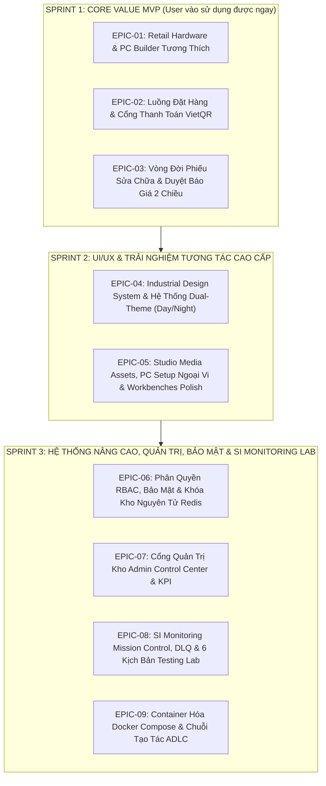

# CyberRig - Master Product Backlog (Tái Cấu Trúc 3-Sprint Model)

> **Mô hình**: Agile / Scrum kết hợp Vòng đời Tác tử ADLC  
> **Tổng thời gian hoàn thiện**: **2.5 Tháng** (Gồm 3 Sprint chu kỳ ~3.5 tuần/Sprint)  
> **Cấu trúc 3 Sprint**:
> - **Sprint 1 (Tuần 1 - Tuần 3.5)**: **Core Value MVP** - Những gì người dùng có thể trực tiếp vào và sử dụng được ngay (Catalog, PC Builder tương thích, Checkout VietQR, Tra cứu bảo hành & Duyệt báo giá).
> - **Sprint 2 (Tuần 3.5 - Tuần 7)**: **UI/UX & Trải Nghiệm Tương Tác** - Ngôn ngữ thiết kế công nghiệp, Dual-Theme Day/Night, Ảnh chụp thực tế Studio, Danh mục PC Setup ngoại vi, Cải tiến tương tác.
> - **Sprint 3 (Tuần 7 - Tuần 10.5)**: **Hệ Thống Nâng Cao, Quản Trị, Bảo Mật & SI Monitoring Testing Lab** - Phân quyền RBAC, Redis Atomic Stock Lock, Admin Hub, Giám sát SOC Real-time SSE, Dead Letter Queue & 6 kịch bản kiểm thử Lab.

---

## 1. Bản Đồ Epics Sản Phẩm (Epic Roadmap)



---

## 2. Bảng Theo Dõi Chi Tiết User Stories (Product Backlog Items)

### GIAI ĐOẠN 1: SPRINT 1 - NHỮNG GÌ USER CÓ THỂ VÀO VÀ SỬ DỤNG ĐƯỢC
*Thời gian: 3.5 tuần | Trọng tâm: Core Functional Flows mà Khách hàng và Kỹ thuật viên có thể vận hành trực tiếp.*

| ID Story | Thuộc Epic | User Story & Mô tả tính năng | Ưu tiên | SP | Trạng thái |
| :--- | :--- | :--- | :---: | :---: | :---: |
| **US-01** | EPIC-01 | **Tra cứu & Lọc linh kiện phần cứng**: Là khách hàng, tôi muốn lọc linh kiện theo danh mục, khoảng giá, thương hiệu để dễ dàng tìm kiếm phụ tùng PC phù hợp. | Must | 5 | [DONE] |
| **US-02** | EPIC-01 | **Thuật toán thẩm định tương thích Socket CPU - Mainboard**: Là người tự lắp PC, tôi muốn hệ thống kiểm tra tức thì chuẩn Socket (AM5, LGA1700) giữa CPU và Bo mạch chủ để không mua nhầm linh kiện xung đột. | Must | 8 | [DONE] |
| **US-03** | EPIC-01 | **Tính toán công suất nguồn (TDP Calculator)**: Là người dùng, tôi muốn hệ thống tính tổng điện năng tiêu thụ và khuyến nghị công suất danh định cho bộ nguồn PSU có biên an toàn $\ge 20\%$. | Must | 5 | [DONE] |
| **US-04** | EPIC-01 | **Thanh tiến trình tương thích thời gian thực**: Là người dùng, tôi muốn thanh tiến trình tăng dần khi chọn từng linh kiện và cảnh báo trực quan khi có linh kiện xung đột. | Must | 5 | [DONE] |
| **US-05** | EPIC-01 | **Cấu hình gợi ý theo ngân sách (Tier Presets)**: Là người mới bắt đầu, tôi muốn bấm 1 click để nạp nhanh cấu hình định sẵn (Gaming Ultra, Designer, Office) vào PC Builder. | Should | 3 | [DONE] |
| **US-06** | EPIC-02 | **Chuyển cấu hình từ PC Builder sang Checkout**: Là khách hàng, sau khi hoàn thiện dàn PC, tôi muốn bấm nút "Tiến Hành Mua Cấu Hình" để chuyển thẳng sang trang Checkout với đầy đủ danh sách linh kiện. | Must | 5 | [DONE] |
| **US-07** | EPIC-02 | **Tạo đơn hàng & Lưu Price Snapshot**: Là hệ thống, tôi muốn lưu cố định giá của linh kiện tại thời điểm đặt hàng để đơn hàng không bị thay đổi khi giá thị trường biến động. | Must | 5 | [DONE] |
| **US-08** | EPIC-02 | **Cổng thanh toán tự động VietQR Napas 247**: Là người mua, tôi muốn quét mã VietQR tự động sinh theo mã đơn hàng với số tiền chính xác và bộ đếm ngược 15 phút giữ hàng. | Must | 5 | [DONE] |
| **US-09** | EPIC-02 | **Tra cứu tình trạng đơn hàng công khai (`/orders/:code`)**: Là khách hàng vãng lai, tôi muốn dùng mã đơn hàng để theo dõi đơn đã được thanh toán và giao hàng hay chưa. | Should | 3 | [DONE] |
| **US-10** | EPIC-03 | **State Machine vòng đời phiếu sửa chữa (6 chặng)**: Là hệ thống, tôi muốn kiểm soát luồng sửa chữa qua 6 trạng thái nghiêm ngặt (`RECEIVED` $\rightarrow$ `DIAGNOSING` $\rightarrow$ `QUOTED` $\rightarrow$ `REPAIRING` $\rightarrow$ `QC` $\rightarrow$ `COMPLETED`), ngăn chặn nhảy cóc bất hợp lệ. | Must | 8 | [DONE] |
| **US-11** | EPIC-03 | **Tra cứu tiến độ phiếu bảo hành công khai**: Là khách hàng gửi máy, tôi muốn nhập mã phiếu vào trang tra cứu `/repair-tracking` để xem dòng thời gian và biên bản giám định lỗi. | Must | 5 | [DONE] |
| **US-12** | EPIC-03 | **Phê duyệt báo giá sửa chữa 2 chiều trực tuyến**: Là khách hàng, tôi muốn xem chi tiết báo giá do kỹ thuật viên lập và bấm `[ ĐỒNG Ý SỬA CHỮA ]` hoặc `[ TỪ CHỐI ]` trực tiếp trên trang tra cứu. | Must | 5 | [DONE] |
| **US-13** | EPIC-03 | **Lập báo giá vật tư & phí nhân công Lab**: Là kỹ thuật viên, tôi muốn chọn linh kiện thay thế từ kho và nhập tiền công để hệ thống tự động sinh bảng báo giá gửi khách hàng duyệt. | Must | 5 | [DONE] |

---

### GIAI ĐOẠN 2: SPRINT 2 - UI/UX & TRẢI NGHIỆM TƯƠNG TÁC CAO CẤP
*Thời gian: 3.5 tuần | Trọng tâm: Chuẩn hóa Design System, Dual-Theme, Studio Media, PC Setup không gian làm việc và tối ưu hóa trải nghiệm tương tác.*

| ID Story | Thuộc Epic | User Story & Mô tả tính năng | Ưu tiên | SP | Trạng thái |
| :--- | :--- | :--- | :---: | :---: | :---: |
| **US-14** | EPIC-04 | **Ngôn ngữ thiết kế công nghiệp Cyberpunk / Tech Industrial**: Là người dùng, tôi muốn giao diện có phong cách mạnh mẽ, bo góc sắc nét 0px, viền HUD scanner mô phỏng thiết bị vi mạch để tạo cảm giác chuyên nghiệp. | Must | 5 | [DONE] |
| **US-15** | EPIC-04 | **Hệ thống Dual-Theme (Day / Night Mode) chuẩn WCAG**: Là người dùng, tôi muốn chuyển đổi mượt mà giữa chế độ Tối (Gaming Dark) và chế độ Sáng (Technical Light) với độ tương phản văn bản đạt chuẩn WCAG 2.1 AA. | Must | 5 | [DONE] |
| **US-16** | EPIC-04 | **Khắc phục lỗi hiển thị & Tối ưu hiệu năng 60 FPS**: Là người dùng, tôi muốn các bóng đổ trên Day Theme không bị lem mờ và các thao tác cuộn/chuyển tab đạt tốc độ phản hồi 60 FPS. | Should | 3 | [DONE] |
| **US-17** | EPIC-05 | **Bộ hình ảnh Studio thực tế cho 8 loại linh kiện**: Là khách hàng, tôi muốn xem ảnh chụp thực tế sắc nét của từng linh kiện thay vì ảnh giữ chỗ placeholder để an tâm tuyệt đối về chất lượng. | Must | 5 | [DONE] |
| **US-18** | EPIC-05 | **Danh mục PC Setup & Thiết bị ngoại vi (`/equipments`)**: Là khách hàng đam mê không gian làm việc, tôi muốn duyệt xem và đặt mua 20 thiết bị Setup (Màn hình OLED, Ghế công thái học, Bàn nâng hạ, Bàn phím cơ, Audio). | Should | 5 | [DONE] |
| **US-19** | EPIC-05 | **Cải tiến giao diện Bàn làm việc Kỹ thuật viên (Technician Workbench)**: Là kỹ thuật viên, tôi muốn giao diện hàng đợi chia tab theo trạng thái, bố cục Split-View rõ ràng để thao tác lập báo giá và chẩn đoán nhanh chóng tại quầy Lab. | Must | 5 | [DONE] |
| **US-20** | EPIC-05 | **Cổng thông tin khách hàng tập trung (Customer Unified Hub)**: Là khách hàng thành viên, tôi muốn một bảng điều khiển trung tâm xem lại toàn bộ cấu hình PC đã sở hữu, lịch sử mua hàng và các phiếu bảo hành. | Should | 4 | [DONE] |
| **US-21** | EPIC-05 | **Phản hồi vi tương tác & Nút "+ Chọn" thông minh**: Là người dùng, tôi muốn nút "+ Chọn" trên catalog tự động đồng bộ sang PC Builder kèm hiệu ứng âm thanh/hình ảnh phản hồi tức thì. | Could | 3 | [DONE] |

---

### GIAI ĐOẠN 3: SPRINT 3 - HỆ THỐNG NÂNG CAO, QUẢN TRỊ, BẢO MẬT & SI MONITORING LAB
*Thời gian: 3.5 tuần | Trọng tâm: Hạ tầng sâu, Quản trị kho, Bảo mật RBAC, Bảng giám sát SOC Real-time, Dead Letter Queue & Testing Lab.*

| ID Story | Thuộc Epic | User Story & Mô tả tính năng | Ưu tiên | SP | Trạng thái |
| :--- | :--- | :--- | :---: | :---: | :---: |
| **US-22** | EPIC-06 | **Phân quyền truy cập RBAC 3 vai trò (Guards)**: Là hệ thống, tôi muốn bảo vệ nghiêm ngặt các API quản trị và kỹ thuật viên bằng JWT token, chặn triệt để mọi truy cập trái phép không đủ quyền `TECHNICIAN` hoặc `ADMIN`. | Must | 5 | [DONE] |
| **US-23** | EPIC-06 | **Bộ đệm khóa tồn kho nguyên tử Redis Atomic Stock Reservation**: Là hệ thống, tôi muốn sử dụng Redis Lua Script khóa giữ hàng tạm thời trong 15 phút thanh toán để loại trừ hoàn toàn rủi ro bán khống (Zero Oversell). | Must | 8 | [DONE] |
| **US-24** | EPIC-07 | **Cổng Quản trị kho hàng Admin Control Center**: Là quản trị viên, tôi muốn có trang quản trị chuyên dụng (`#admin`) để thêm mới, điều chỉnh giá, nhập hàng bổ sung (Restock) và ngừng bán (Soft Delete) linh kiện. | Must | 5 | [DONE] |
| **US-25** | EPIC-07 | **Telemetry tồn kho & Cảnh báo linh kiện sắp hết (Low Stock Alert)**: Là quản trị viên, tôi muốn theo dõi KPI tỷ lệ linh kiện còn hàng và nhận cảnh báo khi số lượng linh kiện dưới ngưỡng an toàn ($\le 3$). | Should | 3 | [DONE] |
| **US-26** | EPIC-08 | **Bảng điều khiển giám sát Dark SOC Dual-Mode (`/admin-monitoring/`)**: Là Quản trị viên/DevOps, tôi muốn bảng điều khiển giám sát phong cách Mission Control hỗ trợ chuyển đổi linh hoạt giữa Real-Time Monitoring và Scenario Testing Lab. | Must | 8 | [DONE] |
| **US-27** | EPIC-08 | **Động cơ Telemetry In-Memory & Terminal SSE Stream**: Là kỹ sư hệ thống, tôi muốn theo dõi trạng thái sống của 4 container Docker và thông lượng Message Broker qua Ring Buffer trên RAM (Zero-DB overhead) phát qua Server-Sent Events. | Must | 5 | [DONE] |
| **US-28** | EPIC-08 | **Dead Letter Queue (DLQ) Inspector & Poison Message Replay**: Là DevOps/QA, tôi muốn hệ thống tự động cách ly các thông điệp lỗi (NACK) vào DLQ và cung cấp nút phát lại (Replay) thủ công sau khi sửa lỗi. | Must | 5 | [DONE] |
| **US-29** | EPIC-08 | **Phòng Lab kích hoạt 6 kịch bản kiểm thử tích hợp tự động**: Là QA/DevOps, tôi muốn có thể bấm chạy trực tiếp 6 kịch bản kiểm thử (Order Pipeline, Stock Check, Trigger DLQ, AI Data Mapping, Rate Limiting, Health Diagnostics) và xem dấu vết thực thi từng bước. | Must | 8 | [DONE] |
| **US-30** | EPIC-09 | **Đóng gói cụm hạ tầng Docker Compose & Nginx Gateway**: Là đội ngũ vận hành, tôi muốn toàn bộ hệ thống (Postgres, Redis, App, Nginx) khởi động đồng bộ qua Docker Compose với mạng nội bộ được cách ly bảo mật. | Must | 5 | [DONE] |
| **US-31** | EPIC-09 | **Tích hợp Chuỗi tạo tác ADLC & Tái cấu trúc Clean Code**: Là kỹ sư phần mềm, tôi muốn cấu trúc mã nguồn được phân rã Clean Code (tách fixtures, mocks khỏi services) và chuẩn hóa chuỗi tạo tác kiểm toán (`intent.md` $\rightarrow$ `spec.md` $\rightarrow$ `plan.md` $\rightarrow$ `code+tests` $\rightarrow$ `review`). | Should | 5 | [DONE] |

---

## 3. Tiêu Chí Chấp Nhận Chi Tiết (Acceptance Criteria Mẫu - Gherkin)

### Kịch bản cho US-02: Thẩm định Socket CPU - Mainboard (Sprint 1)
```gherkin
Scenario: Người dùng chọn Bo mạch chủ không khớp Socket với CPU đã chọn
  Given người dùng đang ở trang "/builder" và đã chọn CPU "AMD Ryzen 7 7800X3D" (Socket AM5)
  When người dùng chọn Bo Mạch Chủ "ASUS ROG STRIX Z790-E" (Socket LGA1700)
  Then hệ thống hiển thị cảnh báo đỏ "XUNG ĐỘT: Socket AM5 không tương thích Bo mạch chủ LGA1700"
  And thanh tiến trình tương thích chuyển sang trạng thái cảnh báo xung đột
  And nút "Tiến Hành Mua Cấu Hình" bị khóa vô hiệu hóa
```

### Kịch bản cho US-12: Khách hàng duyệt báo giá sửa chữa 2 chiều (Sprint 1)
```gherkin
Scenario: Khách hàng đồng ý báo giá sửa chữa trên cổng tra cứu
  Given phiếu bảo hành "TK-1001" đang ở trạng thái "QUOTED" kèm bảng chi phí linh kiện và nhân công
  When khách hàng truy cập "/repair-tracking", nhập mã "TK-1001" và bấm nút "[ ĐỒNG Ý SỬA CHỮA ]"
  Then hệ thống gửi yêu cầu cập nhật State Machine chuyển trạng thái phiếu sang "REPAIRING"
  And ghi nhận thời gian khách hàng chấp thuận vào nhật ký timeline
  And bước REPAIRING trên thanh tiến trình 6 chặng đổi sang trạng thái sáng đèn
```

### Kịch bản cho US-15: Chuyển đổi Dual-Theme Day / Night (Sprint 2)
```gherkin
Scenario: Người dùng chuyển đổi qua lại giữa Chế độ Sáng và Chế độ Tối
  Given người dùng đang ở bất kỳ trang nào trên hệ sinh thái CyberRig
  When người dùng bấm vào nút chuyển đổi Theme trên thanh điều hướng Header
  Then giao diện chuyển đổi tức thì giữa Night Theme (#0a0d14) và Day Theme (#f8fafc)
  And toàn bộ đường viền mô phỏng HUD và màu chữ được cập nhật đạt chuẩn tương phản WCAG 2.1 AA
  And lựa chọn Theme được lưu vào LocalStorage để duy trì qua các phiên truy cập sau
```

### Kịch bản cho US-28: Cô lập Poison Message vào DLQ và Phát lại Replay (Sprint 3)
```gherkin
Scenario: Cách ly thông điệp lỗi độc hại vào Dead Letter Queue và phát lại thành công
  Given quản trị viên đang ở tab "[02] SCENARIO TESTING LAB" trên trang "/admin-monitoring/"
  When quản trị viên kích hoạt nút "Trigger DLQ Error"
  Then hệ thống ghi nhận lỗi NACK, cô lập payload hỏng vào bảng Dead Letter Queue
  And thông điệp mới xuất hiện ngay trên bảng DLQ tại tab "[01] REAL-TIME MONITORING" kèm nguyên nhân lỗi
  When quản trị viên bấm nút "[ REPLAY ]" trên hàng thông điệp lỗi đó
  Then hệ thống đưa thông điệp tái nạp vào hàng đợi chính và xóa thông điệp khỏi danh sách DLQ
  And xuất hiện dòng thông báo thành công màu xanh trên Live Terminal Console
```
