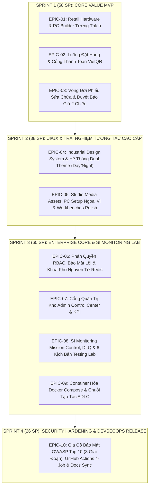

# CyberRig - Master Product Backlog (Mô Hình 4 Sprint — 182 Story Points)

> **Mô hình**: Agile / Scrum trên Jira Software (**Project Key: `SCRUM`** — Board thực tế: `https://minhlocle112.atlassian.net/jira/software/projects/SCRUM/boards/1`) kết hợp GitHub Flow, DevSecOps CI/CD & Vòng đời Tác tử ADLC  
> **Đội ngũ thực hiện**: 5 thành viên (`TV 1`–`TV 5`, phân bổ đều 20% / thành viên)  
> **Tổng lộ trình**: **5 Sprint** (3 Sprint nghiệp vụ chính + Sprint 4 Gia cố Bảo mật & DevSecOps + Sprint 5 Tích hợp SE445 Omnichannel, AI POS & Executive BI — **11 Epics • 42 User Stories • 208 Story Points**)  
> **Cấu trúc 5 Sprint**:
> - **Sprint 1 (Tuần 1 - Tuần 3.5 | 58 SP)**: **Core Value MVP** - Những gì người dùng có thể trực tiếp vào và sử dụng được ngay (Catalog, PC Builder tương thích, Checkout VietQR, Tra cứu bảo hành & Duyệt báo giá).
> - **Sprint 2 (Tuần 3.5 - Tuần 7 | 38 SP)**: **UI/UX & Trải Nghiệm Tương Tác** - Ngôn ngữ thiết kế công nghiệp, Dual-Theme Day/Night, Ảnh chụp thực tế Studio, Danh mục PC Setup ngoại vi, Cải tiến tương tác.
> - **Sprint 3 (Tuần 7 - Tuần 10.5 | 60 SP)**: **Hệ Thống Nâng Cao, Quản Trị, Bảo Mật Lõi & SI Monitoring Lab** - Phân quyền RBAC, Redis Atomic Stock Lock, Admin Hub, Giám sát SOC Real-time SSE, Dead Letter Queue & 6 kịch bản kiểm thử Lab.
> - **Sprint 4 (Tuần 11 | 26 SP)**: **Security Hardening (OWASP Top 10) & DevSecOps Release** - `HttpOnly` Cookie Rotation + Redis Blacklist, Anti-IDOR & PII Masking, RBAC `ADMIN` cho SOC + Single-use SSE Ticket, Webhook VietQR HMAC-SHA256, 2FA TOTP & `audit_logs`, GitHub Actions DevSecOps 4 jobs và đồng bộ Use Case v2.1.
> - **Sprint 5 (Tuần 12 | 26 SP)**: **SE445 Omnichannel Integration, AI POS & CEO Executive BI** - Canonical Order Adapter, `X-Correlation-ID` Tracing, Dual-Mode Event Bus + Outbox (HTTP `503`) + 3x Retry DLQ + 3 Subscribers, AI POS Data Mapper (Nghị định 13 PII Masking + Template Cache), Tab 4 Simulator, CEO Bento Dashboard, Kong/RabbitMQ Reference & 182/182 Tests.

---

## 1. Bản Đồ Epics Sản Phẩm (Epic Roadmap — 10 Epics)



---

## 2. Bảng Theo Dõi Chi Tiết User Stories (Product Backlog Items)

### GIAI ĐOẠN 1: SPRINT 1 - NHỮNG GÌ USER CÓ THỂ VÀO VÀ SỬ DỤNG ĐƯỢC
*Thời gian: 3.5 tuần | Trọng tâm: Core Functional Flows mà Khách hàng và Kỹ thuật viên có thể vận hành trực tiếp.*

| ID Story | Jira Key | Thuộc Epic | User Story & Mô tả tính năng | Ưu tiên | SP | Trạng thái |
| :--- | :---: | :--- | :--- | :---: | :---: | :---: |
| **US-01** | `SCRUM-42` | EPIC-01 | **Tra cứu & Lọc linh kiện phần cứng**: Là khách hàng, tôi muốn lọc linh kiện theo danh mục, khoảng giá, thương hiệu để dễ dàng tìm kiếm phụ tùng PC phù hợp (`/hardware`). | Must | 5 | [DONE] |
| **US-02** | `SCRUM-15` | EPIC-01 | **Thuật toán thẩm định tương thích 4 Rules (Socket, RAM, Clearance, Power)**: Là người tự lắp PC, tôi muốn hệ thống kiểm tra tức thì chuẩn Socket (AM5, LGA1700), thế hệ RAM, kích thước vật lý giữa linh kiện để không mua nhầm đồ xung đột. | Must | 8 | [DONE] |
| **US-03** | `SCRUM-16` | EPIC-01 | **Tính toán công suất nguồn (TDP Calculator)**: Là người dùng, tôi muốn hệ thống tính tổng điện năng tiêu thụ và khuyến nghị công suất danh định cho bộ nguồn PSU có biên an toàn $\ge 25\%$. | Must | 3 | [DONE] |
| **US-04** | `SCRUM-17` | EPIC-01 | **Giao diện PC Builder 8 khoang & Thanh tiến trình tương thích**: Là người dùng, tôi muốn thanh tiến trình (0–100%) tăng dần khi chọn từng linh kiện và cảnh báo trực quan khi có linh kiện xung đột. | Must | 5 | [DONE] |
| **US-05** | `SCRUM-18` | EPIC-01 | **Cấu hình gợi ý theo ngân sách (Tier Presets)**: Là người mới bắt đầu, tôi muốn bấm 1 click để nạp nhanh cấu hình định sẵn (Gaming Ultra, Designer, Office) vào PC Builder. | Should | 3 | [DONE] |
| **US-06** | `SCRUM-19` | EPIC-02 | **Chuyển cấu hình từ PC Builder sang Checkout**: Là khách hàng, sau khi hoàn thiện dàn PC, tôi muốn bấm nút "Tiến Hành Mua Cấu Hình" để chuyển thẳng sang trang Checkout Split-View với đầy đủ danh sách linh kiện. | Must | 5 | [DONE] |
| **US-07** | `SCRUM-20` | EPIC-02 | **Tạo đơn hàng & Lưu Price Snapshot**: Là hệ thống, tôi muốn lưu cố định giá của linh kiện tại thời điểm đặt hàng để đơn hàng không bị thay đổi khi giá thị trường biến động. | Must | 5 | [DONE] |
| **US-08** | `SCRUM-21` | EPIC-02 | **Cổng thanh toán tự động VietQR Napas 247**: Là người mua, tôi muốn quét mã VietQR tự động sinh theo mã đơn hàng với số tiền chính xác và bộ đếm ngược 15 phút giữ hàng. | Must | 5 | [DONE] |
| **US-09** | `SCRUM-22` | EPIC-02 | **Tra cứu tình trạng đơn hàng công khai (`/orders/:code`)**: Là khách hàng vãng lai, tôi muốn dùng mã đơn hàng (kèm xác thực SĐT Anti-IDOR) để theo dõi đơn đã thanh toán và giao hàng hay chưa. | Should | 3 | [DONE] |
| **US-10** | `SCRUM-23` | EPIC-03 | **Finite State Machine vòng đời phiếu sửa chữa (8 trạng thái)**: Là hệ thống, tôi muốn kiểm soát luồng sửa chữa qua FSM 8 trạng thái (`RECEIVED` $\rightarrow$ `DIAGNOSING` $\rightarrow$ `QUOTED` $\rightarrow$ `APPROVED` / `REJECTED` $\rightarrow$ `REPAIRING` $\rightarrow$ `TESTING_QC` $\rightarrow$ `COMPLETED`), ngăn chặn nhảy cóc bất hợp lệ. | Must | 5 | [DONE] |
| **US-11** | `SCRUM-24` | EPIC-03 | **Tra cứu tiến độ phiếu bảo hành công khai**: Là khách hàng gửi máy, tôi muốn nhập mã phiếu vào trang tra cứu `/repair-tracking` để xem Stepper timeline 6 chặng và biên bản giám định lỗi. | Must | 5 | [DONE] |
| **US-12** | `SCRUM-25` | EPIC-03 | **Phê duyệt báo giá sửa chữa 2 chiều trực tuyến**: Là khách hàng, tôi muốn xem chi tiết báo giá do kỹ thuật viên lập và bấm `[ ĐỒNG Ý SỬA CHỮA ]` hoặc `[ TỪ CHỐI ]` trực tiếp trên trang tra cứu. | Must | 3 | [DONE] |
| **US-13** | `SCRUM-26` | EPIC-03 | **Lập báo giá vật tư & phí nhân công Lab**: Là kỹ thuật viên, tôi muốn chọn linh kiện thay thế từ kho và nhập tiền công để hệ thống tự động sinh bảng báo giá gửi khách hàng duyệt. | Must | 3 | [DONE] |

---

### GIAI ĐOẠN 2: SPRINT 2 - UI/UX & TRẢI NGHIỆM TƯƠNG TÁC CAO CẤP
*Thời gian: 3.5 tuần | Trọng tâm: Chuẩn hóa Design System, Dual-Theme, Studio Media, PC Setup không gian làm việc và tối ưu hóa trải nghiệm tương tác.*

| ID Story | Jira Key | Thuộc Epic | User Story & Mô tả tính năng | Ưu tiên | SP | Trạng thái |
| :--- | :---: | :--- | :--- | :---: | :---: | :---: |
| **US-14** | `SCRUM-27` | EPIC-04 | **Ngôn ngữ thiết kế công nghiệp Cyberpunk / Tech Industrial**: Là người dùng, tôi muốn giao diện có phong cách mạnh mẽ, bo góc sắc nét 0px, viền HUD scanner mô phỏng thiết bị vi mạch để tạo cảm giác chuyên nghiệp. | Must | 5 | [DONE] |
| **US-15** | `SCRUM-28` | EPIC-04 | **Hệ thống Dual-Theme (Day / Night Mode) chuẩn WCAG**: Là người dùng, tôi muốn chuyển đổi mượt mà giữa chế độ Tối (Gaming Dark) và chế độ Sáng (Technical Light) với độ tương phản văn bản đạt chuẩn WCAG 2.1 AA. | Must | 5 | [DONE] |
| **US-16** | `SCRUM-29` | EPIC-04 | **Khắc phục lỗi hiển thị & Tối ưu hiệu năng 60 FPS**: Là người dùng, tôi muốn các bóng đổ trên Day Theme không bị lem mờ và các thao tác cuộn/chuyển tab đạt tốc độ phản hồi 60 FPS. | Should | 3 | [DONE] |
| **US-17** | `SCRUM-30` | EPIC-05 | **Bộ hình ảnh Studio thực tế cho 8 loại linh kiện**: Là khách hàng, tôi muốn xem ảnh chụp thực tế sắc nét của từng linh kiện thay vì ảnh giữ chỗ placeholder để an tâm tuyệt đối về chất lượng. | Must | 5 | [DONE] |
| **US-18** | `SCRUM-31` | EPIC-05 | **Danh mục PC Setup & Thiết bị ngoại vi (`/equipments`)**: Là khách hàng đam mê không gian làm việc, tôi muốn duyệt xem và đặt mua 20 thiết bị Setup (Màn hình OLED, Ghế công thái học, Bàn nâng hạ, Bàn phím cơ, Audio). | Should | 5 | [DONE] |
| **US-19** | `SCRUM-32` | EPIC-05 | **Cải tiến giao diện Bàn làm việc Kỹ thuật viên (Technician Workbench)**: Là kỹ thuật viên, tôi muốn giao diện hàng đợi chia tab theo trạng thái, bố cục Split-View rõ ràng để thao tác lập báo giá và chẩn đoán nhanh chóng tại quầy Lab. | Must | 5 | [DONE] |
| **US-20** | `SCRUM-33` | EPIC-05 | **Cổng thông tin khách hàng tập trung (Customer Unified Hub)**: Là khách hàng thành viên, tôi muốn một bảng điều khiển trung tâm xem lại toàn bộ cấu hình PC đã sở hữu, lịch sử mua hàng và các phiếu bảo hành. | Should | 5 | [DONE] |
| **US-21** | `SCRUM-34` | EPIC-05 | **Phản hồi vi tương tác & Nút "+ Chọn" thông minh**: Là người dùng, tôi muốn nút "+ Chọn" trên catalog tự động đồng bộ sang PC Builder kèm hiệu ứng âm thanh/hình ảnh phản hồi tức thì. | Could | 3 | [DONE] |
| **US-22** | `SCRUM-35` | EPIC-05 | **Bộ kiểm thử giao diện UI specs & tương thích đa độ phân giải**: Là QA/Dev, tôi muốn bộ 8 UI spec tests xác thực hiển thị catalog, Dual-Theme và các luồng thao tác trên nhiều kích thước màn hình. | Should | 2 | [DONE] |

---

### GIAI ĐOẠN 3: SPRINT 3 - HỆ THỐNG NÂNG CAO, QUẢN TRỊ, BẢO MẬT & SI MONITORING LAB
*Thời gian: 3.5 tuần | Trọng tâm: Hạ tầng sâu, Quản trị kho, Bảo mật RBAC, Bảng giám sát SOC Real-time, Dead Letter Queue & Testing Lab.*

| ID Story | Jira Key | Thuộc Epic | User Story & Mô tả tính năng | Ưu tiên | SP | Trạng thái |
| :--- | :---: | :--- | :--- | :---: | :---: | :---: |
| **US-23** | `SCRUM-43` | EPIC-06 | **Phân quyền truy cập RBAC 3 vai trò (`CUSTOMER`, `TECHNICIAN`, `ADMIN`) & Route Guards**: Là hệ thống, tôi muốn bảo vệ nghiêm ngặt các API quản trị và kỹ thuật viên bằng JWT token, chặn triệt để mọi truy cập trái phép không đủ quyền. | Must | 5 | [DONE] |
| **US-24** | `SCRUM-44` | EPIC-06 | **Bộ đệm khóa tồn kho nguyên tử Redis Atomic Stock Reservation**: Là hệ thống, tôi muốn sử dụng Redis Lua Script khóa giữ hàng tạm thời trong 15 phút thanh toán để loại trừ hoàn toàn rủi ro bán khống (Zero Oversell). | Must | 8 | [DONE] |
| **US-25** | `SCRUM-45` | EPIC-07 | **Cổng Quản trị kho hàng Admin Control Center (`#admin`)**: Là quản trị viên, tôi muốn có trang quản trị chuyên dụng để thêm mới, điều chỉnh giá, nhập hàng bổ sung (Restock) và ngừng bán (Soft Delete) linh kiện. | Must | 8 | [DONE] |
| **US-26** | `SCRUM-46` | EPIC-07 | **Telemetry tồn kho & Cảnh báo linh kiện sắp hết (Low Stock Alert)**: Là quản trị viên, tôi muốn theo dõi KPI tỷ lệ linh kiện còn hàng và nhận cảnh báo khi số lượng linh kiện dưới ngưỡng an toàn ($\le 3$). | Should | 5 | [DONE] |
| **US-27** | `SCRUM-47` | EPIC-08 | **Bảng điều khiển giám sát Dark SOC Dual-Mode (`/admin-monitoring/`)**: Là Quản trị viên/DevOps, tôi muốn bảng điều khiển giám sát phong cách Mission Control hỗ trợ chuyển đổi linh hoạt giữa Real-Time Monitoring và Scenario Testing Lab. | Must | 8 | [DONE] |
| **US-28** | `SCRUM-48` | EPIC-08 | **Động cơ Telemetry In-Memory Ring Buffer & Terminal SSE Stream**: Là kỹ sư hệ thống, tôi muốn theo dõi trạng thái sống của 4 container Docker và thông lượng Message Broker qua Ring Buffer trên RAM (Zero-DB overhead) phát qua Server-Sent Events. | Must | 5 | [DONE] |
| **US-29** | `SCRUM-49` | EPIC-08 | **Dead Letter Queue (DLQ) Inspector & Poison Message Replay**: Là DevOps/QA, tôi muốn hệ thống tự động cách ly các thông điệp lỗi (NACK) vào DLQ và cung cấp nút phát lại (Replay) thủ công sau khi sửa lỗi. | Must | 5 | [DONE] |
| **US-30** | `SCRUM-50` | EPIC-08 | **Phòng Lab kích hoạt 6 kịch bản kiểm thử tích hợp tự động & `monitoring.spec.ts`**: Là QA/DevOps, tôi muốn bấm chạy trực tiếp 6 kịch bản kiểm thử (Order Pipeline, Stock Check, Trigger DLQ, AI Data Mapping, Rate Limiting, Health) và xác thực tự động bằng test suite. | Must | 8 | [DONE] |
| **US-31** | `SCRUM-51` | EPIC-09 | **Đóng gói cụm hạ tầng Docker Compose 4 containers, Nginx Gateway & Clean Code ADLC**: Là đội ngũ vận hành/kỹ sư, tôi muốn toàn bộ hệ thống (Postgres, Redis, App, Nginx) khởi động đồng bộ qua Docker Compose và tuân thủ Clean Code Monorepo + chuỗi tạo tác kiểm toán ADLC (`intent.md` $\rightarrow$ `spec.md` $\rightarrow$ `plan.md` $\rightarrow$ `code+tests`). | Must | 8 | [DONE] |

---

### GIAI ĐOẠN 4: SPRINT 4 - GIA CỐ BẢO MẬT OWASP TOP 10 & DEVSECOPS RELEASE (26 SP)
*Thời gian: 1 tuần (Hardening Sprint) | Trọng tâm: Triển khai 3 giai đoạn bảo mật chuẩn OWASP, thiết lập GitHub Actions DevSecOps 4-Job Gate và đồng bộ toàn bộ tài liệu UML/Scrum.*

| ID Story | Jira Key | Thuộc Epic | User Story & Mô tả tính năng | Ưu tiên | SP | Trạng thái |
| :--- | :---: | :--- | :--- | :---: | :---: | :---: |
| **US-33** | `SCRUM-36` | EPIC-10 | **Gia cố phiên & Token (`HttpOnly` Cookie Rotation, Reuse Detection, Redis `jti` Blacklist & Lockout)**: Là hệ thống, tôi muốn lưu Refresh Token trong `HttpOnly` Cookie, tự động xoay vòng và thu hồi toàn bộ token family nếu phát hiện tái sử dụng trái phép, đồng thời khóa brute-force tài khoản. | Must | 5 | [DONE] |
| **US-34** | `SCRUM-37` | EPIC-10 | **Anti-IDOR, Che mờ PII & Khóa RBAC `ADMIN` cho SOC + Single-use SSE Ticket**: Là hệ thống, tôi muốn bảo vệ tra cứu đơn hàng/phiếu sửa chữa chống IDOR (`?phone=`), che mờ dữ liệu cá nhân (PII Masking), khóa toàn bộ `/api/monitoring/*` bằng `requireRoles('ADMIN')` và cấp vé SSE dùng một lần (`/stream-ticket`). | Must | 5 | [DONE] |
| **US-35** | `SCRUM-38` | EPIC-10 | **Xác thực Webhook Thanh toán VietQR bằng chữ ký `HMAC-SHA256` & Chống Replay Attack**: Là hệ thống thanh toán, tôi muốn xác thực mọi yêu cầu `POST /api/orders/:id/confirm` qua header `X-CyberRig-Signature` và `X-CyberRig-Timestamp` (bằng `crypto.timingSafeEqual`) để ngăn giả mạo giao dịch. | Must | 5 | [DONE] |
| **US-36** | `SCRUM-39` | EPIC-10 | **Bảo mật 2 lớp MFA/2FA TOTP (RFC 6238) & Nhật ký Kiểm toán bất biến (`audit_logs`)**: Là quản trị viên & khách hàng, tôi muốn bật/tắt 2FA TOTP tương thích Google Authenticator (`/api/auth/2fa/*`) và tra cứu nhật ký kiểm toán bảo mật append-only (`GET /api/monitoring/audit-logs`). | High | 5 | [DONE] |
| **US-37** | `SCRUM-40` | EPIC-10 | **Pipeline DevSecOps CI/CD 4-Job trên GitHub Actions & Test Runner đa nền tảng**: Là kỹ sư DevOps/QA, tôi muốn mọi push/PR kích hoạt tự động 4 job (TypeScript + 173 Tests qua `scripts/run-tests.mjs`, Gitleaks OSS, Semgrep OSS, Trivy CVE) làm cổng kiểm soát chất lượng trước khi Merge. | Must | 4 | [DONE] |
| **US-38** | `SCRUM-41` | EPIC-10 | **Đồng bộ Sơ đồ Use Case v2.1 (Tác nhân hệ thống VietQR Webhook) & Tài liệu Bảo mật**: Là Product Owner, tôi muốn cập nhật đồng bộ `diagram_usecase_master.png`, `SECURITY-DESIGN.md`, `USE-CASES.md`, hồ sơ Scrum/Jira 5 thành viên và Báo cáo Word. | Should | 2 | [DONE] |

---

### GIAI ĐOẠN 5: SPRINT 5 - TÍCH HỢP SE445 OMNICHANNEL, AI POS & CEO EXECUTIVE BI (26 SP)
*Thời gian: 1 tuần (`CRIG Sprint 5`, `id: 8`) | Trọng tâm: Tích hợp toàn diện SE445 Case Study 1 & 2 vào CyberRig và nâng bộ kiểm thử tự động lên 182/182 PASS.*

| ID Story | Jira Key | Thuộc Epic | User Story & Mô tả tính năng | Ưu tiên | SP | Trạng thái |
| :--- | :---: | :--- | :--- | :---: | :---: | :---: |
| **US-39** | `SCRUM-96` | EPIC-11 (`SCRUM-95`) | **Canonical Order Adapter & Truy vết phân tán `X-Correlation-ID` End-to-End**: Chuẩn hóa payload dị thể B2B/Mobile/POS sang `CreateOrderDto` và gắn `X-Correlation-ID` từ Nginx qua Express tới Event Bus. | Must | 5 | [DONE] |
| **US-40** | `SCRUM-97` | EPIC-11 (`SCRUM-95`) | **Dual-Mode Event Bus, Outbox Resilience (HTTP 503) & 3 Downstream Subscribers**: Topic Exchange `cyberrig.orders`, Retry 3x -> DLQ, Replay, Idempotency Guard, Pause/Resume Queue, Outbox `PENDING_RETRY` & 3 consumer (`Inventory`, `CRM`, `TMS`). | Must | 8 | [DONE] |
| **US-41** | `SCRUM-98` | EPIC-11 (`SCRUM-95`) | **AI POS Data Mapper, Che mờ PII trước AI (Nghị định 13) & Template Cache**: Lọc SĐT/Email qua `maskRawTextPii` trước AI, Template Cache (`0.99`), Gemini JSON & Offline Normalizer khớp SKU thật. | Must | 5 | [DONE] |
| **US-42** | `SCRUM-99` | EPIC-11 (`SCRUM-95`) | **SI Studio Bento Dual-Theme, Tab 4 Order & AI POS Simulator & CEO Executive Dashboard**: Bảng điều hành CEO + Tab 4 Simulator cô lập trong `/admin-monitoring/` với `ADMIN` RBAC. | Must | 5 | [DONE] |
| **US-43** | `SCRUM-100` | EPIC-11 (`SCRUM-95`) | **Hạ tầng Kong/RabbitMQ Reference, Postman Collection, 182 Tests & Tài liệu SE445**: Đóng gói `CyberRig-Infra/{kong,rabbitmq}`, Postman SE445, `182/182` tests (28 suites) & `SE445-CASE-STUDY-INTEGRATION.md`. | Should | 3 | [DONE] |

---

## 3. Tiêu Chí Chấp Nhận Chi Tiết (Acceptance Criteria Mẫu - Gherkin)

### Kịch bản cho US-02: Thẩm định Socket CPU - Mainboard (Sprint 1)
```gherkin
Scenario: Người dùng chọn Bo mạch chủ không khớp Socket với CPU đã chọn
  Given người dùng đang ở trang "/builder" và đã chọn CPU "AMD Ryzen 7 7800X3D" (Socket AM5)
  When người dùng chọn Bo Mạch Chủ "ASUS ROG STRIX Z790-E" (Socket LGA1700)
  Then hệ thống hiển thị cảnh báo đỏ "XUNG ĐỘT: Socket AM5 không tương thích Bo mạch chủ LGA1700"
  And thanh tiến trình tương thích chuyển sang trạng thái cảnh báo xung đột
  And nút "Tiến Hành Mua Cấu Hình" bị khóa vô hiệu hóa
```

### Kịch bản cho US-12: Khách hàng duyệt báo giá sửa chữa 2 chiều (Sprint 1)
```gherkin
Scenario: Khách hàng đồng ý báo giá sửa chữa trên cổng tra cứu
  Given phiếu bảo hành "TK-1001" đang ở trạng thái "QUOTED" kèm bảng chi phí linh kiện và nhân công
  When khách hàng truy cập "/repair-tracking", nhập mã "TK-1001" và bấm nút "[ ĐỒNG Ý SỬA CHỮA ]"
  Then hệ thống gửi yêu cầu cập nhật State Machine chuyển trạng thái phiếu sang "REPAIRING"
  And ghi nhận thời gian khách hàng chấp thuận vào nhật ký timeline
  And bước REPAIRING trên thanh tiến trình 6 chặng đổi sang trạng thái sáng đèn
```

### Kịch bản cho US-15: Chuyển đổi Dual-Theme Day / Night (Sprint 2)
```gherkin
Scenario: Người dùng chuyển đổi qua lại giữa Chế độ Sáng và Chế độ Tối
  Given người dùng đang ở bất kỳ trang nào trên hệ sinh thái CyberRig
  When người dùng bấm vào nút chuyển đổi Theme trên thanh điều hướng Header
  Then giao diện chuyển đổi tức thì giữa Night Theme (#0a0d14) và Day Theme (#f8fafc)
  And toàn bộ đường viền mô phỏng HUD và màu chữ được cập nhật đạt chuẩn tương phản WCAG 2.1 AA
  And lựa chọn Theme được lưu vào LocalStorage để duy trì qua các phiên truy cập sau
```

### Kịch bản cho US-28: Cô lập Poison Message vào DLQ và Phát lại Replay (Sprint 3)
```gherkin
Scenario: Cách ly thông điệp lỗi độc hại vào Dead Letter Queue và phát lại thành công
  Given quản trị viên đang ở tab "[02] SCENARIO TESTING LAB" trên trang "/admin-monitoring/"
  When quản trị viên kích hoạt nút "Trigger DLQ Error"
  Then hệ thống ghi nhận lỗi NACK, cô lập payload hỏng vào bảng Dead Letter Queue
  And thông điệp mới xuất hiện ngay trên bảng DLQ tại tab "[01] REAL-TIME MONITORING" kèm nguyên nhân lỗi
  When quản trị viên bấm nút "[ REPLAY ]" trên hàng thông điệp lỗi đó
  Then hệ thống đưa thông điệp tái nạp vào hàng đợi chính và xóa thông điệp khỏi danh sách DLQ
  And xuất hiện dòng thông báo thành công màu xanh trên Live Terminal Console
```

### Kịch bản cho US-35: Xác thực Webhook Thanh toán VietQR bằng HMAC-SHA256 (Sprint 4)
```gherkin
Scenario: Từ chối yêu cầu xác nhận thanh toán giả mạo không có chữ ký HMAC hợp lệ
  Given đơn hàng "ORD-2026-8891" đang ở trạng thái "PENDING"
  When tác nhân bên ngoài gửi POST /api/orders/ORD-2026-8891/confirm không có quyền ADMIN và sai header X-CyberRig-Signature
  Then hệ thống từ chối với mã HTTP 401/403
  And giữ nguyên trạng thái đơn hàng là "PENDING"
  And ghi nhận sự kiện cảnh báo vào bảng nhật ký kiểm toán bất biến audit_logs
```

### Kịch bản cho US-36: Kích hoạt 2FA TOTP & Tra cứu Audit Logs tại SOC (Sprint 4)
```gherkin
Scenario: Quản trị viên bật bảo mật 2 lớp 2FA TOTP và tra cứu nhật ký kiểm toán
  Given quản trị viên đã đăng nhập với JWT hợp lệ và gọi POST /api/auth/2fa/setup
  When quản trị viên xác thực mã OTP 6 chữ số hợp lệ qua POST /api/auth/2fa/verify
  Then trạng thái mfa_enabled của tài khoản chuyển thành true và lần đăng nhập tiếp theo bắt buộc mã TOTP
  And khi gọi GET /api/monitoring/audit-logs với quyền ADMIN, hệ thống trả về đầy đủ nhật ký sự kiện bảo mật
```
