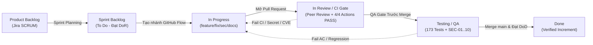

# CyberRig - Quy Chuẩn Khung Làm Việc Agile/Scrum (Scrum Framework)

Tài liệu này xác lập quy trình vận hành và chuẩn mực phát triển phần mềm theo mô hình **Agile/Scrum** dành riêng cho hệ sinh thái **CyberRig** (Bán lẻ phần cứng, Bộ cấu hình PC tương thích và Cổng quản lý bảo hành/sửa chữa).

---

## 1. Tầm Nhìn Sản Phẩm & Ba Trụ Cột Nghiệp Vụ (Product Vision)

CyberRig hướng tới trải nghiệm mua sắm và bảo dưỡng phần cứng máy tính công nghệ cao:
1. **PC Hardware Retail & Inventory Control**: Quản lý danh mục linh kiện, tra cứu tức thì, kiểm soát tồn kho đa thông số kỹ thuật (Socket, TDP, Form Factor, Clock speed, VRAM, v.v.).
2. **Intelligent PC Compatibility Builder**: Thuật toán thẩm định tương thích phần cứng theo thời gian thực (Socket CPU & Mainboard, Công suất nguồn PSU, Kích thước case/VGA, chuẩn RAM DDR4/DDR5, khe cắm M.2/PCIe).
3. **Repair & Warranty Lifecycle Tracking**: Quản lý toàn vẹn vòng đời phiếu sửa chữa máy tính qua State Machine nghiêm ngặt (RECEIVED → DIAGNOSING → QUOTED → REPAIRING → QC → COMPLETED), kèm báo giá chi tiết và tra cứu trực tuyến.

---

## 2. Cơ Cấu Vai Trò & Đội Ngũ 5 Thành Viên (Scrum Roles — 20% / Thành Viên)

| Vai trò Scrum | Thành viên đảm nhiệm | Trách nhiệm cốt lõi |
| :--- | :--- | :--- |
| **Product Owner (PO) / Team Lead** | **TV 1** *(kiêm FE E-Commerce)* | • Quản trị Product Backlog & Jira `SCRUM` (`https://minhlocle112.atlassian.net/jira/software/projects/SCRUM/boards/1`), xác định Product Goal và Acceptance Criteria. • Điều phối chuỗi tạo tác ADLC (`intent`, `spec`, `plan`), nghiệm thu Sprint Review. • Phụ trách `/checkout` VietQR, Customer Hub (`#dashboard`) và bộ ảnh Studio. |
| **Development Team — Frontend Lead** | **TV 2** *(FE Core & Design System)* | • Xây dựng `/hardware`, `/builder`, `LiveCompatibilityBar`, `/equipments`. • Chuẩn hóa Design System v2.1 (`0px`, Dual-Theme Day/Night 60 FPS, WCAG 2.1 AA) & Tech UI. |
| **Development Team — Backend Core** | **TV 3** *(BE Core & Repair Lab)* | • Cài đặt 4 Compatibility Rules (Socket, RAM, Clearance, Power +25%), Repair FSM 8 bước. • Xây dựng Diagnostics Quotation 2 chiều & khóa tồn kho nguyên tử Redis Lua Script. |
| **Development Team — Backend Security** | **TV 4** *(BE Security, DB & Admin)* | • Thiết kế PostgreSQL 16 Schema (`seed.ts`, `audit_logs`), In-Memory Fallback & Admin Hub (`#admin`). • Triển khai 3 giai đoạn gia cố bảo mật OWASP Top 10 (RBAC JWT `HttpOnly`, 2FA TOTP, HMAC Webhook, Anti-IDOR, PII Masking). |
| **Scrum Master (SM) / DevOps & QA** | **TV 5** *(DevOps, SOC & QA Auto)* | • Bảo vệ quy trình Scrum, DoR/DoD, loại bỏ blocker kỹ thuật và quản trị CI/CD. • Xây dựng Dark SOC (`/admin-monitoring/`), Telemetry SSE, Audit Logs, DLQ Replay, 6 Scenarios Lab, Docker Compose, Nginx Hardening, bộ 24 Spec Tests (173 tests) & GitHub Actions DevSecOps 4 jobs. |

---

## 3. Nhịp Độ & Các Phiên Họp (Sprint Cadence & Events)

CyberRig áp dụng chu kỳ phát triển **4 Sprint (3 Sprint nghiệp vụ chính trong 2.5 tháng + 1 Sprint Gia cố Bảo mật & DevSecOps)**, kết hợp giữa Scrum chuẩn trên Jira Software Team-managed (**Project Key: `SCRUM`** — ánh xạ mã Backlog `CRIG-US-XX` $\leftrightarrow$ `SCRUM-4..SCRUM-94`), quy trình phân nhánh **GitHub Flow** và Vòng đời Tác tử ADLC (Agentic Development Life Cycle):

- **Sprint 1 (Tuần 1 - Tuần 3.5 | 58 SP)**: Core Value Functional MVP (Những gì user có thể vào và sử dụng được ngay).
- **Sprint 2 (Tuần 3.5 - Tuần 7 | 38 SP)**: UI/UX & Trải Nghiệm Tương Tác Cao Cấp (Design System, Dual-Theme, Studio Media, PC Setup).
- **Sprint 3 (Tuần 7 - Tuần 10.5 | 60 SP)**: Hệ Thống Nâng Cao, Quản Trị, Bảo Mật Lõi & SI Monitoring Testing Lab.
- **Sprint 4 (Tuần 11 | 26 SP)**: **Security Hardening (OWASP Top 10), DevSecOps CI/CD & Documentation Sync** — Gia cố 3 giai đoạn bảo mật (`HttpOnly` Cookie Rotation, 2FA TOTP, HMAC Webhook, Anti-IDOR, PII Masking, `audit_logs`), Pipeline GitHub Actions 4 jobs và đồng bộ Use Case v2.1.

### 3.1. Sprint Planning (Lập kế hoạch Sprint)
- **Thời điểm**: Ngày đầu tiên của Sprint (thời lượng khuyến nghị: 1 - 2 giờ).
- **Mục tiêu**:
  - Xác định **Sprint Goal** ngắn gọn, tập trung giá trị nghiệp vụ.
  - Chọn lọc các User Stories từ Product Backlog đã đạt chuẩn **DoR**.
  - Phân rã User Stories thành các Task kỹ thuật cụ thể (Frontend, Backend, Database, Test).

### 3.2. Daily Standup / Sync (Đồng bộ hàng ngày)
- **Hình thức**: Cuộc họp ngắn 10 - 15 phút hoặc bản tóm tắt tiến độ tự động qua 3 câu hỏi:
  1. *Tôi đã hoàn thành task kỹ thuật nào trong phiên trước?*
  2. *Tôi sẽ thực hiện task kỹ thuật nào trong phiên hôm nay?*
  3. *Có trở ngại kỹ thuật (blocker) hoặc rủi ro nào cần xử lý ngay không?*

### 3.3. Sprint Review & Demo (Đánh giá & Trình diễn)
- **Thời điểm**: Cuối Sprint.
- **Mục tiêu**:
  - Trình diễn trực quan sản phẩm hoạt động thực tế (Working Increment) trên Docker/Live Browser.
  - PO kiểm tra từng Tiêu chí chấp nhận (Acceptance Criteria) để phê duyệt hoặc yêu cầu chỉnh sửa.
  - Cập nhật lại Product Backlog dựa trên phản hồi thực tế.

### 3.4. Sprint Retrospective (Cải tiến quy trình)
- **Mục tiêu**: Đánh giá hiệu suất nội bộ theo 3 khía cạnh:
  - *What went well?* (Những gì nhóm đã làm rất tốt)
  - *What can be improved?* (Những điểm còn nghẽn hoặc gây chậm trễ)
  - *Action Items*: 1-2 hành động cải tiến cụ thể áp dụng ngay trong Sprint kế tiếp.

---

## 4. Thước Đo Ước Lượng (Estimation & Story Points)

CyberRig áp dụng dãy số **Fibonacci** để ước lượng độ phức tạp và nỗ lực kỹ thuật:

| Story Points | Mức độ phức tạp | Ví dụ điển hình trong CyberRig |
| :---: | :--- | :--- |
| **1 SP** | Rất nhỏ (Trivial / Simple tweak) | Đổi text nút bấm, sửa CSS màu viền, chỉnh sửa biến môi trường. |
| **2 SP** | Nhỏ (Minor feature / Fix) | Thêm 1 API route đơn giản, bổ sung validator cho input, viết unit test cho hàm helper. |
| **3 SP** | Trung bình (Standard feature) | Tạo trang hiển thị tĩnh kèm responsive, thêm bộ lọc đa tiêu chí cho 1 danh mục. |
| **5 SP** | Lớn (Complex feature) | Xây dựng thuật toán kiểm tra xung đột Socket, tích hợp State Machine chuyển trạng thái phiếu bảo hành. |
| **8 SP** | Rất lớn (High complexity / Multi-layer) | Hoàn thiện trọn vẹn luồng Checkout tích hợp VietQR, Cổng chẩn đoán kỹ thuật viên Split-view. |
| **13+ SP** | Quá lớn (Epic - Cần phân rã) | *Bắt buộc phân rã thành các User Stories nhỏ hơn ($\le 8\text{ SP}$) trước khi đưa vào Sprint.* |

---

## 5. Quy Chuẩn Đánh Mã Task, Nhánh Git & Smart Commits

Mọi yêu cầu kỹ thuật phải được gắn mã định danh chuẩn theo cấu trúc:
`[SCRUM TASK] <MODULE_PREFIX>-<ID>: <TIÊU ĐỀ NGẮN GỌN>`

- **`FE-`**: Frontend UI / UX / Styling / Client logic (Ví dụ: `Task FE-06`, `Task FE-POLISH-DAYNIGHT-V3`).
- **`BE-`**: Backend Domain Service / Controller / API Routes (Ví dụ: `Task BE-07`, `Task BE-SEC-05`).
- **`CORE-`**: Hạ tầng cốt lõi: Auth, Security, Database Schema, Error Handler (Ví dụ: `Task CORE-SEC-01`).
- **`DEVOPS-`**: Docker, Nginx Gateway, GitHub Actions CI/CD, Test Runner (Ví dụ: `Task DEVOPS-02`).
- **`DOC-`**: Sơ đồ UML/Use Case, tài liệu Kiến trúc Bảo mật, Scrum/Jira Reports (Ví dụ: `Task DOC-01`).

### Quy ước Branching (GitHub Flow) & Smart Commits liên kết Jira `SCRUM`:
- **Tên nhánh:** `<type>/SCRUM-<id>-<mo-ta-ngan>` (hoặc giữ mã tham chiếu Backlog `CRIG-US-XX`, ví dụ: `feature/SCRUM-15-socket-rule`, `sec/SCRUM-38-vietqr-hmac`, `fix/SCRUM-40-ci-runner`, `docs/SCRUM-41-usecase-v2`).
- **Thông điệp Commit (Conventional Commits):** `<type>(<scope>): SCRUM-<id> <mô tả>` (`feat:`, `fix:`, `fix(ci):`, `sec:`, `refactor:`, `docs:`).
- **Quy tắc Pull Request:** Nhánh `main` được bảo vệ; mọi thay đổi phải qua Pull Request, tối thiểu **1 lượt Peer Code Review** và vượt qua **4/4 job GitHub Actions** (`.github/workflows/security-scan.yml`) trước khi Merge.
- *(Ghi chú bảng Jira thực tế `SCRUM` Team-managed Board `1`: hiển thị 4 cột gốc `To Do` $\rightarrow$ `In Progress` $\rightarrow$ `In Review` [tích hợp Code Review + 4-Job CI Gate + QA 173 Tests] $\rightarrow$ `Done`; các thẻ hiện dùng Labels `tv-1`..`tv-5` & `cmp-*` thay Components rời, sẵn sàng gán `Assignee` cho 5 thành viên).*

---

## 6. Bộ Tiêu Chuẩn Chất Lượng: DoR & DoD

### 6.1. Definition of Ready (DoR) - Tiêu Chuẩn Tiếp Nhận Công Việc
Một User Story chỉ được đưa vào Sprint Backlog khi thỏa mãn các điều kiện:
- [ ] **Rõ ràng nghiệp vụ**: Có User Story chuẩn: *"Là một [User], tôi muốn [Tính năng], để [Mục đích]"*.
- [ ] **Acceptance Criteria (AC)**: Có tối thiểu 2-4 tiêu chí chấp nhận viết dưới định dạng **Given - When - Then (Gherkin)**.
- [ ] **Đã ước lượng**: Đã được chấm điểm Story Points ($\le 8\text{ SP}$) và phân công rõ thành viên phụ trách (`TV 1`–`TV 5`).
- [ ] **Xác định kiến trúc & Tác động Bảo mật (Security Impact Check)**: Rõ ràng file/module bị ảnh hưởng, vai trò RBAC được phép truy cập (`Guest`, `CUSTOMER`, `TECHNICIAN`, `ADMIN`, `VietQR Webhook`), yêu cầu Anti-IDOR và PII Masking (nếu có).
- [ ] **Không bị phụ thuộc**: Các API hoặc thành phần phụ thuộc đã sẵn sàng hoặc được mock chuẩn.

### 6.2. Definition of Done (DoD) - Tiêu Chuẩn Nghiệm Thu Công Việc
Một Task chỉ được chuyển sang trạng thái **Done** khi thỏa mãn toàn bộ:
- [ ] **Clean Code & SRP**: Mã nguồn ngắn gọn, không có file dài quá tải (>300 dòng không có lý do chính đáng), tách biệt rõ ràng giữa Business logic, Data fixtures và UI.
- [ ] **Type Safety**: 100% TypeScript Strict Mode, không sử dụng kiểu `any` vô căn cứ, `npx tsc --noEmit` hoàn thành với mã thoát `0`.
- [ ] **Automated Testing**: Mọi chức năng mới đều có kiểm thử tương ứng, `npm test` (`scripts/run-tests.mjs` — **24 spec files / 26 suites / 173 tests**) vượt qua 100%.
- [ ] **DevSecOps CI Gate (4/4 PASS)**: Pull Request vượt qua cả 4 job GitHub Actions (`TypeScript & Security Tests`, `Gitleaks OSS`, `Semgrep OSS`, `Trivy CVE`) và `npm audit --omit=dev --audit-level=high` đạt `0 vulnerabilities`.
- [ ] **Design System & Visual Quality**: Tuân thủ triệt để bảng màu Neon Cyberpunk (Night) và Cobalt Professional (Day) theo `@docs/STYLE_GUIDE.md`, độ tương phản đạt chuẩn WCAG AA.
- [ ] **Live Verification & Traceability**: Xác thực trên trình duyệt / Docker Compose (`cyberrig_app_prod` & `cyberrig_nginx_prod`), liên kết commit/PR vào Issue Jira `SCRUM` (`SCRUM-4`..`SCRUM-94`) và cập nhật tài liệu liên quan.
