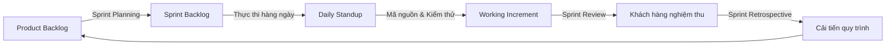

# CyberRig - Quy Chuẩn Khung Làm Việc Agile/Scrum (Scrum Framework)

Tài liệu này xác lập quy trình vận hành và chuẩn mực phát triển phần mềm theo mô hình **Agile/Scrum** dành riêng cho hệ sinh thái **CyberRig** (Bán lẻ phần cứng, Bộ cấu hình PC tương thích và Cổng quản lý bảo hành/sửa chữa).

---

## 1. Tầm Nhìn Sản Phẩm & Ba Trụ Cột Nghiệp Vụ (Product Vision)

CyberRig hướng tới trải nghiệm mua sắm và bảo dưỡng phần cứng máy tính công nghệ cao:
1. **PC Hardware Retail & Inventory Control**: Quản lý danh mục linh kiện, tra cứu tức thì, kiểm soát tồn kho đa thông số kỹ thuật (Socket, TDP, Form Factor, Clock speed, VRAM, v.v.).
2. **Intelligent PC Compatibility Builder**: Thuật toán thẩm định tương thích phần cứng theo thời gian thực (Socket CPU & Mainboard, Công suất nguồn PSU, Kích thước case/VGA, chuẩn RAM DDR4/DDR5, khe cắm M.2/PCIe).
3. **Repair & Warranty Lifecycle Tracking**: Quản lý toàn vẹn vòng đời phiếu sửa chữa máy tính qua State Machine nghiêm ngặt (RECEIVED → DIAGNOSING → QUOTED → REPAIRING → QC → COMPLETED), kèm báo giá chi tiết và tra cứu trực tuyến.

---

## 2. Cơ Cấu Vai Trò (Scrum Roles)

| Vai trò | Thành viên đảm nhiệm | Trách nhiệm cốt lõi |
| :--- | :--- | :--- |
| **Product Owner (PO)** | Khách hàng / Quản lý sản phẩm | • Xác định Product Goal và thứ tự ưu tiên trong Product Backlog. • Viết và làm rõ Tiêu chí chấp nhận (Acceptance Criteria) cho User Stories. • Nghiệm thu tính năng và quyết định phát hành (Release). |
| **Scrum Master (SM)** | Điều phối viên kỹ thuật / Lead Dev | • Hướng dẫn và bảo đảm nhóm tuân thủ đúng quy trình Scrum. • Loại bỏ các cản trở kỹ thuật (impediments / blockers). • Bảo vệ tiêu chuẩn chất lượng: Definition of Ready (DoR) và Definition of Done (DoD). |
| **Development Team** | Devs & AI Pair-Programmers (Antigravity) | • Phân tích giải pháp kỹ thuật, phân rã công việc (Task breakdown). • Ước lượng điểm độ phức tạp (Story Points). • Hiện thực hóa mã nguồn (TypeScript, Clean Code, Design System). • Viết kiểm thử tự động (Unit, Integration, E2E) và bàn giao Increment đạt chuẩn DoD. |

---

## 3. Nhịp Độ & Các Phiên Họp (Sprint Cadence & Events)

CyberRig áp dụng chu kỳ phát triển **3 Sprint hoàn thiện trong vòng 2.5 tháng (~3.5 tuần / Sprint)**, kết hợp giữa Scrum truyền thống và Vòng đời Tác tử ADLC (Agentic Development Life Cycle):

- **Sprint 1 (Tuần 1 - Tuần 3.5)**: Core Value Functional MVP (Những gì user có thể vào và sử dụng được ngay).
- **Sprint 2 (Tuần 3.5 - Tuần 7)**: UI/UX & Trải Nghiệm Tương Tác Cao Cấp (Design System, Dual-Theme, Studio Media, PC Setup).
- **Sprint 3 (Tuần 7 - Tuần 10.5)**: Hệ Thống Nâng Cao, Quản Trị, Bảo Mật & SI Monitoring Testing Lab.

### 3.1. Sprint Planning (Lập kế hoạch Sprint)
- **Thời điểm**: Ngày đầu tiên của Sprint (thời lượng khuyến nghị: 1 - 2 giờ).
- **Mục tiêu**:
  - Xác định **Sprint Goal** ngắn gọn, tập trung giá trị nghiệp vụ.
  - Chọn lọc các User Stories từ Product Backlog đã đạt chuẩn **DoR**.
  - Phân rã User Stories thành các Task kỹ thuật cụ thể (Frontend, Backend, Database, Test).

### 3.2. Daily Standup / Sync (Đồng bộ hàng ngày)
- **Hình thức**: Cuộc họp ngắn 10 - 15 phút hoặc bản tóm tắt tiến độ tự động qua 3 câu hỏi:
  1. *Tôi đã hoàn thành task kỹ thuật nào trong phiên trước?*
  2. *Tôi sẽ thực hiện task kỹ thuật nào trong phiên hôm nay?*
  3. *Có trở ngại kỹ thuật (blocker) hoặc rủi ro nào cần xử lý ngay không?*

### 3.3. Sprint Review & Demo (Đánh giá & Trình diễn)
- **Thời điểm**: Cuối Sprint.
- **Mục tiêu**:
  - Trình diễn trực quan sản phẩm hoạt động thực tế (Working Increment) trên Docker/Live Browser.
  - PO kiểm tra từng Tiêu chí chấp nhận (Acceptance Criteria) để phê duyệt hoặc yêu cầu chỉnh sửa.
  - Cập nhật lại Product Backlog dựa trên phản hồi thực tế.

### 3.4. Sprint Retrospective (Cải tiến quy trình)
- **Mục tiêu**: Đánh giá hiệu suất nội bộ theo 3 khía cạnh:
  - *What went well?* (Những gì nhóm đã làm rất tốt)
  - *What can be improved?* (Những điểm còn nghẽn hoặc gây chậm trễ)
  - *Action Items*: 1-2 hành động cải tiến cụ thể áp dụng ngay trong Sprint kế tiếp.

---

## 4. Thước Đo Ước Lượng (Estimation & Story Points)

CyberRig áp dụng dãy số **Fibonacci** để ước lượng độ phức tạp và nỗ lực kỹ thuật:

| Story Points | Mức độ phức tạp | Ví dụ điển hình trong CyberRig |
| :---: | :--- | :--- |
| **1 SP** | Rất nhỏ (Trivial / Simple tweak) | Đổi text nút bấm, sửa CSS màu viền, chỉnh sửa biến môi trường. |
| **2 SP** | Nhỏ (Minor feature / Fix) | Thêm 1 API route đơn giản, bổ sung validator cho input, viết unit test cho hàm helper. |
| **3 SP** | Trung bình (Standard feature) | Tạo trang hiển thị tĩnh kèm responsive, thêm bộ lọc đa tiêu chí cho 1 danh mục. |
| **5 SP** | Lớn (Complex feature) | Xây dựng thuật toán kiểm tra xung đột Socket, tích hợp State Machine chuyển trạng thái phiếu bảo hành. |
| **8 SP** | Rất lớn (High complexity / Multi-layer) | Hoàn thiện trọn vẹn luồng Checkout tích hợp VietQR, Cổng chẩn đoán kỹ thuật viên Split-view. |
| **13+ SP** | Quá lớn (Epic - Cần phân rã) | *Bắt buộc phân rã thành các User Stories nhỏ hơn ($\le 8\text{ SP}$) trước khi đưa vào Sprint.* |

---

## 5. Quy Chuẩn Đánh Mã Task (Task Nomenclature)

Mọi yêu cầu kỹ thuật phải được gắn mã định danh chuẩn theo cấu trúc:
`[SCRUM TASK] <MODULE_PREFIX>-<ID>: <TIÊU ĐỀ NGẮN GỌN>`

- **`FE-`**: Frontend UI / UX / Styling / Client logic (Ví dụ: `Task FE-06`, `Task FE-POLISH-DAYNIGHT-V3`).
- **`BE-`**: Backend Domain Service / Controller / API Routes (Ví dụ: `Task BE-07`, `Task BE-PORTALS`).
- **`CORE-`**: Hạ tầng cốt lõi: Auth, Security, Database Schema, Error Handler (Ví dụ: `Task CORE-RBAC`).
- **`DEVOPS-`**: Docker, Nginx Gateway, CI/CD, Script kiểm thử tải (Ví dụ: `Task DEVOPS-01`).

---

## 6. Bộ Tiêu Chuẩn Chất Lượng: DoR & DoD

### 6.1. Definition of Ready (DoR) - Tiêu Chuẩn Tiếp Nhận Công Việc
Một User Story chỉ được đưa vào Sprint Backlog khi thỏa mãn các điều kiện:
- [ ] **Rõ ràng nghiệp vụ**: Có User Story chuẩn: *"Là một [User], tôi muốn [Tính năng], để [Mục đích]"*.
- [ ] **Acceptance Criteria (AC)**: Có tối thiểu 2-4 tiêu chí chấp nhận viết dưới định dạng **Given - When - Then (Gherkin)**.
- [ ] **Đã ước lượng**: Đã được chấm điểm Story Points ($\le 8\text{ SP}$).
- [ ] **Xác định kiến trúc**: Rõ ràng các file/module sẽ bị ảnh hưởng (Model, Service, UI layout).
- [ ] **Không bị phụ thuộc**: Các API hoặc thành phần phụ thuộc đã sẵn sàng hoặc được mock chuẩn.

### 6.2. Definition of Done (DoD) - Tiêu Chuẩn Nghiệm Thu Công Việc
Một Task chỉ được chuyển sang trạng thái **Done** khi thỏa mãn toàn bộ:
- [ ] **Clean Code & SRP**: Mã nguồn ngắn gọn, không có file dài quá tải (>300 dòng không có lý do chính đáng), tách biệt rõ ràng giữa Business logic, Data fixtures và UI.
- [ ] **Type Safety**: 100% TypeScript Strict Mode, không sử dụng kiểu `any` vô căn cứ, `npx tsc --noEmit` hoàn thành với mã thoát `0`.
- [ ] **Automated Testing**: Mọi chức năng mới đều có kiểm thử tương ứng, lệnh `npm test` vượt qua 100%.
- [ ] **Design System & Visual Quality**: Tuân thủ triệt để bảng màu Neon Cyberpunk (Night) và Cobalt Professional (Day) theo `@docs/STYLE_GUIDE.md`, độ tương phản đạt chuẩn WCAG AA.
- [ ] **Live Verification**: Được xác thực trực tiếp trên trình duyệt hoặc chạy trơn tru trong container Docker (`cyberrig_app_prod` & `cyberrig_nginx_prod`).
- [ ] **Walkthrough Documentation**: Đã tạo hoặc cập nhật `walkthrough.md` kèm tóm tắt thay đổi và ảnh/video bằng chứng kiểm thử.
