# CyberRig - Master Sprint Backlog (Cấu Trúc 3 Sprint - 2.5 Tháng)

> **Mô hình**: Agile / Scrum phối hợp cùng Vòng đời Tác tử ADLC (Agentic Development Life Cycle)  
> **Tổng thời gian hoàn thiện**: **2.5 Tháng** (10.5 tuần / 75 ngày)  
> **Cấu trúc thực thi**:
> - **Sprint 1 (Tuần 1 - Tuần 3.5)**: **Core Value Functional MVP** - Những gì người dùng có thể trực tiếp vào và sử dụng được ngay (Duyệt phần cứng, PC Builder tương thích, Checkout VietQR, Tra cứu bảo hành 6 chặng & Duyệt báo giá trực tuyến).
> - **Sprint 2 (Tuần 3.5 - Tuần 7)**: **UI/UX & Trải Nghiệm Tương Tác Cao Cấp** - Ngôn ngữ thiết kế công nghiệp Cyberpunk, Hệ thống Dual-Theme Day/Night, Ảnh chụp thực tế Studio, PC Setup ngoại vi & Tối ưu hóa vi tương tác.
> - **Sprint 3 (Tuần 7 - Tuần 10.5)**: **Hệ Thống Nâng Cao, Quản Trị, Bảo Mật & SI Monitoring Lab** - Phân quyền RBAC, Redis Atomic Stock Lock, Cổng Admin Hub, Bảng giám sát SOC Real-time SSE, Dead Letter Queue & 6 Kịch bản Testing Lab.

---

## 1. Bảng Tổng Hợp Vận Tốc & Tiến Độ 3 Sprint (Velocity & Progress Matrix)

| Sprint ID | Tên Sprint & Trọng Tâm Nghiệp Vụ | Thời Gian Thực Hiện | SP Đăng Ký | SP Hoàn Thành | Tỷ Lệ Hoàn Thành | Trạng Thái |
| :---: | :--- | :---: | :---: | :---: | :---: | :---: |
| **Sprint 1** | **Core Value MVP**: Những gì user có thể vào và sử dụng được ngay | Tuần 1 - Tuần 3.5 (25 ngày) | 58 | 58 | 100% | [COMPLETED] |
| **Sprint 2** | **UI/UX Excellence**: Thiết kế công nghiệp, Dual-Theme & Studio Media | Tuần 3.5 - Tuần 7 (25 ngày) | 38 | 38 | 100% | [COMPLETED] |
| **Sprint 3** | **Enterprise Core**: Quản trị, Bảo mật, SI Monitoring SOC & Testing Lab | Tuần 7 - Tuần 10.5 (25 ngày) | 60 | 60 | 100% | [COMPLETED] |
| **TỔNG CỘNG** | **Toàn bộ chu kỳ phát triển 2.5 tháng** | **10.5 Tuần (75 Ngày)** | **156** | **156** | **100%** | **[DELIVERED]** |

---

## 2. Chi Tiết Thực Thi Từng Sprint & Sequence Diagram

---

### SPRINT 1: CORE VALUE MVP - NHỮNG GÌ USER CÓ THỂ VÀO VÀ SỬ DỤNG ĐƯỢC
- **Sprint Goal**: Xây dựng toàn bộ các luồng nghiệp vụ cốt lõi mà khách hàng và kỹ thuật viên có thể truy cập và thao tác được ngay lập tức: Xem danh mục phần cứng, Tự phối cấu hình PC với thuật toán kiểm tra Socket/TDP, Chuyển giỏ hàng sang Checkout thanh toán VietQR động Napas 247, và Tra cứu tiến độ phiếu sửa chữa kèm phê duyệt báo giá 2 chiều trực tuyến.
- **Thời gian thực hiện**: Tuần 1 đến Tuần 3.5 (25 ngày làm việc).
- **Dung lượng hoàn thành**: 58 Story Points.
- **Trạng thái**: [COMPLETED].

#### 1. Sơ Đồ Tuần Tự Sprint 1 (Sequence Diagram Sprint 1)

```mermaid
sequenceDiagram
    autonumber
    actor User as Khách Hàng / Kỹ Thuật Viên
    participant FE as CyberRig Frontend (/builder & /checkout)
    participant API as API Gateway / Router
    participant Compat as Compatibility Engine (Socket/TDP)
    participant Order as Order & Stock Service
    participant Ticket as Repair Ticket State Machine
    participant DB as PostgreSQL Database
    participant VietQR as Cổng Thanh Toán VietQR (Napas 247)

    %% Luồng 1: PC Builder & Checkout
    rect rgb(15, 23, 42)
        note over User, VietQR: Luồng 1: Khách hàng Build PC, Kiểm tra tương thích & Thanh toán VietQR
        User->>FE: Truy cập /builder và chọn CPU + Bo Mạch Chủ
        FE->>API: POST /api/compatibility/validate (payload: CPU, Mainboard)
        API->>Compat: Thẩm định SocketRule & PowerRule
        Compat-->>API: Kết quả: Compatible = True, TDP = 420W, Khuyến nghị PSU >= 650W
        API-->>FE: HTTP 200 (Cập nhật Compatibility Bar lên 100%)
        FE-->>User: Hiển thị giao diện an toàn & mở nút "[ TIẾN HÀNH MUA CẤU HÌNH ]"
        
        User->>FE: Bấm "Tiến Hành Mua Cấu Hình" -> Chuyển sang /checkout
        User->>FE: Điền thông tin giao hàng & bấm "Xác nhận đặt hàng"
        FE->>API: POST /api/orders (Danh sách linh kiện, thông tin người nhận)
        API->>Order: Kiểm tra tồn kho & tạo Price Snapshot
        Order->>DB: INSERT INTO orders & order_items
        DB-->>Order: Đã lưu đơn hàng (Mã: ORD-2026-8891)
        Order->>VietQR: Sinh mã VietQR động theo mã đơn hàng & số tiền
        VietQR-->>Order: Chuỗi QR Code URL Napas 247
        Order-->>API: Trả về đơn hàng ORD-2026-8891 + QR Code Payload
        API-->>FE: HTTP 201 Created (Hiển thị VietQR + Đồng hồ đếm ngược 15:00)
        FE-->>User: Quét mã VietQR trên App Ngân Hàng để thanh toán
    end

    %% Luồng 2: Repair Ticket Lifecycle & Two-Way Approval
    rect rgb(30, 41, 59)
        note over User, Ticket: Luồng 2: Tra cứu tiến độ bảo hành & Duyệt báo giá 2 chiều trực tuyến
        User->>FE: Truy cập /repair-tracking và nhập mã phiếu "TK-1001"
        FE->>API: GET /api/tickets/TK-1001/timeline
        API->>Ticket: Truy vấn trạng thái State Machine & Báo giá
        Ticket->>DB: SELECT * FROM repair_tickets WHERE code = 'TK-1001'
        DB-->>Ticket: Trả về trạng thái "QUOTED", danh mục thay thế & tiền công thợ
        Ticket-->>API: Payload phiếu bảo hành + bảng báo giá
        API-->>FE: HTTP 200 OK (Render Stepper 6 chặng, bước QUOTED sáng đèn)
        FE-->>User: Hiển thị bảng chi phí + 2 nút "[ ĐỒNG Ý SỬA CHỮA ]" / "[ TỪ CHỐI ]"
        
        User->>FE: Bấm nút "[ ĐỒNG Ý SỬA CHỮA ]"
        FE->>API: PATCH /api/tickets/TK-1001/approve (action: APPROVE)
        API->>Ticket: Thực thi chuyển trạng thái State Machine (QUOTED -> REPAIRING)
        Ticket->>DB: UPDATE repair_tickets SET status = 'REPAIRING' & INSERT status_logs
        DB-->>Ticket: Ghi nhận thành công
        Ticket-->>API: HTTP 200 OK (Trạng thái mới: REPAIRING)
        API-->>FE: Cập nhật giao diện tức thì
        FE-->>User: Hiển thị thông báo "Kỹ thuật viên đang tiến hành sửa chữa máy"
    end
```

#### 2. Danh Mục Tasks Kỹ Thuật Chi Tiết Sprint 1:
| Mã Task | User Story | Phân Loại | Mô tả kỹ thuật chi tiết | SP | Trạng thái |
| :--- | :---: | :---: | :--- | :---: | :---: |
| **TASK-SP1-01** | US-01 | FE | Giao diện danh mục linh kiện phần cứng (`/hardware`): bộ lọc theo danh mục, khoảng giá, thương hiệu, ô tìm kiếm thời gian thực. | 5 | [DONE] |
| **TASK-SP1-02** | US-02 | BE | Engine thẩm định tương thích Socket CPU & Bo Mạch Chủ (`POST /api/compatibility/validate`), nhận diện xung đột LGA1700 và AM5. | 8 | [DONE] |
| **TASK-SP1-03** | US-03 | BE | Domain Service tính toán công suất nguồn PSU và biên an toàn TDP (Safety margin $\ge 20\%$) giữa CPU, GPU và linh kiện ngoại vi. | 5 | [DONE] |
| **TASK-SP1-04** | US-04 | FE | Giao diện PC Builder (`/builder`): 8 khoang lắp ráp linh kiện, thanh tiến trình tương thích thời gian thực (0 - 100%), cảnh báo xung đột. | 5 | [DONE] |
| **TASK-SP1-05** | US-05 | FE/DATA | Thiết lập 3 bộ cấu hình định sẵn theo ngân sách (Gaming Ultra, Designer, Office Budget) cho phép nạp nhanh cấu hình bằng 1 click. | 3 | [DONE] |
| **TASK-SP1-06** | US-06 | FE | Luồng chuyển giỏ hàng PC Builder sang Checkout Split-View (`/checkout`): giữ nguyên danh sách linh kiện và tính tổng hóa đơn. | 5 | [DONE] |
| **TASK-SP1-07** | US-07 | BE | REST API Tạo đơn hàng (`POST /api/orders`) kèm cơ chế Price Snapshot bảo lưu giá niêm yết tại thời điểm tạo đơn. | 5 | [DONE] |
| **TASK-SP1-08** | US-08 | FE/BE | Cổng thanh toán tự động VietQR Napas 247: sinh mã QR động chứa mã đơn hàng và số tiền, tích hợp đồng hồ đếm ngược 15 phút. | 5 | [DONE] |
| **TASK-SP1-09** | US-09 | FE | Trang tra cứu trạng thái đơn hàng công khai (`/orders/:code`): xem trạng thái thanh toán và thông tin vận chuyển không cần đăng nhập. | 3 | [DONE] |
| **TASK-SP1-10** | US-10 | BE | State Machine vòng đời phiếu sửa chữa 6 giai đoạn (`RECEIVED` $\rightarrow$ `DIAGNOSING` $\rightarrow$ `QUOTED` $\rightarrow$ `REPAIRING` $\rightarrow$ `QC` $\rightarrow$ `COMPLETED`). | 5 | [DONE] |
| **TASK-SP1-11** | US-11 | FE | Cổng tra cứu tiến độ bảo hành công khai (`/repair-tracking`): Stepper 6 chặng trực quan, hiển thị lịch sử thời gian và biên bản giám định lỗi. | 5 | [DONE] |
| **TASK-SP1-12** | US-12, 13 | FE/BE | Tính năng phê duyệt báo giá 2 chiều: Kỹ thuật viên lập báo giá chi tiết; Khách hàng bấm `[ ĐỒNG Ý SỬA CHỮA ]` hoặc `[ TỪ CHỐI ]` trực tuyến. | 4 | [DONE] |

#### 3. Tiêu Chuẩn Hoàn Thành (Definition of Done - DoD) Sprint 1:
- [x] Khách hàng có thể truy cập `/builder`, tự phối 8 linh kiện và nhận phản hồi tương thích chuẩn xác.
- [x] Đơn hàng được tạo thành công kèm ảnh chụp giá (Price Snapshot) và mã VietQR thanh toán tự động hiển thị chính xác.
- [x] Phiếu sửa chữa kiểm soát nghiêm ngặt qua 6 trạng thái State Machine; khách hàng duyệt báo giá thành công trên trang tra cứu.
- [x] Bộ kiểm thử tự động `app.spec.ts` cho các luồng nghiệp vụ cốt lõi đạt tỷ lệ vượt qua 100%.

---

### SPRINT 2: UI/UX & TRẢI NGHIỆM TƯƠNG TÁC CAO CẤP
- **Sprint Goal**: Nâng cấp toàn diện phần nhìn và trải nghiệm cảm xúc của người dùng: Chuẩn hóa ngôn ngữ thiết kế công nghiệp Cyberpunk (bo góc 0px sắc nét, font kỹ thuật, neon accents, viền HUD scanner), triển khai hoàn hảo hệ thống Dual-Theme (Day / Night Mode) đạt chuẩn WCAG 2.1 AA, nạp bộ ảnh chụp thực tế Studio chất lượng cao cho 8 nhóm linh kiện, bổ sung danh mục PC Setup ngoại vi (`/equipments`), và hoàn thiện trải nghiệm Bàn làm việc Kỹ thuật viên cùng Cổng thông tin khách hàng.
- **Thời gian thực hiện**: Tuần 3.5 đến Tuần 7 (25 ngày làm việc).
- **Dung lượng hoàn thành**: 38 Story Points.
- **Trạng thái**: [COMPLETED].

#### 1. Sơ Đồ Tuần Tự Sprint 2 (Sequence Diagram Sprint 2)

```mermaid
sequenceDiagram
    autonumber
    actor User as Người Dùng / Khách Hàng
    participant Nav as Thanh Điều Hướng Header
    participant Theme as Theme Engine & CSS Tokens
    participant Catalog as Hardware / Equipments Catalog
    participant Studio as Studio Media Cache (WebP / Hi-Res)
    participant Builder as PC Builder HUD Scanner
    participant Storage as LocalStorage & Audio Feedback

    %% Luồng 1: Chuyển đổi Dual-Theme tức thì 60 FPS
    rect rgb(15, 23, 42)
        note over User, Storage: Luồng 1: Chuyển đổi Dual-Theme (Day/Night) mượt mà không lem mờ
        User->>Nav: Bấm nút chuyển đổi giao diện [ DAY / NIGHT ]
        Nav->>Theme: Kích hoạt toggleTheme()
        Theme->>Theme: Hoán đổi CSS Variables: --bg-primary, --border-color, --neon-glow
        Theme->>Storage: Lưu trạng thái theme ('day' hoặc 'night') vào LocalStorage
        Theme-->>Nav: Cập nhật biểu tượng Mặt trời / Mặt trăng
        Nav-->>User: Giao diện chuyển đổi tức thì (<16ms, đạt 60 FPS, chuẩn tương phản WCAG 2.1 AA)
    end

    %% Luồng 2: Nạp ảnh thực tế Studio & Nút "+ Chọn" phản hồi vi mô
    rect rgb(30, 41, 59)
        note over User, Builder: Luồng 2: Duyệt ảnh Studio thực tế & Tương tác "+ Chọn" vào PC Builder
        User->>Catalog: Duyệt danh mục linh kiện hoặc PC Setup ngoại vi (/equipments)
        Catalog->>Studio: Yêu cầu nạp ảnh linh kiện thực tế (CPU, GPU, Màn hình OLED...)
        Studio-->>Catalog: Trả về ảnh Studio chụp góc thực tế (thay thế hoàn toàn placeholder)
        Catalog-->>User: Hiển thị thẻ linh kiện sắc nét kèm thông số chuẩn
        
        User->>Catalog: Bấm nút "+ Chọn" trên Card linh kiện
        Catalog->>Storage: Phát âm thanh phản hồi vi mô (Click feedback)
        Catalog->>Builder: Dispatch sự kiện gán linh kiện vào khoang PC Builder
        Builder->>Builder: Kích hoạt hiệu ứng quét HUD Scanner mô phỏng vi mạch
        Builder->>Builder: Tính toán lại thanh tiến trình tương thích (lũy tiến an toàn)
        Builder-->>User: Cập nhật linh kiện vào dàn máy kèm hiệu ứng thị giác Neon
    end
```

#### 2. Danh Mục Tasks Kỹ Thuật Chi Tiết Sprint 2:
| Mã Task | User Story | Phân Loại | Mô tả kỹ thuật chi tiết | SP | Trạng thái |
| :--- | :---: | :---: | :--- | :---: | :---: |
| **TASK-SP2-01** | US-14 | UI/UX | Chuẩn hóa Design System Cyberpunk: bo góc 0px sắc cạnh, font kỹ thuật (Space Grotesk, Roboto Mono), viền HUD scanner. | 5 | [DONE] |
| **TASK-SP2-02** | US-15 | FE/STYLE | Xây dựng hệ thống Dual-Theme hoàn chỉnh (Day Mode / Night Mode), cấu trúc CSS Variables đồng bộ, đạt chuẩn WCAG 2.1 AA. | 5 | [DONE] |
| **TASK-SP2-03** | US-16 | UI-POLISH | Khắc phục triệt để lem bóng mờ Day Theme, chuẩn hóa viền Simulate HUD và tối ưu CSS Custom Variables đạt tốc độ 60 FPS. | 3 | [DONE] |
| **TASK-SP2-04** | US-17 | MEDIA | Xây dựng và tích hợp bộ ảnh chụp thực tế Studio chất lượng cao cho toàn bộ 8 nhóm linh kiện (CPU, GPU, RAM, Mainboard...), loại bỏ 100% placeholder. | 5 | [DONE] |
| **TASK-SP2-05** | US-18 | FE | Xây dựng trang PC Setup & Không gian làm việc (`/equipments`): 20 sản phẩm công thái học (Màn hình OLED, Bàn nâng hạ, Ghế Ergonomic). | 5 | [DONE] |
| **TASK-SP2-06** | US-19 | FE | Cải tiến Bàn làm việc Kỹ thuật viên (Technician Workbench): Split-View hàng đợi theo trạng thái, form chẩn đoán lỗi và tạo báo giá tối ưu tại quầy. | 5 | [DONE] |
| **TASK-SP2-07** | US-20 | FE | Cổng thông tin khách hàng tập trung (Customer Unified Hub): Quản lý dàn máy cá nhân, lịch sử đơn hàng và phiếu bảo hành. | 4 | [DONE] |
| **TASK-SP2-08** | US-21 | FE | Tinh chỉnh phản hồi vi mô (Micro-interactions): Hiệu ứng âm thanh khi bấm nút "+ Chọn", thanh tiến trình tương thích duy trì trạng thái khi rời chuột. | 3 | [DONE] |
| **TASK-SP2-09** | US-18 | QA | Bộ kiểm thử E2E giao diện kiểm tra tương thích theme và hiển thị catalog sản phẩm không bị vỡ bố cục trên mọi độ phân giải. | 3 | [DONE] |

#### 3. Tiêu Chuẩn Hoàn Thành (Definition of Done - DoD) Sprint 2:
- [x] Chuyển đổi Day / Night Mode mượt mà không bị giật lag, màu sắc tương phản đạt chuẩn WCAG 2.1 AA.
- [x] Toàn bộ linh kiện trên hệ thống sở hữu ảnh chụp Studio thực tế sắc nét, không còn ảnh placeholder.
- [x] Trang PC Setup & Thiết bị ngoại vi (`/equipments`) hoạt động hoàn hảo với 20 sản phẩm không gian làm việc.
- [x] Giao diện Bàn làm việc Kỹ thuật viên và Customer Hub đáp ứng thao tác nhanh chóng và thân thiện.

---

### SPRINT 3: HỆ THỐNG NÂNG CAO, QUẢN TRỊ, BẢO MẬT & SI MONITORING TESTING LAB
- **Sprint Goal**: Hoàn thiện toàn bộ hạ tầng chiều sâu, các tính năng quản trị cấp cao, bảo mật và hệ thống giám sát tích hợp phục vụ vận hành: Phân quyền RBAC 3 vai trò (`CUSTOMER`, `TECHNICIAN`, `ADMIN`), Bộ đệm khóa tồn kho nguyên tử Redis Atomic Stock Reservation (loại bỏ bán khống Zero Oversell), Cổng Quản trị kho hàng Admin Control Center, Bảng điều khiển giám sát SI Monitoring & Testing Lab phong cách Dark SOC Mission Control (SSE Telemetry, Dead Letter Queue & Replay, 6 kịch bản kiểm thử tích hợp), Cụm container Docker Compose và tích hợp chuỗi tạo tác ADLC.
- **Thời gian thực hiện**: Tuần 7 đến Tuần 10.5 (25 ngày làm việc).
- **Dung lượng hoàn thành**: 60 Story Points.
- **Trạng thái**: [COMPLETED].

#### 1. Sơ Đồ Tuần Tự Sprint 3 (Sequence Diagram Sprint 3)

```mermaid
sequenceDiagram
    autonumber
    actor AdminOps as Admin / DevOps / QA Engineer
    participant FE_Mon as SI Monitoring Dashboard (/admin-monitoring/)
    participant SSE as Server-Sent Events Hub (/api/monitoring/stream)
    participant Telemetry as Telemetry Service (In-Memory Ring Buffer)
    participant Docker as Docker Engine & System Health Probes
    participant DLQ as Dead Letter Queue (Poison Message Storage)
    participant Scenario as Scenario Runner Engine (6 Scenarios)
    participant RedisDB as Redis Atomic Stock Lock & PostgreSQL

    %% Luồng 1: Giám sát SOC Thời Gian Thực & Docker Health Probes
    rect rgb(15, 23, 42)
        note over AdminOps, Docker: Luồng 1: Giám sát SOC Mission Control qua In-Memory Telemetry & SSE Stream
        AdminOps->>FE_Mon: Truy cập /admin-monitoring/ (Tab [01] REAL-TIME MONITORING)
        FE_Mon->>SSE: Mở kết nối EventSource('/api/monitoring/stream')
        loop Chu kỳ 1000ms (Zero-DB Overhead)
            Telemetry->>Docker: Thu thập chỉ số CPU/RAM 4 container & Message Broker Queues
            Docker-->>Telemetry: Metrics (Postgres, Redis, App, Nginx: HEALTHY)
            Telemetry->>SSE: Đẩy bản ghi Telemetry từ Ring Buffer qua SSE
            SSE-->>FE_Mon: Cập nhật biểu đồ Gauge, Queue Metrics & Terminal Event Log
        end
    end

    %% Luồng 2: Cách ly Poison Message vào DLQ & Cơ chế Phát lại (Replay)
    rect rgb(30, 41, 59)
        note over AdminOps, DLQ: Luồng 2: Phát hiện thông điệp hỏng, cô lập vào DLQ và bấm phát lại (Replay)
        AdminOps->>FE_Mon: Bấm nút "Trigger DLQ Error" tại Scenario Lab
        FE_Mon->>Scenario: POST /api/monitoring/scenarios/trigger-dlq
        Scenario->>Scenario: Giả lập lỗi NACK / Poison Message sau 3 lần retry
        Scenario->>DLQ: Cách ly thông điệp hỏng vào bảng Dead Letter Queue
        DLQ-->>SSE: Bắn sự kiện DLQ_NEW_POISON_MESSAGE
        SSE-->>FE_Mon: Hiển thị dòng thông điệp lỗi trong bảng DLQ kèm nút [ REPLAY ]
        
        AdminOps->>FE_Mon: Bấm nút [ REPLAY ] trên hàng thông điệp lỗi
        FE_Mon->>Scenario: POST /api/monitoring/dlq/replay (messageId)
        Scenario->>DLQ: Tái nạp thông điệp về hàng đợi chính & xóa khỏi DLQ
        DLQ-->>FE_Mon: HTTP 200 OK
        FE_Mon-->>AdminOps: Hiển thị thông báo màu xanh trên Terminal: "[SUCCESS] Message Replayed"
    end

    %% Luồng 3: Kích hoạt Phòng Lab 6 Kịch Bản Kiểm Thử & Khóa Kho Nguyên Tử
    rect rgb(51, 65, 85)
        note over AdminOps, RedisDB: Luồng 3: Kích hoạt 6 kịch bản kiểm thử tích hợp & Khóa tồn kho nguyên tử
        AdminOps->>FE_Mon: Chuyển sang Tab [02] SCENARIO TESTING LAB & Bấm "Run Scenario 1: Order Placement"
        FE_Mon->>Scenario: POST /api/monitoring/scenarios/run (id: 'scenario-order')
        Scenario->>RedisDB: Bước 1: Gọi Redis Lua Script khóa kho nguyên tử (TTL 15 min)
        RedisDB-->>Scenario: Đã khóa an toàn (Zero Oversell)
        Scenario->>RedisDB: Bước 2: Tạo đơn hàng & Price Snapshot vào PostgreSQL
        Scenario->>Scenario: Bước 3 & 4: Sinh mã VietQR và xuất log kiểm toán
        Scenario-->>FE_Mon: Trả về kết quả 4/4 bước SUCCESS kèm Payload chi tiết
        FE_Mon-->>AdminOps: Hiển thị thẻ kịch bản chuyển màu Xanh Lục kèm dấu thời gian hoàn tất
    end
```

#### 2. Danh Mục Tasks Kỹ Thuật Chi Tiết Sprint 3:
| Mã Task | User Story | Phân Loại | Mô tả kỹ thuật chi tiết | SP | Trạng thái |
| :--- | :---: | :---: | :--- | :---: | :---: |
| **TASK-SP3-01** | US-22 | CORE/SEC | Hệ thống phân quyền RBAC 3 vai trò (`CUSTOMER`, `TECHNICIAN`, `ADMIN`), cơ chế JWT Token Rotation và Route Guards. | 5 | [DONE] |
| **TASK-SP3-02** | US-23 | CORE/DB | Động cơ khóa tồn kho nguyên tử Redis Atomic Stock Reservation sử dụng Lua script, cơ chế TTL tự động hủy sau 15 phút. | 8 | [DONE] |
| **TASK-SP3-03** | US-24 | BE/FE | Cổng Quản trị kho hàng Admin Control Center (`#admin`): CRUD linh kiện, cập nhật giá, nhập hàng bổ sung (Restock) và Soft Delete. | 5 | [DONE] |
| **TASK-SP3-04** | US-25 | BE/FE | Telemetry tồn kho & Cảnh báo số lượng linh kiện an toàn (Low Stock Alert $\le 3$ món), thống kê KPI doanh thu. | 3 | [DONE] |
| **TASK-SP3-05** | US-26 | FE | Giao diện SI Monitoring & Testing Dashboard (`/admin-monitoring/`): Thiết kế Dark SOC Mission Control, chuyển đổi tab Dual-Mode. | 8 | [DONE] |
| **TASK-SP3-06** | US-27 | BE | Động cơ In-Memory Ring Buffer Telemetry (200 sự kiện, Zero-DB overhead), thu thập metrics Docker và stream Server-Sent Events (SSE). | 5 | [DONE] |
| **TASK-SP3-07** | US-28 | BE/FE | Dead Letter Queue (DLQ) Inspector & Poison Message Quarantine: Bắt lỗi NACK, cô lập payload hỏng và nút bấm Replay phát lại thông điệp. | 5 | [DONE] |
| **TASK-SP3-08** | US-29 | BE/FE | Động cơ thực thi 6 kịch bản kiểm thử tích hợp tự động (`scenario-runner.service.ts`): Order, Stock, DLQ, AI Mapping, Rate Limit, Health. | 8 | [DONE] |
| **TASK-SP3-09** | US-30 | DEVOPS | Đóng gói cụm hạ tầng Docker Compose hoàn chỉnh (`postgres`, `redis`, `app`, `nginx`) kèm reverse proxy gateway và network isolation. | 5 | [DONE] |
| **TASK-SP3-10** | US-31 | REFACTOR | Tái cấu trúc Clean Code Monorepo: tách biệt fixtures, mocks; chuẩn hóa chuỗi tạo tác kiểm toán ADLC (`intent.md` $\rightarrow$ `spec.md` $\rightarrow$ `plan.md` $\rightarrow$ `code+tests`). | 5 | [DONE] |
| **TASK-SP3-11** | US-29 | QA | Xây dựng bộ kiểm thử tích hợp tự động `monitoring.spec.ts` (9/9 tests passed) xác thực hoạt động của Telemetry, DLQ và 6 Scenarios. | 3 | [DONE] |

#### 3. Tiêu Chuẩn Hoàn Thành (Definition of Done - DoD) Sprint 3:
- [x] Cơ chế khóa kho nguyên tử Redis Atomic Stock Reservation hoạt động tin cậy, ngăn chặn tuyệt đối tình trạng bán khống (Zero Oversell).
- [x] Middleware RBAC bảo vệ an toàn các endpoint của Admin và Technician; token hết hạn tự động từ chối truy cập.
- [x] Bảng điều khiển SI Monitoring chạy thời gian thực qua Server-Sent Events với Zero-DB Overhead trên cơ sở dữ liệu chính.
- [x] Dead Letter Queue bắt giữ chính xác thông điệp lỗi và hỗ trợ cơ chế phát lại (Replay) mượt mà.
- [x] Toàn bộ 6 kịch bản kiểm thử tích hợp thực thi thành công 100% trong phòng Lab; kiểm thử `monitoring.spec.ts` đạt 9/9 Passed.
- [x] Cụm Docker Compose khởi động thành công và kiểm tra sức khỏe đạt 100% Healthy.

---

## 3. Bảng Ma Trận Bàn Giao Hệ Thống (System Deliverables Matrix)

| Hạng mục bàn giao | Sprint Bàn Giao | Công nghệ & Chuẩn triển khai | Đường dẫn truy cập / Cấu hình | Trạng thái |
| :--- | :---: | :--- | :--- | :---: |
| **Bộ Cấu Hình PC Thông Minh (PC Builder)** | **Sprint 1** | Thuật toán Socket & TDP, Compatibility Bar | `http://localhost:4000/builder` | [DELIVERED] |
| **Cổng Đặt Hàng & Thanh Toán VietQR** | **Sprint 1** | Split-View Checkout, Dynamic VietQR Napas 247 | `http://localhost:4000/checkout` | [DELIVERED] |
| **Cổng Tra Cứu Bảo Hành & Duyệt Báo Giá** | **Sprint 1** | 6-Stage State Machine, Two-Way Online Approval | `http://localhost:4000/repair-tracking` | [DELIVERED] |
| **Danh Mục Linh Kiện Phần Cứng** | **Sprint 1, 2** | Bộ lọc đa tiêu chí, Studio Media thực tế chất lượng cao | `http://localhost:4000/hardware` | [DELIVERED] |
| **Hệ Thống Dual-Theme (Day / Night Mode)** | **Sprint 2** | CSS Tokens, 0px border-radius, WCAG 2.1 AA | Toàn bộ giao diện hệ thống | [DELIVERED] |
| **PC Setup & Thiết Bị Ngoại Vi** | **Sprint 2** | 20 Thiết bị không gian làm việc công thái học | `http://localhost:4000/equipments` | [DELIVERED] |
| **Bàn Làm Việc Kỹ Thuật Viên (Workbench)** | **Sprint 2** | Hàng đợi Split-View, Chẩn đoán lỗi & Lập báo giá Lab | `http://localhost:4000/#technician` | [DELIVERED] |
| **Customer Unified Hub** | **Sprint 2** | Quản lý dàn máy cá nhân, lịch sử đơn hàng & bảo hành | `http://localhost:4000/#dashboard` | [DELIVERED] |
| **Cổng Quản Trị Kho Hàng (Admin Hub)** | **Sprint 3** | CRUD linh kiện, Restock, Soft Delete, KPI tồn kho | `http://localhost:4000/#admin` | [DELIVERED] |
| **Khóa Tồn Kho Nguyên Tử & Bảo Mật RBAC** | **Sprint 3** | Redis Lua Script Atomic Lock, JWT Guard 3 vai trò | Backend Middleware & Services | [DELIVERED] |
| **SI Monitoring & Testing Lab Dashboard** | **Sprint 3** | Dual-Mode Dark SOC, Telemetry SSE, DLQ Replay, 6 Scenarios | `http://localhost:4000/admin-monitoring/` | [DELIVERED] |
| **Cụm Hạ Tầng Docker Production** | **Sprint 3** | PostgreSQL 16, Redis Alpine, App, Nginx Gateway | `docker compose -f docker-compose.prod.yml up -d` | [DELIVERED] |

---

## 4. Kịch Bản Nghiệm Thu & Trình Diễn Từng Sprint (Demonstration Guide)

### 4.1. Nghiệm Thu Sprint 1: Những gì user có thể vào và sử dụng được
1. **Trải nghiệm PC Builder & Thẩm định tương thích**:
   - Truy cập `/builder`, chọn CPU `AMD Ryzen 7 7800X3D` (AM5).
   - Chọn Bo mạch chủ `ASUS ROG STRIX Z790-E` (LGA1700) $\rightarrow$ Quan sát cảnh báo đỏ xung đột Socket tức thì.
   - Đổi sang Mainboard Socket AM5 $\rightarrow$ Thanh tiến trình tương thích đạt 100% màu xanh, hiển thị công suất nguồn khuyến nghị.
2. **Trải nghiệm Đặt hàng & Quét mã VietQR**:
   - Bấm `[ TIẾN HÀNH MUA CẤU HÌNH ]`, hệ thống chuyển hướng sang `/checkout`.
   - Điền thông tin giao hàng, chọn phương thức VietQR và xác nhận đơn hàng.
   - Quan sát mã VietQR tự động sinh chứa đúng mã đơn hàng và số tiền, có đồng hồ đếm ngược 15 phút.
   - Bấm nút giả lập chuyển khoản để chuyển trạng thái đơn hàng sang `[ STATUS: PAID ]`.
3. **Trải nghiệm Bảo hành & Duyệt báo giá 2 chiều**:
   - Truy cập `/repair-tracking`, nhập mã `TK-1001`.
   - Xem timeline 6 chặng đang ở bước `QUOTED`, đọc bảng chi phí vật tư và công thợ.
   - Bấm `[ ĐỒNG Ý SỬA CHỮA ]` $\rightarrow$ Quan sát trạng thái chuyển ngay sang `REPAIRING`.

### 4.2. Nghiệm Thu Sprint 2: UI/UX & Trải Nghiệm Tương Tác
1. **Kiểm tra Chuyển đổi Dual-Theme**:
   - Bấm nút chuyển đổi theme trên Header $\rightarrow$ Kiểm tra chuyển đổi mượt mà giữa Gaming Dark và Technical Light, viền HUD rõ nét, không lem bóng mờ.
2. **Kiểm tra Ảnh Studio Thực tế**:
   - Truy cập `/hardware` và `/builder` $\rightarrow$ Toàn bộ 8 danh mục linh kiện hiển thị ảnh chụp thực tế sắc nét, không còn ảnh placeholder.
3. **Khám phá Không Gian Làm Việc PC Setup**:
   - Truy cập `/equipments` $\rightarrow$ Duyệt xem 20 sản phẩm công thái học (Màn hình OLED, Bàn nâng hạ, Ghế công thái học).
4. **Kiểm tra Bàn làm việc Kỹ thuật viên & Customer Hub**:
   - Đăng nhập tài khoản kỹ thuật viên, mở Bàn làm việc `#technician` để xem giao diện Split-View hàng đợi và công cụ chẩn đoán Lab.

### 4.3. Nghiệm Thu Sprint 3: Quản Trị, Bảo Mật & SI Monitoring Lab
1. **Bảng điều khiển Giám sát SOC Thời Gian Thực**:
   - Truy cập `/admin-monitoring/` bằng tài khoản Admin.
   - Tại tab `[01] REAL-TIME MONITORING`: Quan sát 4 container Docker hiển thị trạng thái `HEALTHY`, chỉ số hàng đợi cập nhật trực tiếp qua dòng SSE, dòng nhật ký Terminal chạy liên tục.
2. **Kiểm tra Dead Letter Queue & Replay**:
   - Chuyển sang tab `[02] SCENARIO TESTING LAB`, bấm nút "Trigger DLQ Error".
   - Quay lại tab `[01] REAL-TIME MONITORING`, quan sát thông điệp lỗi độc hại (Poison Message) bị cô lập trong bảng DLQ.
   - Bấm nút `[ REPLAY ]` trên thông điệp lỗi $\rightarrow$ Thông điệp được tái nạp thành công và biến mất khỏi DLQ, xuất hiện log màu xanh trên Terminal Console.
3. **Chạy Kịch Bản Kiểm Thử Tự Động**:
   - Tại tab `[02] SCENARIO TESTING LAB`, lần lượt kích hoạt 6 kịch bản kiểm thử:
     - `Scenario 1: Order Placement Pipeline` (Khóa kho Redis Lua script $\rightarrow$ Snapshot đơn hàng $\rightarrow$ Sinh VietQR).
     - `Scenario 4: Run AI Data Mapping Pipeline` (Chuẩn hóa thông số kỹ thuật với độ chính xác >98%).
     - Quan sát thẻ trạng thái chuyển sang màu Xanh Lục và xem chi tiết dấu vết thực thi của từng bước.
