# CyberRig - Master Sprint Backlog (Cấu Trúc 4 Sprint — 182 Story Points)

> **Mô hình**: Agile / Scrum trên Jira Software (**Project Key: `SCRUM`** — Board thực tế: `https://minhlocle112.atlassian.net/jira/software/projects/SCRUM/boards/1`) kết hợp GitHub Flow, DevSecOps CI/CD & Vòng đời Tác tử ADLC  
> **Đội ngũ thực hiện**: 5 thành viên (`TV 1`–`TV 5`, 20% / thành viên)  
> **Tổng lộ trình**: **4 Sprint** (3 Sprint nghiệp vụ chính 2.5 tháng + 1 Sprint Gia cố Bảo mật & DevSecOps)  
> **Cấu trúc thực thi**:
> - **Sprint 1 (Tuần 1 - Tuần 3.5 | 58 SP)**: **Core Value Functional MVP** - Những gì người dùng có thể trực tiếp vào và sử dụng được ngay (Duyệt phần cứng, PC Builder tương thích, Checkout VietQR, Tra cứu bảo hành 6 chặng & Duyệt báo giá trực tuyến).
> - **Sprint 2 (Tuần 3.5 - Tuần 7 | 38 SP)**: **UI/UX & Trải Nghiệm Tương Tác Cao Cấp** - Ngôn ngữ thiết kế công nghiệp Cyberpunk, Hệ thống Dual-Theme Day/Night, Ảnh chụp thực tế Studio, PC Setup ngoại vi & Tối ưu hóa vi tương tác.
> - **Sprint 3 (Tuần 7 - Tuần 10.5 | 60 SP)**: **Hệ Thống Nâng Cao, Quản Trị, Bảo Mật Lõi & SI Monitoring Lab** - Phân quyền RBAC, Redis Atomic Stock Lock, Cổng Admin Hub, Bảng giám sát SOC Real-time SSE, Dead Letter Queue & 6 Kịch bản Testing Lab.
> - **Sprint 4 (Tuần 11 | 26 SP)**: **Security Hardening (OWASP Top 10) & DevSecOps Release** - Gia cố 3 giai đoạn bảo mật (`HttpOnly` Cookie Rotation, Redis Blacklist, Anti-IDOR, PII Masking, Webhook HMAC-SHA256, 2FA TOTP, `audit_logs`), Pipeline GitHub Actions 4 jobs và đồng bộ Use Case v2.1.

---

## 1. Bảng Tổng Hợp Vận Tốc & Tiến Độ 4 Sprint (Velocity & Progress Matrix)

| Sprint ID | Tên Sprint & Trọng Tâm Nghiệp Vụ | Thời Gian Thực Hiện | SP Đăng Ký | SP Hoàn Thành | Tỷ Lệ Hoàn Thành | Trạng Thái |
| :---: | :--- | :---: | :---: | :---: | :---: | :---: |
| **Sprint 1** | **Core Value MVP**: Những gì user có thể vào và sử dụng được ngay | Tuần 1 - Tuần 3.5 (25 ngày) | 58 | 58 | 100% | [COMPLETED] |
| **Sprint 2** | **UI/UX Excellence**: Thiết kế công nghiệp, Dual-Theme & Studio Media | Tuần 3.5 - Tuần 7 (25 ngày) | 38 | 38 | 100% | [COMPLETED] |
| **Sprint 3** | **Enterprise Core**: Quản trị, Bảo mật lõi, SI Monitoring SOC & Testing Lab | Tuần 7 - Tuần 10.5 (25 ngày) | 60 | 60 | 100% | [COMPLETED] |
| **Sprint 4** | **Security Hardening & DevSecOps**: OWASP 3 giai đoạn, CI/CD 4 jobs & Docs Sync | Tuần 11 (Hardening — 7 ngày) | 26 | 26 | 100% | [COMPLETED] |
| **TỔNG CỘNG** | **Toàn bộ chu kỳ phát triển & gia cố bảo mật** | **11.5 Tuần (4 Sprint)** | **182** | **182** | **100%** | **[DELIVERED]** |

---

## 2. Chi Tiết Thực Thi Từng Sprint & Sequence Diagram

---

### SPRINT 1: CORE VALUE MVP - NHỮNG GÌ USER CÓ THỂ VÀO VÀ SỬ DỤNG ĐƯỢC
- **Sprint Goal**: Xây dựng toàn bộ các luồng nghiệp vụ cốt lõi mà khách hàng và kỹ thuật viên có thể truy cập và thao tác được ngay lập tức: Xem danh mục phần cứng, Tự phối cấu hình PC với thuật toán kiểm tra Socket/TDP, Chuyển giỏ hàng sang Checkout thanh toán VietQR động Napas 247, và Tra cứu tiến độ phiếu sửa chữa kèm phê duyệt báo giá 2 chiều trực tuyến.
- **Thời gian thực hiện**: Tuần 1 đến Tuần 3.5 (25 ngày làm việc).
- **Dung lượng hoàn thành**: 58 Story Points.
- **Trạng thái**: [COMPLETED].

#### 1. Sơ Đồ Tuần Tự Sprint 1 (Sequence Diagram Sprint 1)

```mermaid
sequenceDiagram
    autonumber
    actor User as Khách Hàng / Kỹ Thuật Viên
    participant FE as CyberRig Frontend (/builder & /checkout)
    participant API as API Gateway / Router
    participant Compat as Compatibility Engine (Socket/TDP)
    participant Order as Order & Stock Service
    participant Ticket as Repair Ticket State Machine
    participant DB as PostgreSQL Database
    participant VietQR as Cổng Thanh Toán VietQR (Napas 247)

    %% Luồng 1: PC Builder & Checkout
    rect rgb(15, 23, 42)
        note over User, VietQR: Luồng 1: Khách hàng Build PC, Kiểm tra tương thích & Thanh toán VietQR
        User->>FE: Truy cập /builder và chọn CPU + Bo Mạch Chủ
        FE->>API: POST /api/compatibility/validate (payload: CPU, Mainboard)
        API->>Compat: Thẩm định SocketRule & PowerRule
        Compat-->>API: Kết quả: Compatible = True, TDP = 420W, Khuyến nghị PSU >= 650W
        API-->>FE: HTTP 200 (Cập nhật Compatibility Bar lên 100%)
        FE-->>User: Hiển thị giao diện an toàn & mở nút "[ TIẾN HÀNH MUA CẤU HÌNH ]"
        
        User->>FE: Bấm "Tiến Hành Mua Cấu Hình" -> Chuyển sang /checkout
        User->>FE: Điền thông tin giao hàng & bấm "Xác nhận đặt hàng"
        FE->>API: POST /api/orders (Danh sách linh kiện, thông tin người nhận)
        API->>Order: Kiểm tra tồn kho & tạo Price Snapshot
        Order->>DB: INSERT INTO orders & order_items
        DB-->>Order: Đã lưu đơn hàng (Mã: ORD-2026-8891)
        Order->>VietQR: Sinh mã VietQR động theo mã đơn hàng & số tiền
        VietQR-->>Order: Chuỗi QR Code URL Napas 247
        Order-->>API: Trả về đơn hàng ORD-2026-8891 + QR Code Payload
        API-->>FE: HTTP 201 Created (Hiển thị VietQR + Đồng hồ đếm ngược 15:00)
        FE-->>User: Quét mã VietQR trên App Ngân Hàng để thanh toán
    end

    %% Luồng 2: Repair Ticket Lifecycle & Two-Way Approval
    rect rgb(30, 41, 59)
        note over User, Ticket: Luồng 2: Tra cứu tiến độ bảo hành & Duyệt báo giá 2 chiều trực tuyến
        User->>FE: Truy cập /repair-tracking và nhập mã phiếu "TK-1001"
        FE->>API: GET /api/tickets/TK-1001/timeline
        API->>Ticket: Truy vấn trạng thái State Machine & Báo giá
        Ticket->>DB: SELECT * FROM repair_tickets WHERE code = 'TK-1001'
        DB-->>Ticket: Trả về trạng thái "QUOTED", danh mục thay thế & tiền công thợ
        Ticket-->>API: Payload phiếu bảo hành + bảng báo giá
        API-->>FE: HTTP 200 OK (Render Stepper 6 chặng, bước QUOTED sáng đèn)
        FE-->>User: Hiển thị bảng chi phí + 2 nút "[ ĐỒNG Ý SỬA CHỮA ]" / "[ TỪ CHỐI ]"
        
        User->>FE: Bấm nút "[ ĐỒNG Ý SỬA CHỮA ]"
        FE->>API: PATCH /api/tickets/TK-1001/approve (action: APPROVE)
        API->>Ticket: Thực thi chuyển trạng thái State Machine (QUOTED -> REPAIRING)
        Ticket->>DB: UPDATE repair_tickets SET status = 'REPAIRING' & INSERT status_logs
        DB-->>Ticket: Ghi nhận thành công
        Ticket-->>API: HTTP 200 OK (Trạng thái mới: REPAIRING)
        API-->>FE: Cập nhật giao diện tức thì
        FE-->>User: Hiển thị thông báo "Kỹ thuật viên đang tiến hành sửa chữa máy"
    end
```

#### 2. Danh Mục Tasks Kỹ Thuật Chi Tiết Sprint 1:
| Mã Task | Jira Key | User Story | Phân Loại | Phụ Trách | Mô tả kỹ thuật chi tiết | SP Story | Trạng thái |
| :--- | :---: | :---: | :---: | :---: | :--- | :---: | :---: |
| **TASK-SP1-01** (`FE-01`) | `SCRUM-4` | US-01 (`SCRUM-42`) | FE | TV 2 | Giao diện danh mục linh kiện phần cứng (`/hardware`): bộ lọc theo danh mục, khoảng giá, thương hiệu, ô tìm kiếm thời gian thực. | 5 | [DONE] |
| **TASK-SP1-02** (`BE-01`) | `SCRUM-52` | US-02 (`SCRUM-15`) | BE | TV 3 | Engine thẩm định tương thích 4 Rules (Socket CPU–Mainboard, RAM, Clearance, Power) qua `POST /api/compatibility/validate`. | 8 | [DONE] |
| **TASK-SP1-03** (`BE-02`) | `SCRUM-53` | US-03 (`SCRUM-16`) | BE | TV 3 | Domain Service tính toán công suất nguồn PSU và biên an toàn TDP (Safety margin $\ge 25\%$) giữa CPU, GPU và linh kiện ngoại vi. | 3 | [DONE] |
| **TASK-SP1-04** (`FE-02`) | `SCRUM-54` | US-04 (`SCRUM-17`) | FE | TV 2 | Giao diện PC Builder (`/builder`): 8 khoang lắp ráp linh kiện, thanh tiến trình tương thích thời gian thực (0 - 100%), cảnh báo xung đột. | 5 | [DONE] |
| **TASK-SP1-05** (`FE-03`) | `SCRUM-55` | US-05 (`SCRUM-18`) | FE/DATA | TV 2 | Thiết lập 3 bộ cấu hình định sẵn theo ngân sách (Gaming Ultra, Designer, Office Budget) cho phép nạp nhanh cấu hình bằng 1 click. | 3 | [DONE] |
| **TASK-SP1-06** (`FE-04`) | `SCRUM-56` | US-06 (`SCRUM-19`) | FE | TV 1 | Luồng chuyển giỏ hàng PC Builder sang Checkout Split-View (`/checkout`): giữ nguyên danh sách linh kiện và tính tổng hóa đơn. | 5 | [DONE] |
| **TASK-SP1-07** (`BE-03`) | `SCRUM-57` | US-07 (`SCRUM-20`) | BE | TV 4 | REST API Tạo đơn hàng (`POST /api/orders`) kèm cơ chế Price Snapshot bảo lưu giá niêm yết tại thời điểm tạo đơn. | 5 | [DONE] |
| **TASK-SP1-08** (`FE-05`) | `SCRUM-58` | US-08 (`SCRUM-21`) | FE/BE | TV 1 | Cổng thanh toán tự động VietQR Napas 247: sinh mã QR động chứa mã đơn hàng và số tiền, tích hợp đồng hồ đếm ngược 15 phút. | 5 | [DONE] |
| **TASK-SP1-09** (`FE-06`) | `SCRUM-59` | US-09 (`SCRUM-22`) | FE | TV 1 | Trang tra cứu trạng thái đơn hàng công khai (`/orders/:code`): xem trạng thái thanh toán và thông tin vận chuyển. | 3 | [DONE] |
| **TASK-SP1-10** (`BE-04`) | `SCRUM-60` | US-10 (`SCRUM-23`) | BE | TV 3 | Finite State Machine vòng đời phiếu sửa chữa 8 trạng thái (`RECEIVED` $\rightarrow$ `DIAGNOSING` $\rightarrow$ `QUOTED` $\rightarrow$ `APPROVED` / `REJECTED` $\rightarrow$ `REPAIRING` $\rightarrow$ `TESTING_QC` $\rightarrow$ `COMPLETED`). | 5 | [DONE] |
| **TASK-SP1-11** (`FE-07`) | `SCRUM-61` | US-11 (`SCRUM-24`) | FE | TV 2 | Cổng tra cứu tiến độ bảo hành công khai (`/repair-tracking`): Stepper timeline 6 chặng trực quan, hiển thị lịch sử thời gian và biên bản giám định lỗi. | 5 | [DONE] |
| **TASK-SP1-12** (`BE-05`) | `SCRUM-62` | US-12, US-13 (`SCRUM-25`, `SCRUM-26`) | FE/BE | TV 3 | Tính năng phê duyệt báo giá 2 chiều: Kỹ thuật viên lập báo giá vật tư & công thợ (`US-13`: 3 SP); Khách hàng bấm `[ ĐỒNG Ý SỬA CHỮA ]` / `[ TỪ CHỐI ]` (`US-12`: 3 SP). | 6 (3+3) | [DONE] |

#### 3. Tiêu Chuẩn Hoàn Thành (Definition of Done - DoD) Sprint 1:
- [x] Khách hàng có thể truy cập `/builder`, tự phối 8 linh kiện và nhận phản hồi tương thích chuẩn xác.
- [x] Đơn hàng được tạo thành công kèm ảnh chụp giá (Price Snapshot) và mã VietQR thanh toán tự động hiển thị chính xác.
- [x] Phiếu sửa chữa kiểm soát nghiêm ngặt qua 6 trạng thái State Machine; khách hàng duyệt báo giá thành công trên trang tra cứu.
- [x] Bộ kiểm thử tự động `app.spec.ts` cho các luồng nghiệp vụ cốt lõi đạt tỷ lệ vượt qua 100%.

---

### SPRINT 2: UI/UX & TRẢI NGHIỆM TƯƠNG TÁC CAO CẤP
- **Sprint Goal**: Nâng cấp toàn diện phần nhìn và trải nghiệm cảm xúc của người dùng: Chuẩn hóa ngôn ngữ thiết kế công nghiệp Cyberpunk (bo góc 0px sắc nét, font kỹ thuật, neon accents, viền HUD scanner), triển khai hoàn hảo hệ thống Dual-Theme (Day / Night Mode) đạt chuẩn WCAG 2.1 AA, nạp bộ ảnh chụp thực tế Studio chất lượng cao cho 8 nhóm linh kiện, bổ sung danh mục PC Setup ngoại vi (`/equipments`), và hoàn thiện trải nghiệm Bàn làm việc Kỹ thuật viên cùng Cổng thông tin khách hàng.
- **Thời gian thực hiện**: Tuần 3.5 đến Tuần 7 (25 ngày làm việc).
- **Dung lượng hoàn thành**: 38 Story Points.
- **Trạng thái**: [COMPLETED].

#### 1. Sơ Đồ Tuần Tự Sprint 2 (Sequence Diagram Sprint 2)

```mermaid
sequenceDiagram
    autonumber
    actor User as Người Dùng / Khách Hàng
    participant Nav as Thanh Điều Hướng Header
    participant Theme as Theme Engine & CSS Tokens
    participant Catalog as Hardware / Equipments Catalog
    participant Studio as Studio Media Cache (WebP / Hi-Res)
    participant Builder as PC Builder HUD Scanner
    participant Storage as LocalStorage & Audio Feedback

    %% Luồng 1: Chuyển đổi Dual-Theme tức thì 60 FPS
    rect rgb(15, 23, 42)
        note over User, Storage: Luồng 1: Chuyển đổi Dual-Theme (Day/Night) mượt mà không lem mờ
        User->>Nav: Bấm nút chuyển đổi giao diện [ DAY / NIGHT ]
        Nav->>Theme: Kích hoạt toggleTheme()
        Theme->>Theme: Hoán đổi CSS Variables: --bg-primary, --border-color, --neon-glow
        Theme->>Storage: Lưu trạng thái theme ('day' hoặc 'night') vào LocalStorage
        Theme-->>Nav: Cập nhật biểu tượng Mặt trời / Mặt trăng
        Nav-->>User: Giao diện chuyển đổi tức thì (<16ms, đạt 60 FPS, chuẩn tương phản WCAG 2.1 AA)
    end

    %% Luồng 2: Nạp ảnh thực tế Studio & Nút "+ Chọn" phản hồi vi mô
    rect rgb(30, 41, 59)
        note over User, Builder: Luồng 2: Duyệt ảnh Studio thực tế & Tương tác "+ Chọn" vào PC Builder
        User->>Catalog: Duyệt danh mục linh kiện hoặc PC Setup ngoại vi (/equipments)
        Catalog->>Studio: Yêu cầu nạp ảnh linh kiện thực tế (CPU, GPU, Màn hình OLED...)
        Studio-->>Catalog: Trả về ảnh Studio chụp góc thực tế (thay thế hoàn toàn placeholder)
        Catalog-->>User: Hiển thị thẻ linh kiện sắc nét kèm thông số chuẩn
        
        User->>Catalog: Bấm nút "+ Chọn" trên Card linh kiện
        Catalog->>Storage: Phát âm thanh phản hồi vi mô (Click feedback)
        Catalog->>Builder: Dispatch sự kiện gán linh kiện vào khoang PC Builder
        Builder->>Builder: Kích hoạt hiệu ứng quét HUD Scanner mô phỏng vi mạch
        Builder->>Builder: Tính toán lại thanh tiến trình tương thích (lũy tiến an toàn)
        Builder-->>User: Cập nhật linh kiện vào dàn máy kèm hiệu ứng thị giác Neon
    end
```

#### 2. Danh Mục Tasks Kỹ Thuật Chi Tiết Sprint 2:
| Mã Task | Jira Key | User Story | Phân Loại | Phụ Trách | Mô tả kỹ thuật chi tiết | SP | Trạng thái |
| :--- | :---: | :---: | :---: | :---: | :--- | :---: | :---: |
| **TASK-SP2-01** (`FE-08`) | `SCRUM-63` | US-14 (`SCRUM-27`) | UI/UX | TV 2 | Chuẩn hóa Design System Cyberpunk v2.1: bo góc 0px sắc cạnh, font kỹ thuật (`Barlow Condensed` / `JetBrains Mono`), viền HUD scanner. | 5 | [DONE] |
| **TASK-SP2-02** (`FE-09`) | `SCRUM-64` | US-15 (`SCRUM-28`) | FE/STYLE | TV 2 | Xây dựng hệ thống Dual-Theme hoàn chỉnh (Day Mode / Night Mode), cấu trúc CSS Variables đồng bộ, đạt chuẩn WCAG 2.1 AA. | 5 | [DONE] |
| **TASK-SP2-03** (`FE-10`) | `SCRUM-65` | US-16 (`SCRUM-29`) | UI-POLISH | TV 2 | Khắc phục triệt để lem bóng mờ Day Theme, chuẩn hóa viền Simulate HUD và tối ưu CSS Custom Variables đạt tốc độ 60 FPS. | 3 | [DONE] |
| **TASK-SP2-04** (`FE-11`) | `SCRUM-66` | US-17 (`SCRUM-30`) | MEDIA | TV 1 | Xây dựng và tích hợp bộ ảnh chụp thực tế Studio chất lượng cao cho toàn bộ 8 nhóm linh kiện (CPU, GPU, RAM, Mainboard...), loại bỏ 100% placeholder. | 5 | [DONE] |
| **TASK-SP2-05** (`FE-12`) | `SCRUM-67` | US-18 (`SCRUM-31`) | FE | TV 2 | Xây dựng trang PC Setup & Không gian làm việc (`/equipments`): 20 sản phẩm công thái học (Màn hình OLED, Bàn nâng hạ, Ghế Ergonomic). | 5 | [DONE] |
| **TASK-SP2-06** (`FE-13`) | `SCRUM-68` | US-19 (`SCRUM-32`) | FE | TV 2 | Cải tiến Bàn làm việc Kỹ thuật viên (Technician Workbench `#technician`): Split-View hàng đợi theo trạng thái, form chẩn đoán lỗi và tạo báo giá tối ưu tại quầy. | 5 | [DONE] |
| **TASK-SP2-07** (`FE-14`) | `SCRUM-69` | US-20 (`SCRUM-33`) | FE | TV 1 | Cổng thông tin khách hàng tập trung (Customer Unified Hub `#dashboard`): Quản lý dàn máy cá nhân, lịch sử đơn hàng và phiếu bảo hành. | 5 | [DONE] |
| **TASK-SP2-08** (`FE-15`) | `SCRUM-70` | US-21 (`SCRUM-34`) | FE | TV 2 | Tinh chỉnh phản hồi vi mô (Micro-interactions): Hiệu ứng `scale(0.96)`, nút "+ Chọn" đồng bộ nhanh, thanh tiến trình tương thích ổn định. | 3 | [DONE] |
| **TASK-SP2-09** (`QA-01`) | `SCRUM-71` | US-22 (`SCRUM-35`) | QA | TV 5 | Bộ 8 UI/Admin spec tests (`src/ui/**.spec.ts`) kiểm tra tương thích theme, responsive đa độ phân giải và luồng giao diện. | 2 | [DONE] |

#### 3. Tiêu Chuẩn Hoàn Thành (Definition of Done - DoD) Sprint 2:
- [x] Chuyển đổi Day / Night Mode mượt mà không bị giật lag, màu sắc tương phản đạt chuẩn WCAG 2.1 AA.
- [x] Toàn bộ linh kiện trên hệ thống sở hữu ảnh chụp Studio thực tế sắc nét, không còn ảnh placeholder.
- [x] Trang PC Setup & Thiết bị ngoại vi (`/equipments`) hoạt động hoàn hảo với 20 sản phẩm không gian làm việc.
- [x] Giao diện Bàn làm việc Kỹ thuật viên và Customer Hub đáp ứng thao tác nhanh chóng và thân thiện.

---

### SPRINT 3: HỆ THỐNG NÂNG CAO, QUẢN TRỊ, BẢO MẬT & SI MONITORING TESTING LAB
- **Sprint Goal**: Hoàn thiện toàn bộ hạ tầng chiều sâu, các tính năng quản trị cấp cao, bảo mật và hệ thống giám sát tích hợp phục vụ vận hành: Phân quyền RBAC 3 vai trò (`CUSTOMER`, `TECHNICIAN`, `ADMIN`), Bộ đệm khóa tồn kho nguyên tử Redis Atomic Stock Reservation (loại bỏ bán khống Zero Oversell), Cổng Quản trị kho hàng Admin Control Center, Bảng điều khiển giám sát SI Monitoring & Testing Lab phong cách Dark SOC Mission Control (SSE Telemetry, Dead Letter Queue & Replay, 6 kịch bản kiểm thử tích hợp), Cụm container Docker Compose và tích hợp chuỗi tạo tác ADLC.
- **Thời gian thực hiện**: Tuần 7 đến Tuần 10.5 (25 ngày làm việc).
- **Dung lượng hoàn thành**: 60 Story Points.
- **Trạng thái**: [COMPLETED].

#### 1. Sơ Đồ Tuần Tự Sprint 3 (Sequence Diagram Sprint 3)

```mermaid
sequenceDiagram
    autonumber
    actor AdminOps as Admin / DevOps / QA Engineer
    participant FE_Mon as SI Monitoring Dashboard (/admin-monitoring/)
    participant SSE as Server-Sent Events Hub (/api/monitoring/stream)
    participant Telemetry as Telemetry Service (In-Memory Ring Buffer)
    participant Docker as Docker Engine & System Health Probes
    participant DLQ as Dead Letter Queue (Poison Message Storage)
    participant Scenario as Scenario Runner Engine (6 Scenarios)
    participant RedisDB as Redis Atomic Stock Lock & PostgreSQL

    %% Luồng 1: Giám sát SOC Thời Gian Thực & Docker Health Probes
    rect rgb(15, 23, 42)
        note over AdminOps, Docker: Luồng 1: Giám sát SOC Mission Control qua In-Memory Telemetry & SSE Stream
        AdminOps->>FE_Mon: Truy cập /admin-monitoring/ (Tab [01] REAL-TIME MONITORING)
        FE_Mon->>SSE: Mở kết nối EventSource('/api/monitoring/stream')
        loop Chu kỳ 1000ms (Zero-DB Overhead)
            Telemetry->>Docker: Thu thập chỉ số CPU/RAM 4 container & Message Broker Queues
            Docker-->>Telemetry: Metrics (Postgres, Redis, App, Nginx: HEALTHY)
            Telemetry->>SSE: Đẩy bản ghi Telemetry từ Ring Buffer qua SSE
            SSE-->>FE_Mon: Cập nhật biểu đồ Gauge, Queue Metrics & Terminal Event Log
        end
    end

    %% Luồng 2: Cách ly Poison Message vào DLQ & Cơ chế Phát lại (Replay)
    rect rgb(30, 41, 59)
        note over AdminOps, DLQ: Luồng 2: Phát hiện thông điệp hỏng, cô lập vào DLQ và bấm phát lại (Replay)
        AdminOps->>FE_Mon: Bấm nút "Trigger DLQ Error" tại Scenario Lab
        FE_Mon->>Scenario: POST /api/monitoring/scenarios/trigger-dlq
        Scenario->>Scenario: Giả lập lỗi NACK / Poison Message sau 3 lần retry
        Scenario->>DLQ: Cách ly thông điệp hỏng vào bảng Dead Letter Queue
        DLQ-->>SSE: Bắn sự kiện DLQ_NEW_POISON_MESSAGE
        SSE-->>FE_Mon: Hiển thị dòng thông điệp lỗi trong bảng DLQ kèm nút [ REPLAY ]
        
        AdminOps->>FE_Mon: Bấm nút [ REPLAY ] trên hàng thông điệp lỗi
        FE_Mon->>Scenario: POST /api/monitoring/dlq/replay (messageId)
        Scenario->>DLQ: Tái nạp thông điệp về hàng đợi chính & xóa khỏi DLQ
        DLQ-->>FE_Mon: HTTP 200 OK
        FE_Mon-->>AdminOps: Hiển thị thông báo màu xanh trên Terminal: "[SUCCESS] Message Replayed"
    end

    %% Luồng 3: Kích hoạt Phòng Lab 6 Kịch Bản Kiểm Thử & Khóa Kho Nguyên Tử
    rect rgb(51, 65, 85)
        note over AdminOps, RedisDB: Luồng 3: Kích hoạt 6 kịch bản kiểm thử tích hợp & Khóa tồn kho nguyên tử
        AdminOps->>FE_Mon: Chuyển sang Tab [02] SCENARIO TESTING LAB & Bấm "Run Scenario 1: Order Placement"
        FE_Mon->>Scenario: POST /api/monitoring/scenarios/run (id: 'scenario-order')
        Scenario->>RedisDB: Bước 1: Gọi Redis Lua Script khóa kho nguyên tử (TTL 15 min)
        RedisDB-->>Scenario: Đã khóa an toàn (Zero Oversell)
        Scenario->>RedisDB: Bước 2: Tạo đơn hàng & Price Snapshot vào PostgreSQL
        Scenario->>Scenario: Bước 3 & 4: Sinh mã VietQR và xuất log kiểm toán
        Scenario-->>FE_Mon: Trả về kết quả 4/4 bước SUCCESS kèm Payload chi tiết
        FE_Mon-->>AdminOps: Hiển thị thẻ kịch bản chuyển màu Xanh Lục kèm dấu thời gian hoàn tất
    end
```

#### 2. Danh Mục Tasks Kỹ Thuật Chi Tiết Sprint 3:
| Mã Task | Jira Key | User Story | Phân Loại | Phụ Trách | Mô tả kỹ thuật chi tiết | SP | Trạng thái |
| :--- | :---: | :---: | :---: | :---: | :--- | :---: | :---: |
| **TASK-SP3-01** (`CORE-01`) | `SCRUM-72` | US-23 (`SCRUM-43`) | CORE/SEC | TV 4 | Xây dựng `auth.middleware.ts` (`authenticateToken`, `requireRoles`) phân quyền RBAC 3 vai trò (`CUSTOMER`, `TECHNICIAN`, `ADMIN`) & JWT util. | 5 | [DONE] |
| **TASK-SP3-02** (`CORE-02`) | `SCRUM-73` | US-24 (`SCRUM-44`) | CORE/DB | TV 3 | Động cơ khóa tồn kho nguyên tử Redis Atomic Stock Reservation sử dụng `LUA_RESERVE_STOCK`, rollback khi thiếu hàng & TTL tự động hủy sau 15 phút. | 8 | [DONE] |
| **TASK-SP3-03** (`BE-06`) | `SCRUM-74` | US-25 (`SCRUM-45`) | BE | TV 4 | Xây dựng Admin CRUD/Restock/Soft-Delete API & PostgreSQL `seed.ts` + In-Memory Fallback. | 4 | [DONE] |
| **TASK-SP3-04** (`FE-16`) | `SCRUM-75` | US-25 (`SCRUM-45`) | FE | TV 4 | Hoàn thiện bảng điều khiển Admin Control Center (`#admin`): CRUD linh kiện, điều chỉnh giá, nhập kho và Soft Delete. | 4 | [DONE] |
| **TASK-SP3-05** (`BE-07`) | `SCRUM-76` | US-26 (`SCRUM-46`) | BE/FE | TV 4 | Xây dựng API thống kê KPI tồn kho và cảnh báo số lượng linh kiện an toàn (Low Stock Alert $\le 3$). | 5 | [DONE] |
| **TASK-SP3-06** (`FE-17`) | `SCRUM-77` | US-27 (`SCRUM-47`) | FE | TV 5 | Giao diện SI Monitoring & Testing Dashboard (`/admin-monitoring/`): Thiết kế Dark SOC Mission Control Dual-Mode. | 8 | [DONE] |
| **TASK-SP3-07** (`BE-08`) | `SCRUM-78` | US-28 (`SCRUM-48`) | BE | TV 5 | Động cơ In-Memory Ring Buffer Telemetry (Zero-DB overhead), thu thập metrics Docker và SSE Event Hub. | 5 | [DONE] |
| **TASK-SP3-08** (`BE-09`) | `SCRUM-79` | US-29 (`SCRUM-49`) | BE/FE | TV 5 | Dead Letter Queue (DLQ) Quarantine Storage & API Replay / Clear DLQ xử lý Poison Message. | 5 | [DONE] |
| **TASK-SP3-09** (`BE-10`) | `SCRUM-80` | US-30 (`SCRUM-50`) | BE/FE | TV 5 | Động cơ `scenario-runner.service.ts` thực thi 6 kịch bản kiểm thử Lab: Order, Stock, DLQ, AI Mapping, Rate Limit, Health. | 5 | [DONE] |
| **TASK-SP3-10** (`QA-02`) | `SCRUM-81` | US-30 (`SCRUM-50`) | QA | TV 5 | Bộ kiểm thử tích hợp tự động `monitoring.spec.ts` & `health.spec.ts` xác thực Telemetry, DLQ và 6 Scenarios. | 3 | [DONE] |
| **TASK-SP3-11** (`DEVOPS-01`) | `SCRUM-82` | US-31 (`SCRUM-51`) | DEVOPS | TV 5 | Đóng gói Docker Compose 4 containers (`postgres`, `redis`, `app`, `nginx`), Nginx Gateway, Clean Code Monorepo & chuỗi tạo tác ADLC (`intent.md` $\rightarrow$ `spec.md` $\rightarrow$ `plan.md`). | 8 | [DONE] |

#### 3. Tiêu Chuẩn Hoàn Thành (Definition of Done - DoD) Sprint 3:
- [x] Cơ chế khóa kho nguyên tử Redis Atomic Stock Reservation hoạt động tin cậy, ngăn chặn tuyệt đối tình trạng bán khống (Zero Oversell).
- [x] Middleware RBAC bảo vệ an toàn các endpoint của Admin và Technician; token hết hạn tự động từ chối truy cập.
- [x] Bảng điều khiển SI Monitoring chạy thời gian thực qua Server-Sent Events với Zero-DB Overhead trên cơ sở dữ liệu chính.
- [x] Dead Letter Queue bắt giữ chính xác thông điệp lỗi và hỗ trợ cơ chế phát lại (Replay) mượt mà.
- [x] Toàn bộ 6 kịch bản kiểm thử tích hợp thực thi thành công 100% trong phòng Lab; kiểm thử `monitoring.spec.ts` đạt 9/9 Passed.
- [x] Cụm Docker Compose khởi động thành công và kiểm tra sức khỏe đạt 100% Healthy.

---

### SPRINT 4: SECURITY HARDENING (OWASP TOP 10) & DEVSECOPS RELEASE
- **Sprint Goal**: Triển khai trọn bộ 3 giai đoạn gia cố bảo mật theo chuẩn OWASP Top 10 / OWASP API Top 10 (`HttpOnly` Cookie Refresh Rotation + Reuse Detection, Redis `jti` Blacklist, Anti-IDOR + PII Masking, RBAC `ADMIN` cho SOC + Single-use SSE Ticket, Webhook VietQR HMAC-SHA256, MFA/2FA TOTP RFC 6238, `audit_logs` bất biến), thiết lập cổng kiểm soát DevSecOps 4-job trên GitHub Actions và đồng bộ toàn bộ Sơ đồ Use Case v2.1 + tài liệu báo cáo.
- **Thời gian thực hiện**: Tuần 11 (Hardening Sprint — 7 ngày làm việc).
- **Dung lượng hoàn thành**: 26 Story Points (`EPIC-10`, 6 Stories, 12 Sub-tasks).
- **Trạng thái**: [COMPLETED].

#### 1. Sơ Đồ Tuần Tự Sprint 4 (Security Hardening & DevSecOps CI Gate)

```mermaid
sequenceDiagram
    autonumber
    actor User as Admin / Customer / VietQR Gateway
    participant App as Express API + Security Middlewares
    participant Sec as Security Core (HMAC / TOTP / Blacklist)
    participant DB as PostgreSQL (audit_logs) & Redis
    participant CI as GitHub Actions DevSecOps (4 Jobs)

    rect rgb(15, 23, 42)
        note over User, DB: Luồng 1: Phiên đăng nhập HttpOnly Rotation, 2FA TOTP & Webhook HMAC-SHA256
        User->>App: POST /api/auth/login (+ mã 2FA TOTP nếu đã bật)
        App->>Sec: Xác thực mật khẩu + TOTP RFC 6238 & cấp Access JWT + HttpOnly Refresh Cookie
        User->>App: POST /api/orders/:id/confirm (Header X-CyberRig-Signature + Timestamp)
        App->>Sec: Kiểm tra chữ ký HMAC-SHA256 (timingSafeEqual) & chống Replay Attack
        Sec->>DB: Chuyển trạng thái PAID + ghi sự kiện append-only vào audit_logs
    end

    rect rgb(30, 41, 59)
        note over User, CI: Luồng 2: DevSecOps Quality Gate khi mở Pull Request / Push lên GitHub
        User->>CI: Mở PR nhánh feature/sec/docs gắn mã SCRUM-XX (hoặc CRIG-US-XX) vào nhánh main
        CI->>CI: Chạy song song 4 jobs: TS+173 Tests (run-tests.mjs), Gitleaks, Semgrep OSS, Trivy CVE
        CI-->>User: 4/4 Jobs PASS -> Cho phép Merge vào main & chuyển thẻ Jira sang DONE
    end
```

#### 2. Danh Mục Tasks Kỹ Thuật Chi Tiết Sprint 4 (12 Sub-tasks — Jira `SCRUM-83`..`SCRUM-94`):
| Mã Task | Jira Key | User Story | Phân Loại | Phụ Trách | Mô tả kỹ thuật chi tiết | SP | Trạng thái |
| :--- | :---: | :---: | :---: | :---: | :--- | :---: | :---: |
| **TASK-SP4-01** (`CORE-SEC-01`) | `SCRUM-83` | US-33 (`SCRUM-36`) | CORE/SEC | TV 4 | Cài đặt `cookie.util.ts` lưu Refresh Token bằng `HttpOnly`/`SameSite` Cookie + Refresh Rotation & Reuse Detection. | 3 | [DONE] |
| **TASK-SP4-02** (`CORE-SEC-02`) | `SCRUM-84` | US-33 (`SCRUM-36`) | CORE/SEC | TV 4 | Cài đặt `token-blacklist.service.ts` (Redis `jti` Blacklist khi logout) và cơ chế Brute-Force Account Lockout. | 2 | [DONE] |
| **TASK-SP4-03** (`BE-SEC-03`) | `SCRUM-85` | US-34 (`SCRUM-37`) | BE/SEC | TV 4 | Áp dụng Anti-IDOR (`?phone=`) trên Orders và `pii-mask.util.ts` che mờ PII trên `GET /orders/:id` & `GET /tickets/:id/timeline`. | 2 | [DONE] |
| **TASK-SP4-04** (`BE-SEC-04`) | `SCRUM-86` | US-34 (`SCRUM-37`) | BE/SOC | TV 5 | Khóa toàn bộ `/api/monitoring/*` bằng `authenticateToken` + `requireRoles('ADMIN')` và cấp Single-use SSE Ticket (`/stream-ticket`). | 3 | [DONE] |
| **TASK-SP4-05** (`BE-SEC-05`) | `SCRUM-87` | US-35 (`SCRUM-38`) | BE/SEC | TV 4 | Xây dựng `hmac-webhook.util.ts` xác thực `X-CyberRig-Signature`/`X-CyberRig-Timestamp` chống giả mạo & Replay Attack. | 3 | [DONE] |
| **TASK-SP4-06** (`BE-SEC-06`) | `SCRUM-88` | US-35 (`SCRUM-38`) | FE/BE | TV 1 | Bảo vệ `POST /api/orders/:id/confirm`, tách `POST /simulate-payment` cho môi trường dev và đồng bộ `checkout.js`. | 2 | [DONE] |
| **TASK-SP4-07** (`BE-SEC-07`) | `SCRUM-89` | US-36 (`SCRUM-39`) | BE/SEC | TV 4 | Xây dựng `totp.util.ts` (RFC 6238 thuần `node:crypto`) & `mfa.service.ts` cho 3 API `/api/auth/2fa/setup`, `/verify`, `/disable`. | 3 | [DONE] |
| **TASK-SP4-08** (`BE-SEC-08`) | `SCRUM-90` | US-36 (`SCRUM-39`) | BE/DB | TV 3 | Tạo bảng `audit_logs` (append-only) trong `seed.ts`, `audit-log.service.ts` và API `GET /api/monitoring/audit-logs`. | 2 | [DONE] |
| **TASK-SP4-09** (`DEVOPS-02`) | `SCRUM-91` | US-37 (`SCRUM-40`) | DEVOPS | TV 5 | Thiết lập `.github/workflows/security-scan.yml` (4 jobs: TS+Tests, Gitleaks, Semgrep, Trivy), `.gitleaks.toml` và `.gitignore`. | 2 | [DONE] |
| **TASK-SP4-10** (`DEVOPS-03`) | `SCRUM-92` | US-37 (`SCRUM-40`) | QA/SEC | TV 5 | Chuẩn hóa `scripts/run-tests.mjs` đa nền tảng (Windows/Linux/Node 22) và bộ 10 test bảo mật `security-hardening.spec.ts` (`SEC-01..10`). | 2 | [DONE] |
| **TASK-SP4-11** (`DOC-01`) | `SCRUM-93` | US-38 (`SCRUM-41`) | DOC/UML | TV 2 | Vẽ lại `diagram_usecase_master.png` (bổ sung tác nhân `«system» Cổng VietQR`) và `diagram_security_architecture.png`. | 1 | [DONE] |
| **TASK-SP4-12** (`DOC-02`) | `SCRUM-94` | US-38 (`SCRUM-41`) | DOC/PM | TV 1 | Đồng bộ `SECURITY-DESIGN.md`, `USE-CASES.md`, hồ sơ `docs/scrum/*` (5 thành viên + CSV Jira) và `TAI-LIEU-BAO-CAO.docx`. | 1 | [DONE] |

#### 3. Tiêu Chuẩn Hoàn Thành (Definition of Done - DoD) Sprint 4:
- [x] Toàn bộ 10 kịch bản kiểm thử bảo mật (`SEC-01` đến `SEC-10`) trong `security-hardening.spec.ts` vượt qua 100%.
- [x] `npx tsc --noEmit` thoát mã `0`, `npm audit --omit=dev --audit-level=high` báo `0 vulnerabilities`, `npm test` đạt **26/26 suites (173/173 tests passed)**.
- [x] Cả **4/4 job** trên GitHub Actions (`.github/workflows/security-scan.yml`) đạt trạng thái PASS trên Ubuntu Runner (Node 22).
- [x] Toàn bộ sơ đồ Use Case v2.1, tài liệu bảo mật, Scrum/Jira 5 thành viên và Báo cáo Word đồng bộ hoàn chỉnh.

---

## 3. Bảng Ma Trận Bàn Giao Hệ Thống (System Deliverables Matrix)

| Hạng mục bàn giao | Sprint Bàn Giao | Công nghệ & Chuẩn triển khai | Đường dẫn truy cập / Cấu hình | Trạng thái |
| :--- | :---: | :--- | :--- | :---: |
| **Bộ Cấu Hình PC Thông Minh (PC Builder)** | **Sprint 1** | Thuật toán Socket & TDP, Compatibility Bar | `http://localhost:4000/builder` | [DELIVERED] |
| **Cổng Đặt Hàng & Thanh Toán VietQR** | **Sprint 1, 4** | Split-View Checkout, VietQR Napas 247 + Webhook HMAC | `http://localhost:4000/checkout` | [DELIVERED] |
| **Cổng Tra Cứu Bảo Hành & Duyệt Báo Giá** | **Sprint 1, 4** | State Machine, Two-Way Approval, Rate Limit & PII Mask | `http://localhost:4000/repair-tracking` | [DELIVERED] |
| **Danh Mục Linh Kiện Phần Cứng** | **Sprint 1, 2** | Bộ lọc đa tiêu chí, Studio Media thực tế chất lượng cao | `http://localhost:4000/hardware` | [DELIVERED] |
| **Hệ Thống Dual-Theme (Day / Night Mode)** | **Sprint 2** | CSS Tokens, 0px border-radius, WCAG 2.1 AA | Toàn bộ giao diện hệ thống | [DELIVERED] |
| **PC Setup & Thiết Bị Ngoại Vi** | **Sprint 2** | 20 Thiết bị không gian làm việc công thái học | `http://localhost:4000/equipments` | [DELIVERED] |
| **Bàn Làm Việc Kỹ Thuật Viên (Workbench)** | **Sprint 2** | Hàng đợi Split-View, Chẩn đoán lỗi & Lập báo giá Lab | `http://localhost:4000/#technician` | [DELIVERED] |
| **Customer Unified Hub** | **Sprint 2** | Quản lý dàn máy cá nhân, lịch sử đơn hàng & bảo hành | `http://localhost:4000/#dashboard` | [DELIVERED] |
| **Cổng Quản Trị Kho Hàng (Admin Hub)** | **Sprint 3** | CRUD linh kiện, Restock, Soft Delete, KPI tồn kho | `http://localhost:4000/#admin` | [DELIVERED] |
| **Khóa Tồn Kho Nguyên Tử & Bảo Mật OWASP** | **Sprint 3, 4** | Redis Lua Lock, HttpOnly Rotation, 2FA TOTP, HMAC, Audit Logs | `src/core/security/*` & Middlewares | [DELIVERED] |
| **SI Monitoring & Testing Lab Dashboard** | **Sprint 3, 4** | Dark SOC (`ADMIN` RBAC), SSE Ticket, Audit Logs, DLQ, 6 Lab | `http://localhost:4000/admin-monitoring/` | [DELIVERED] |
| **Cụm Hạ Tầng Docker & DevSecOps CI/CD** | **Sprint 3, 4** | Docker Compose 4 containers, Nginx CSP/HSTS, GitHub Actions 4 jobs | `.github/workflows/security-scan.yml` | [DELIVERED] |

---

## 4. Kịch Bản Nghiệm Thu & Trình Diễn Từng Sprint (Demonstration Guide)

### 4.1. Nghiệm Thu Sprint 1: Những gì user có thể vào và sử dụng được
1. **Trải nghiệm PC Builder & Thẩm định tương thích**:
   - Truy cập `/builder`, chọn CPU `AMD Ryzen 7 7800X3D` (AM5).
   - Chọn Bo mạch chủ `ASUS ROG STRIX Z790-E` (LGA1700) $\rightarrow$ Quan sát cảnh báo đỏ xung đột Socket tức thì.
   - Đổi sang Mainboard Socket AM5 $\rightarrow$ Thanh tiến trình tương thích đạt 100% màu xanh, hiển thị công suất nguồn khuyến nghị.
2. **Trải nghiệm Đặt hàng & Quét mã VietQR**:
   - Bấm `[ TIẾN HÀNH MUA CẤU HÌNH ]`, hệ thống chuyển hướng sang `/checkout`.
   - Điền thông tin giao hàng, chọn phương thức VietQR và xác nhận đơn hàng.
   - Quan sát mã VietQR tự động sinh chứa đúng mã đơn hàng và số tiền, có đồng hồ đếm ngược 15 phút.
   - Bấm nút giả lập chuyển khoản để chuyển trạng thái đơn hàng sang `[ STATUS: PAID ]`.
3. **Trải nghiệm Bảo hành & Duyệt báo giá 2 chiều**:
   - Truy cập `/repair-tracking`, nhập mã `TK-1001`.
   - Xem timeline 6 chặng đang ở bước `QUOTED`, đọc bảng chi phí vật tư và công thợ.
   - Bấm `[ ĐỒNG Ý SỬA CHỮA ]` $\rightarrow$ Quan sát trạng thái chuyển ngay sang `REPAIRING`.

### 4.2. Nghiệm Thu Sprint 2: UI/UX & Trải Nghiệm Tương Tác
1. **Kiểm tra Chuyển đổi Dual-Theme**:
   - Bấm nút chuyển đổi theme trên Header $\rightarrow$ Kiểm tra chuyển đổi mượt mà giữa Gaming Dark và Technical Light, viền HUD rõ nét, không lem bóng mờ.
2. **Kiểm tra Ảnh Studio Thực tế**:
   - Truy cập `/hardware` và `/builder` $\rightarrow$ Toàn bộ 8 danh mục linh kiện hiển thị ảnh chụp thực tế sắc nét, không còn ảnh placeholder.
3. **Khám phá Không Gian Làm Việc PC Setup**:
   - Truy cập `/equipments` $\rightarrow$ Duyệt xem 20 sản phẩm công thái học (Màn hình OLED, Bàn nâng hạ, Ghế công thái học).
4. **Kiểm tra Bàn làm việc Kỹ thuật viên & Customer Hub**:
   - Đăng nhập tài khoản kỹ thuật viên, mở Bàn làm việc `#technician` để xem giao diện Split-View hàng đợi và công cụ chẩn đoán Lab.

### 4.3. Nghiệm Thu Sprint 3: Quản Trị, Bảo Mật & SI Monitoring Lab
1. **Bảng điều khiển Giám sát SOC Thời Gian Thực**:
   - Truy cập `/admin-monitoring/` bằng tài khoản Admin.
   - Tại tab `[01] REAL-TIME MONITORING`: Quan sát 4 container Docker hiển thị trạng thái `HEALTHY`, chỉ số hàng đợi cập nhật trực tiếp qua dòng SSE, dòng nhật ký Terminal chạy liên tục.
2. **Kiểm tra Dead Letter Queue & Replay**:
   - Chuyển sang tab `[02] SCENARIO TESTING LAB`, bấm nút "Trigger DLQ Error".
   - Quay lại tab `[01] REAL-TIME MONITORING`, quan sát thông điệp lỗi độc hại (Poison Message) bị cô lập trong bảng DLQ.
   - Bấm nút `[ REPLAY ]` trên thông điệp lỗi $\rightarrow$ Thông điệp được tái nạp thành công và biến mất khỏi DLQ, xuất hiện log màu xanh trên Terminal Console.
3. **Chạy Kịch Bản Kiểm Thử Tự Động**:
   - Tại tab `[02] SCENARIO TESTING LAB`, lần lượt kích hoạt 6 kịch bản kiểm thử:
     - `Scenario 1: Order Placement Pipeline` (Khóa kho Redis Lua script $\rightarrow$ Snapshot đơn hàng $\rightarrow$ Sinh VietQR).
     - `Scenario 4: Run AI Data Mapping Pipeline` (Chuẩn hóa thông số kỹ thuật với độ chính xác >98%).
     - Quan sát thẻ trạng thái chuyển sang màu Xanh Lục và xem chi tiết dấu vết thực thi của từng bước.

### 4.4. Nghiệm Thu Sprint 4: Gia Cố Bảo Mật OWASP & DevSecOps CI/CD
1. **Kiểm chứng Khóa RBAC & SSE Ticket**: Gọi `GET /api/monitoring/telemetry` khi chưa đăng nhập $\rightarrow$ nhận HTTP `401`; đăng nhập tài khoản `ADMIN` $\rightarrow$ cấp vé 1 lần qua `POST /api/monitoring/stream-ticket` và xem `GET /api/monitoring/audit-logs`.
2. **Kiểm chứng Webhook HMAC-SHA256 & 2FA TOTP**: Gọi `POST /api/orders/:id/confirm` thiếu chữ ký $\rightarrow$ bị từ chối và ghi vào `audit_logs`; chạy luồng `/api/auth/2fa/setup` $\rightarrow$ `/verify` xác nhận OTP 6 chữ số chuẩn RFC 6238.
3. **Kiểm chứng Bộ Kiểm Thử & DevSecOps Gate**: Chạy `npx tsc --noEmit` (mã thoát `0`), `npm test` (**26/26 suites — 173/173 tests passed**, gồm `SEC-01`→`SEC-10`) và kiểm tra trạng thái **4/4 jobs PASS** trên tab Actions của GitHub (`https://github.com/itsminloc/Cyberig`).
